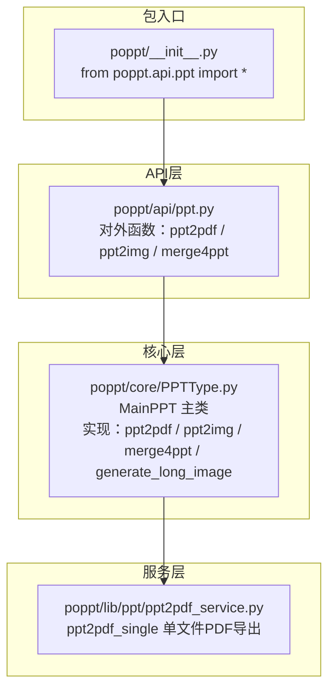
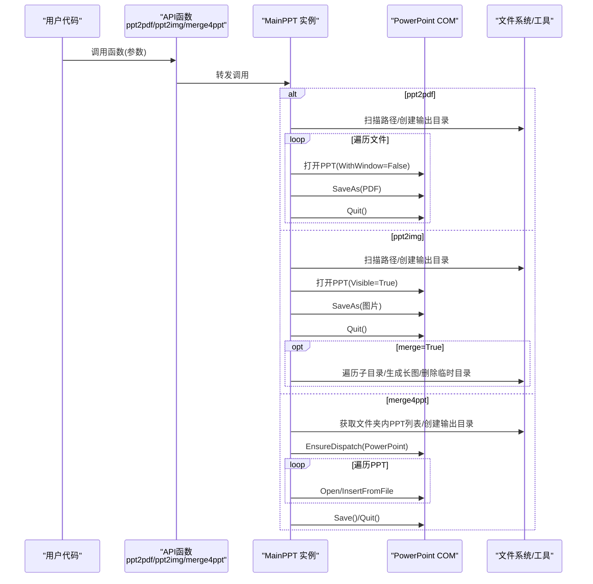
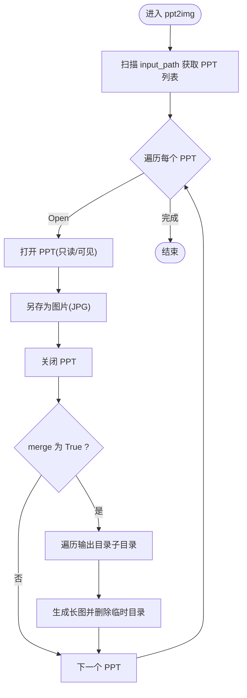
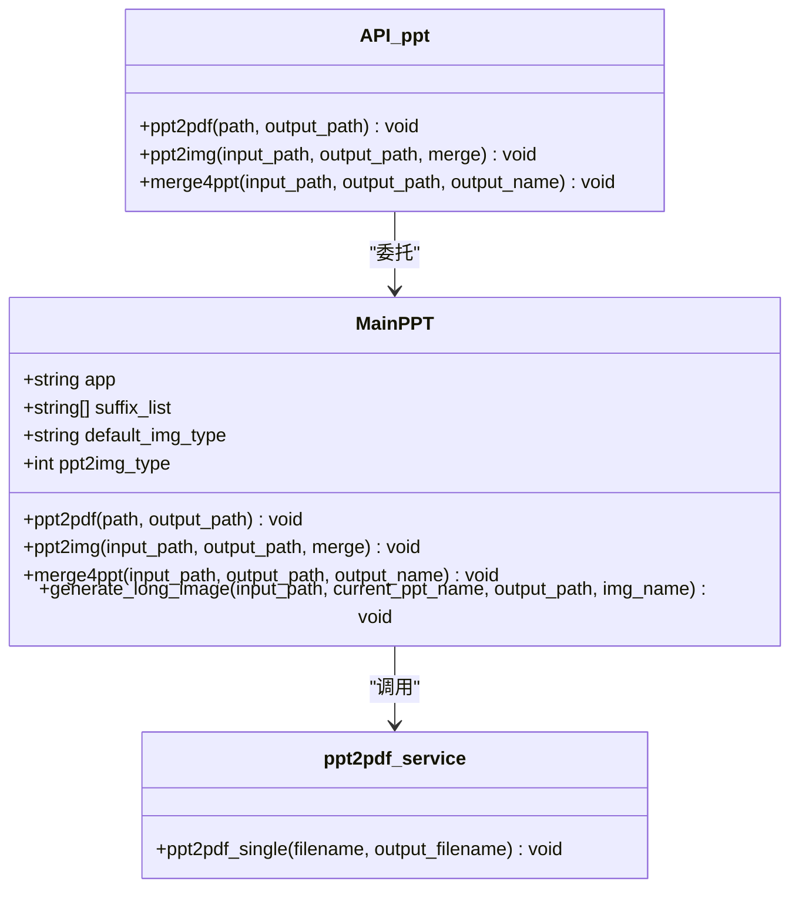
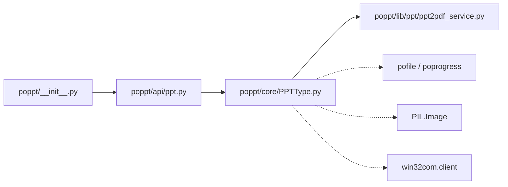

# API参考

<cite>
**本文引用的文件**
- [poppt/api/ppt.py](file://poppt/api/ppt.py)
- [poppt/core/PPTType.py](file://poppt/core/PPTType.py)
- [poppt/lib/ppt/ppt2pdf_service.py](file://poppt/lib/ppt/ppt2pdf_service.py)
- [poppt/__init__.py](file://poppt/__init__.py)
- [tests/test_ppt.py](file://tests/test_ppt.py)
- [demo/ppt2img.py](file://demo/ppt2img.py)
- [README.md](file://README.md)
</cite>

## 目录
1. [简介](#简介)
2. [项目结构](#项目结构)
3. [核心组件](#核心组件)
4. [架构总览](#架构总览)
5. [详细组件分析](#详细组件分析)
6. [依赖关系分析](#依赖关系分析)
7. [性能考虑](#性能考虑)
8. [故障排查指南](#故障排查指南)
9. [结论](#结论)
10. [附录](#附录)

## 简介
本文件为 poppt 库的完整 API 文档，聚焦于以下三个公开接口：
- ppt2pdf：将 PPT/PPTX 转换为 PDF，支持单文件或文件夹批量处理。
- ppt2img：将 PPT 转换为图片，支持独立图片或合并为长图。
- merge4ppt：将文件夹中多个 PPT 合并为一个 PPT。

文档基于源码注释与实现细节，逐项说明参数类型、默认值、批量处理机制、错误处理行为、使用示例与性能提示，并给出调用流程图与时序图以便快速理解。

## 项目结构
poppt 采用分层设计：
- API 层：对外暴露简洁的函数接口，统一入口由包级导出。
- 核心层：封装具体业务逻辑，负责与 PowerPoint COM 交互、文件扫描与输出管理。
- 服务层：提供单一 PPT 转 PDF 的底层服务函数。
- 示例与测试：提供使用示例与单元测试，便于验证行为。

图表来源
- [poppt/api/ppt.py](file://poppt/api/ppt.py#L1-L66)
- [poppt/core/PPTType.py](file://poppt/core/PPTType.py#L1-L204)
- [poppt/lib/ppt/ppt2pdf_service.py](file://poppt/lib/ppt/ppt2pdf_service.py#L1-L42)
- [poppt/__init__.py](file://poppt/__init__.py#L1-L3)

章节来源
- [poppt/api/ppt.py](file://poppt/api/ppt.py#L1-L66)
- [poppt/core/PPTType.py](file://poppt/core/PPTType.py#L1-L204)
- [poppt/lib/ppt/ppt2pdf_service.py](file://poppt/lib/ppt/ppt2pdf_service.py#L1-L42)
- [poppt/__init__.py](file://poppt/__init__.py#L1-L3)

## 核心组件
- API 层函数
  - ppt2pdf(path: str, output_path: str = "./") -> None
  - ppt2img(input_path: str, output_path: str = r"./", merge: bool = False) -> None
  - merge4ppt(input_path: str, output_path: str = r"./", output_name: str = "merge4ppt.pptx") -> None
- 核心类 MainPPT
  - 负责与 PowerPoint COM 交互、批量扫描文件、输出目录管理、图片合并与长图生成。
- 服务函数
  - ppt2pdf_single(filename: str, output_filename: str) -> None：单文件 PDF 导出。

章节来源
- [poppt/api/ppt.py](file://poppt/api/ppt.py#L18-L66)
- [poppt/core/PPTType.py](file://poppt/core/PPTType.py#L20-L204)
- [poppt/lib/ppt/ppt2pdf_service.py](file://poppt/lib/ppt/ppt2pdf_service.py#L15-L42)

## 架构总览
API 层函数作为门面，统一委托给 MainPPT 实例；MainPPT 内部通过 win32com 调用 PowerPoint，结合 pofile 工具（get_files、mkdir、check_suffix）与 poprogress 进度条，完成批量处理与输出管理；PPT 转 PDF 使用独立服务函数进行单文件导出。

图表来源
- [poppt/api/ppt.py](file://poppt/api/ppt.py#L18-L66)
- [poppt/core/PPTType.py](file://poppt/core/PPTType.py#L38-L204)
- [poppt/lib/ppt/ppt2pdf_service.py](file://poppt/lib/ppt/ppt2pdf_service.py#L15-L42)

## 详细组件分析

### API：ppt2pdf
- 函数签名与行为
  - 签名：ppt2pdf(path: str, output_path: str = "./") -> None
  - 功能：将 PPT/PPTX 文件转换为 PDF，支持单文件或文件夹批量处理。
- 参数说明
  - path：PPT 文件或文件夹路径（字符串）。内部通过文件扫描函数获取目标文件列表。
  - output_path：PDF 输出目录（字符串），默认为当前目录。
- 数据类型与默认值
  - path: str
  - output_path: str，默认 "./"
- 批量处理机制
  - 内部使用文件扫描工具获取路径下的所有文件，过滤后缀为 "ppt"/"pptx" 的文件，逐个调用单文件 PDF 导出服务。
- 错误处理与异常
  - 源码未显式捕获异常，调用方需确保路径有效、PowerPoint 可用。
- 使用示例（基于测试与示例）
  - 单文件转换：参考测试用例中对单个 PPT 的 PDF 转换调用。
  - 批量转换：将 input_path 指向包含多个 PPT 的文件夹，自动批量处理。
- 性能提示
  - 大量文件时建议先清理输出目录，避免重复文件导致额外 IO。
  - 使用进度条工具进行批量处理，便于监控进度。

章节来源
- [poppt/api/ppt.py](file://poppt/api/ppt.py#L18-L33)
- [poppt/core/PPTType.py](file://poppt/core/PPTType.py#L38-L66)
- [poppt/lib/ppt/ppt2pdf_service.py](file://poppt/lib/ppt/ppt2pdf_service.py#L15-L42)
- [tests/test_ppt.py](file://tests/test_ppt.py#L34-L43)

### API：ppt2img
- 函数签名与行为
  - 签名：ppt2img(input_path: str, output_path: str = r"./", merge: bool = False) -> None
  - 功能：将 PPT 转换为图片，支持独立图片或合并为长图。
- 参数说明
  - input_path：PPT 文件或文件夹路径（字符串）。内部通过文件扫描函数获取目标文件列表。
  - output_path：图片输出目录（字符串），默认为当前目录。
  - merge：是否合并为长图（布尔），默认 False。
- 数据类型与默认值
  - input_path: str
  - output_path: str，默认 r"./"
  - merge: bool，默认 False
- 批量处理机制
  - 内部扫描 input_path 下的 PPT 文件，逐个打开并另存为图片（默认 JPG）。
  - 若 merge=True，则对每个 PPT 的图片输出目录进行遍历，按顺序拼接成长图，并删除临时图片目录。
- 错误处理与异常
  - 源码未显式捕获异常，调用方需确保路径有效、PowerPoint 可用。
- 使用示例（基于测试与示例）
  - 单文件转独立图片：传入单个 PPT 文件路径与输出目录，merge=False。
  - 批量转独立图片：传入包含多个 PPT 的文件夹路径，merge=False。
  - 合并为长图：传入单个或多个 PPT 路径，merge=True，输出为每份 PPT 的长图。
- 性能提示
  - 合并长图时会进行多次图像读取与拼接，建议控制单 PPT 幻灯片数量，避免超大长图导致内存压力。
  - 输出目录层级较深时，遍历与删除临时目录会有额外 IO 开销。

图表来源
- [poppt/api/ppt.py](file://poppt/api/ppt.py#L34-L51)
- [poppt/core/PPTType.py](file://poppt/core/PPTType.py#L114-L167)

章节来源
- [poppt/api/ppt.py](file://poppt/api/ppt.py#L34-L51)
- [poppt/core/PPTType.py](file://poppt/core/PPTType.py#L114-L167)
- [tests/test_ppt.py](file://tests/test_ppt.py#L44-L62)
- [demo/ppt2img.py](file://demo/ppt2img.py#L1-L25)

### API：merge4ppt
- 函数签名与行为
  - 签名：merge4ppt(input_path: str, output_path: str = r"./", output_name: str = "merge4ppt.pptx") -> None
  - 功能：将文件夹中多个 PPT 合并为一个 PPT。
- 参数说明
  - input_path：包含多个 PPT 的文件夹路径（字符串）。
  - output_path：合并后 PPT 的输出目录（字符串），默认为当前目录。
  - output_name：合并后 PPT 的文件名（字符串），默认 "merge4ppt.pptx"。
- 数据类型与默认值
  - input_path: str
  - output_path: str，默认 r"./"
  - output_name: str，默认 "merge4ppt.pptx"
- 批量处理机制
  - 内部扫描 input_path 下的 PPT 文件列表，逐个打开并插入到新 PPT 中，最后保存并退出。
- 错误处理与异常
  - 源码未显式捕获异常，调用方需确保路径有效、PowerPoint 可用。
- 使用示例（基于测试与示例）
  - 将包含多个 PPT 的文件夹传入 input_path，指定 output_path 与 output_name，即可生成合并后的 PPT。
- 性能提示
  - 合并大量 PPT 时，PowerPoint 插入操作可能较慢，建议分批处理或减少单次合并数量。

章节来源
- [poppt/api/ppt.py](file://poppt/api/ppt.py#L53-L66)
- [poppt/core/PPTType.py](file://poppt/core/PPTType.py#L67-L113)
- [tests/test_ppt.py](file://tests/test_ppt.py#L64-L93)

### 类关系与职责

图表来源
- [poppt/api/ppt.py](file://poppt/api/ppt.py#L18-L66)
- [poppt/core/PPTType.py](file://poppt/core/PPTType.py#L20-L204)
- [poppt/lib/ppt/ppt2pdf_service.py](file://poppt/lib/ppt/ppt2pdf_service.py#L15-L42)

## 依赖关系分析
- 包入口导出
  - 包级导出所有 API 函数，便于直接从包名导入使用。
- 外部依赖
  - win32com.client：与 PowerPoint 交互。
  - PIL.Image：长图拼接。
  - pofile：文件扫描、目录创建、后缀校验。
  - poprogress：批量处理进度条。
- 内部依赖
  - API 层依赖核心类 MainPPT。
  - MainPPT 内部依赖服务函数与工具函数。

图表来源
- [poppt/__init__.py](file://poppt/__init__.py#L1-L3)
- [poppt/api/ppt.py](file://poppt/api/ppt.py#L1-L66)
- [poppt/core/PPTType.py](file://poppt/core/PPTType.py#L1-L204)
- [poppt/lib/ppt/ppt2pdf_service.py](file://poppt/lib/ppt/ppt2pdf_service.py#L1-L42)

章节来源
- [poppt/__init__.py](file://poppt/__init__.py#L1-L3)
- [poppt/api/ppt.py](file://poppt/api/ppt.py#L1-L66)
- [poppt/core/PPTType.py](file://poppt/core/PPTType.py#L1-L204)
- [poppt/lib/ppt/ppt2pdf_service.py](file://poppt/lib/ppt/ppt2pdf_service.py#L1-L42)

## 性能考虑
- 大型 PPT 文件
  - 图像拼接生成长图时，会加载每页图片并进行多次像素粘贴，内存占用与时间成本随幻灯片数量线性增长。建议控制单 PPT 幻灯片数量或分批处理。
- 批量转换
  - 使用进度条工具进行批量处理，有助于监控耗时与资源占用。
- 输出目录
  - 合并长图后会删除临时图片目录，避免磁盘空间浪费；但大量文件的 IO 操作仍需关注。

[本节为通用性能建议，不直接分析特定文件]

## 故障排查指南
- 常见问题
  - PowerPoint 未安装或不可用：调用 COM 组件失败，需确保系统已安装 PowerPoint。
  - 路径无效或权限不足：文件扫描与目录创建失败，需检查路径与权限。
  - 合并长图失败：图片排序或尺寸不一致可能导致异常，建议检查输出目录结构。
- 建议
  - 在调用前确认路径有效性与后缀匹配（仅支持 "ppt"/"pptx"）。
  - 对于大批量任务，建议先在小范围测试，再逐步扩大规模。

[本节为通用排查建议，不直接分析特定文件]

## 结论
poppt 提供了简洁易用的 PPT 自动化接口，分别覆盖 PDF 转换、图片转换与合并功能。API 层通过 MainPPT 统一调度，结合 PowerPoint COM 与常用工具库，实现了稳定的批量处理能力。使用时需关注路径与权限、PowerPoint 可用性以及长图生成的内存与 IO 开销。

[本节为总结性内容，不直接分析特定文件]

## 附录

### 使用示例索引
- 单文件 PDF 转换
  - 参考测试用例：[tests/test_ppt.py](file://tests/test_ppt.py#L34-L43)
- 单文件转独立图片
  - 参考测试用例：[tests/test_ppt.py](file://tests/test_ppt.py#L44-L53)
- 单文件转长图
  - 参考测试用例：[tests/test_ppt.py](file://tests/test_ppt.py#L54-L62)
- 合并多个 PPT
  - 参考测试用例：[tests/test_ppt.py](file://tests/test_ppt.py#L64-L93)
- 示例脚本
  - 图片转换示例：[demo/ppt2img.py](file://demo/ppt2img.py#L1-L25)

### 参数验证与异常说明
- 参数验证
  - 输入路径类型：字符串；默认值：见各函数签名。
  - 后缀过滤：内部使用工具函数对文件后缀进行校验，仅处理 "ppt"/"pptx"。
- 异常类型
  - 源码未显式捕获异常，常见异常可能来自：
    - 路径不存在或权限不足
    - PowerPoint COM 组件不可用
    - 图像拼接过程中的文件读取失败
  - 建议调用方自行捕获并处理异常，或在上层封装统一的异常处理逻辑。

章节来源
- [poppt/api/ppt.py](file://poppt/api/ppt.py#L18-L66)
- [poppt/core/PPTType.py](file://poppt/core/PPTType.py#L38-L204)
- [tests/test_ppt.py](file://tests/test_ppt.py#L1-L98)