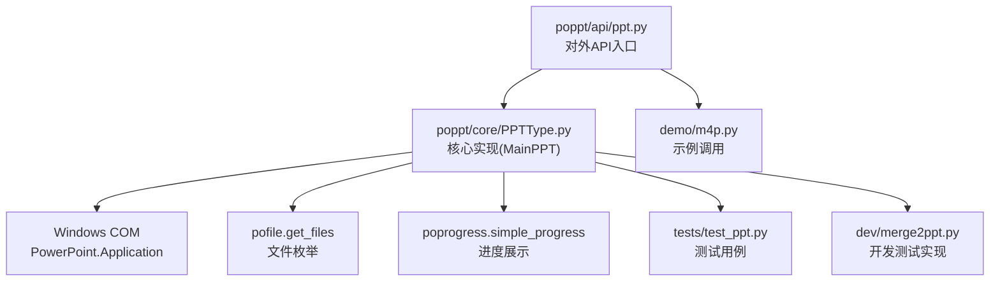
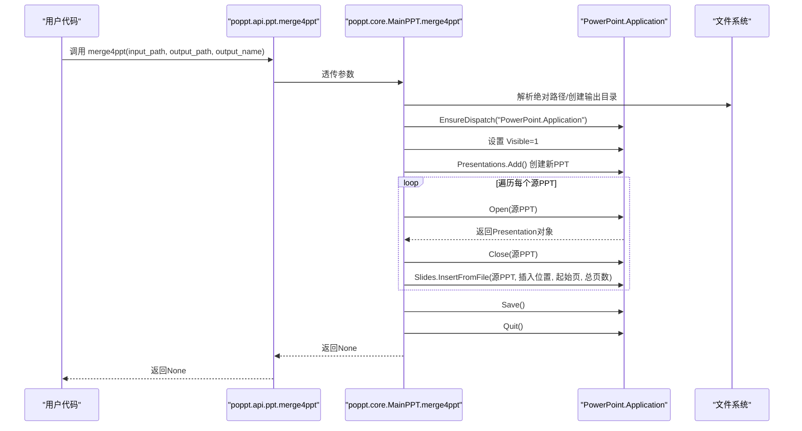
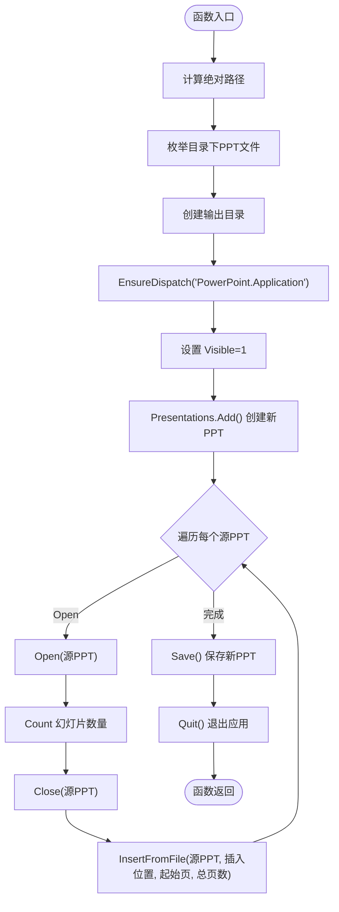
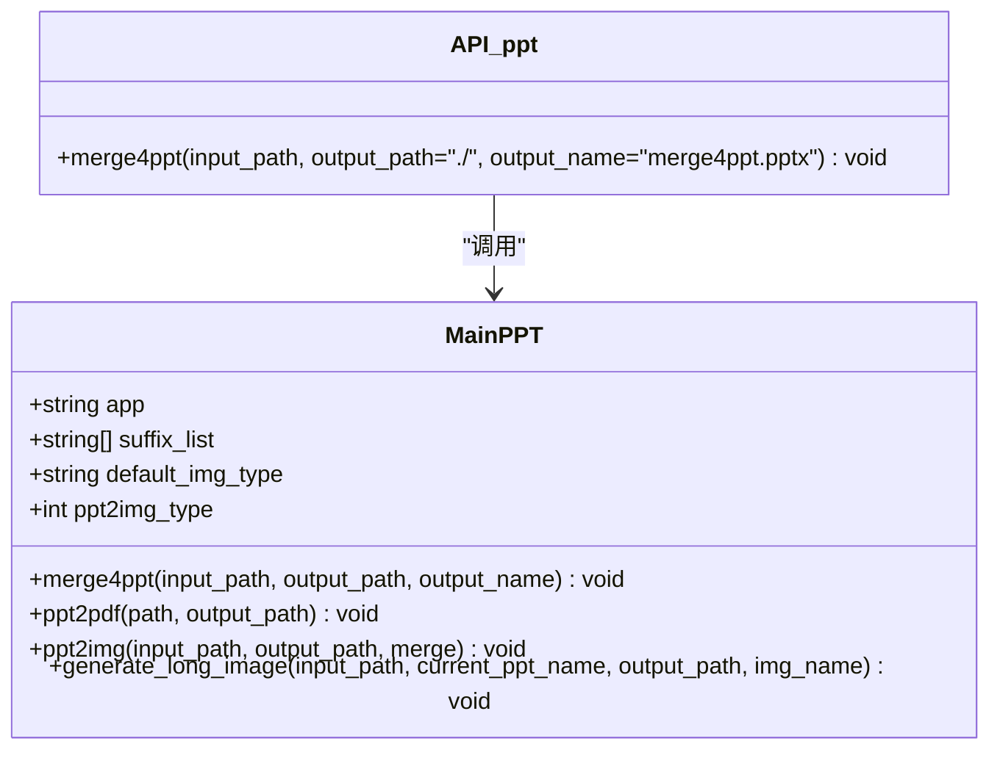
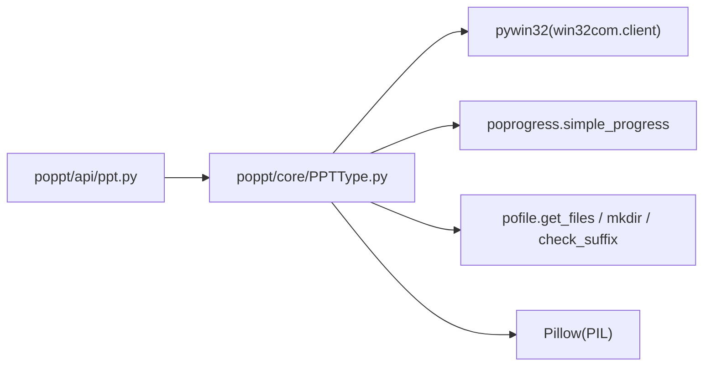

# merge4ppt函数

<cite>
**本文引用的文件**
- [poppt/api/ppt.py](file://poppt/api/ppt.py)
- [poppt/core/PPTType.py](file://poppt/core/PPTType.py)
- [demo/m4p.py](file://demo/m4p.py)
- [tests/test_ppt.py](file://tests/test_ppt.py)
- [dev/merge2ppt.py](file://dev/merge2ppt.py)
- [README.md](file://README.md)
- [requirements.txt](file://requirements.txt)
- [setup.cfg](file://setup.cfg)
</cite>

## 目录
1. [简介](#简介)
2. [项目结构](#项目结构)
3. [核心组件](#核心组件)
4. [架构总览](#架构总览)
5. [详细组件分析](#详细组件分析)
6. [依赖关系分析](#依赖关系分析)
7. [性能与行为特性](#性能与行为特性)
8. [使用示例](#使用示例)
9. [故障排查指南](#故障排查指南)
10. [结论](#结论)

## 简介
本文件为 merge4ppt 函数的完整API文档，面向希望将多个PPT文件合并为一个PPT的用户与开发者。文档基于仓库中的实际实现，详细说明函数签名、参数含义、调用流程、合并策略、进度展示与资源释放机制，并给出可直接参考的使用示例与注意事项。

## 项目结构
- API层：对外暴露统一接口，负责参数透传与文档说明。
- 核心实现：在核心类中完成具体逻辑，包括COM组件调用、文件枚举、进度展示与资源管理。
- 示例与测试：提供演示脚本与单元测试，便于验证与复现。

图表来源
- [poppt/api/ppt.py](file://poppt/api/ppt.py#L53-L66)
- [poppt/core/PPTType.py](file://poppt/core/PPTType.py#L67-L113)
- [dev/merge2ppt.py](file://dev/merge2ppt.py#L21-L65)
- [tests/test_ppt.py](file://tests/test_ppt.py#L70-L98)

章节来源
- [poppt/api/ppt.py](file://poppt/api/ppt.py#L53-L66)
- [poppt/core/PPTType.py](file://poppt/core/PPTType.py#L67-L113)
- [demo/m4p.py](file://demo/m4p.py#L1-L16)
- [tests/test_ppt.py](file://tests/test_ppt.py#L70-L98)
- [dev/merge2ppt.py](file://dev/merge2ppt.py#L1-L78)

## 核心组件
- API层函数：merge4ppt(input_path, output_path='./', output_name='merge4ppt.pptx')，负责接收用户输入并调用核心类方法。
- 核心类 MainPPT：封装合并逻辑，包括路径解析、文件枚举、PowerPoint应用生命周期管理、进度展示与资源释放。

章节来源
- [poppt/api/ppt.py](file://poppt/api/ppt.py#L53-L66)
- [poppt/core/PPTType.py](file://poppt/core/PPTType.py#L20-L37)

## 架构总览
merge4ppt的调用链路如下：
- 用户调用 poppt.api.ppt.merge4ppt
- 该函数将参数传递给 poppt.core.MainPPT.merge4ppt
- MainPPT内部通过 win32com.client 与 PowerPoint 交互，使用 InsertFromFile 将各PPT的幻灯片追加到新PPT末尾
- 合并过程中通过 simple_progress 展示进度
- 合并完成后保存并退出 PowerPoint 应用

图表来源
- [poppt/api/ppt.py](file://poppt/api/ppt.py#L53-L66)
- [poppt/core/PPTType.py](file://poppt/core/PPTType.py#L67-L113)
- [dev/merge2ppt.py](file://dev/merge2ppt.py#L43-L64)

## 详细组件分析

### API层：merge4ppt函数
- 函数签名与文档
  - 函数定义与参数说明来自API层文档字符串，明确输入路径、输出路径与输出文件名的默认值。
  - 该函数仅负责参数透传，实际逻辑由核心类实现。
- 参数说明
  - input_path：包含多个PPT文件的文件夹路径（字符串）。函数内部会将其转换为绝对路径，并通过文件枚举工具获取该目录下的所有PPT文件列表。
  - output_path：合并后PPT文件的输出目录（字符串，默认为当前目录）。
  - output_name：合并后PPT文件的名称（字符串，默认为 'merge4ppt.pptx'）。
- 返回值
  - 无返回值（None），但会在目标路径生成合并后的PPT文件。

章节来源
- [poppt/api/ppt.py](file://poppt/api/ppt.py#L53-L66)

### 核心实现：MainPPT.merge4ppt
- 输入参数
  - input_path：PPT所在文件夹路径（字符串）。
  - output_path：输出目录（字符串）。
  - output_name：输出文件名（字符串）。
- 路径与文件枚举
  - 将相对路径转换为绝对路径。
  - 使用文件枚举工具获取该目录下的所有PPT文件列表（支持 .ppt/.pptx）。
- PowerPoint应用生命周期
  - 通过 COM 组件 EnsureDispatch("PowerPoint.Application") 创建应用实例。
  - 设置 Application.Visible=1，使PowerPoint在合并过程中可见。
  - 创建新的 Presentation 对象作为合并容器。
- 幻灯片合并策略
  - 遍历每个源PPT文件：
    - 打开源PPT，获取其幻灯片总数，随后关闭该PPT。
    - 使用 InsertFromFile 将该PPT的所有幻灯片插入到新PPT的末尾，保持原始顺序。
- 进度展示
  - 使用进度条工具对文件枚举过程进行可视化提示。
- 资源释放
  - 保存新PPT后，调用 Application.Quit() 退出PowerPoint应用。

图表来源
- [poppt/core/PPTType.py](file://poppt/core/PPTType.py#L67-L113)

章节来源
- [poppt/core/PPTType.py](file://poppt/core/PPTType.py#L67-L113)

### 与MainPPT类的关系
- API层通过全局实例 mainPPT 调用核心方法，二者职责清晰分离：API层负责对外接口与文档，核心类负责业务实现与资源管理。

图表来源
- [poppt/api/ppt.py](file://poppt/api/ppt.py#L12-L16)
- [poppt/api/ppt.py](file://poppt/api/ppt.py#L53-L66)
- [poppt/core/PPTType.py](file://poppt/core/PPTType.py#L20-L37)
- [poppt/core/PPTType.py](file://poppt/core/PPTType.py#L67-L113)

章节来源
- [poppt/api/ppt.py](file://poppt/api/ppt.py#L12-L16)
- [poppt/api/ppt.py](file://poppt/api/ppt.py#L53-L66)
- [poppt/core/PPTType.py](file://poppt/core/PPTType.py#L20-L37)
- [poppt/core/PPTType.py](file://poppt/core/PPTType.py#L67-L113)

## 依赖关系分析
- 外部依赖
  - pywin32：用于win32com.client调用PowerPoint COM组件。
  - poprogress：提供简单进度条展示。
  - pofile：提供文件枚举与目录创建等工具函数。
  - Pillow：图像处理库（与本函数无直接关联，但与PPT转图片功能相关）。
- 内部依赖
  - API层依赖核心类 MainPPT。
  - 核心类依赖文件枚举、进度条与PowerPoint COM组件。

图表来源
- [requirements.txt](file://requirements.txt#L1-L5)
- [setup.cfg](file://setup.cfg#L21-L26)
- [poppt/core/PPTType.py](file://poppt/core/PPTType.py#L1-L18)
- [poppt/api/ppt.py](file://poppt/api/ppt.py#L12-L16)

章节来源
- [requirements.txt](file://requirements.txt#L1-L5)
- [setup.cfg](file://setup.cfg#L21-L26)
- [poppt/core/PPTType.py](file://poppt/core/PPTType.py#L1-L18)
- [poppt/api/ppt.py](file://poppt/api/ppt.py#L12-L16)

## 性能与行为特性
- 合并策略
  - 逐个打开源PPT，读取幻灯片总数后立即关闭，再通过 InsertFromFile 将全部幻灯片追加到新PPT末尾，避免重复加载，提高效率。
- 进度展示
  - 使用 simple_progress 对文件枚举过程进行可视化提示，便于观察合并进度。
- 资源管理
  - 合并完成后显式保存并退出PowerPoint应用，确保COM组件资源得到释放。
- 可见性设置
  - 合并过程中 PowerPoint 应用可见（Visible=1），有助于调试与监控。

章节来源
- [poppt/core/PPTType.py](file://poppt/core/PPTType.py#L92-L112)
- [dev/merge2ppt.py](file://dev/merge2ppt.py#L43-L64)

## 使用示例
以下示例展示了如何调用 merge4ppt 完成PPT合并。示例均来自仓库中的演示与测试文件，便于直接参考与复现。

- 示例1：合并指定文件夹内的所有PPT（默认输出到当前目录，文件名为默认值）
  - 参考路径：[demo/m4p.py](file://demo/m4p.py#L1-L16)
  - 调用形式：poppt.merge4ppt(input_path)
  - 说明：仅传入包含PPT的文件夹路径，其余参数采用默认值。

- 示例2：指定输出目录与文件名
  - 参考路径：[tests/test_ppt.py](file://tests/test_ppt.py#L84-L88)
  - 调用形式：merge4ppt(input_path=temp_dir, output_path=output_path, output_name='合并后的PPT.pptx')

- 示例3：开发测试脚本中的调用
  - 参考路径：[dev/merge2ppt.py](file://dev/merge2ppt.py#L69-L77)
  - 调用形式：merge4ppt(input_path, output_path, output_name)

章节来源
- [demo/m4p.py](file://demo/m4p.py#L1-L16)
- [tests/test_ppt.py](file://tests/test_ppt.py#L84-L88)
- [dev/merge2ppt.py](file://dev/merge2ppt.py#L69-L77)

## 故障排查指南
- PowerPoint未安装或COM组件不可用
  - 现象：调用失败或报错。
  - 处理：确保已安装Microsoft PowerPoint，并正确安装pywin32；确认系统环境变量与权限允许COM组件访问。
  - 参考依赖声明：[requirements.txt](file://requirements.txt#L1-L5)、[setup.cfg](file://setup.cfg#L21-L26)

- 源PPT不在同一目录
  - 现象：合并结果不符合预期。
  - 处理：确保所有待合并的PPT文件位于同一文件夹内，函数会按该目录下的PPT文件列表进行合并。
  - 参考实现：文件枚举逻辑来自核心类，会扫描指定目录下的PPT文件。

- PowerPoint应用不可见导致无法调试
  - 现象：合并过程无界面反馈。
  - 处理：函数默认设置 Visible=1，可在合并过程中看到PowerPoint界面；若需后台运行，可在核心类中调整该设置（不建议在生产环境中修改）。
  - 参考实现：[poppt/core/PPTType.py](file://poppt/core/PPTType.py#L92-L96)

- 资源未释放
  - 现象：PowerPoint进程残留。
  - 处理：函数在合并完成后会调用 Quit() 退出应用；若异常中断，需手动结束PowerPoint进程。
  - 参考实现：[poppt/core/PPTType.py](file://poppt/core/PPTType.py#L110-L112)

- 输出路径权限不足
  - 现象：保存失败或权限错误。
  - 处理：确认输出目录存在且具备写入权限；必要时提升权限或更换输出路径。

章节来源
- [requirements.txt](file://requirements.txt#L1-L5)
- [setup.cfg](file://setup.cfg#L21-L26)
- [poppt/core/PPTType.py](file://poppt/core/PPTType.py#L92-L112)

## 结论
merge4ppt函数通过简洁的API设计与稳健的实现逻辑，实现了将多个PPT文件合并为一个PPT的功能。其核心优势包括：
- 明确的参数约定与默认值，降低使用门槛；
- 基于COM组件的高效合并策略，保持原始幻灯片顺序；
- 进度可视化与资源释放，提升用户体验与稳定性。

建议在生产环境中：
- 确保PowerPoint安装与COM组件可用；
- 将所有源PPT置于同一目录；
- 注意输出路径权限与磁盘空间；
- 如需后台运行，谨慎调整可见性设置。