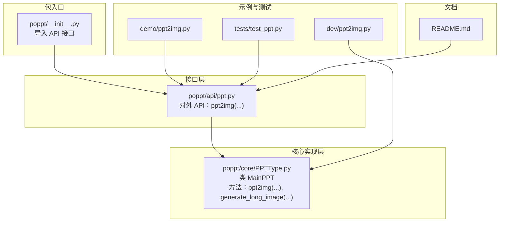
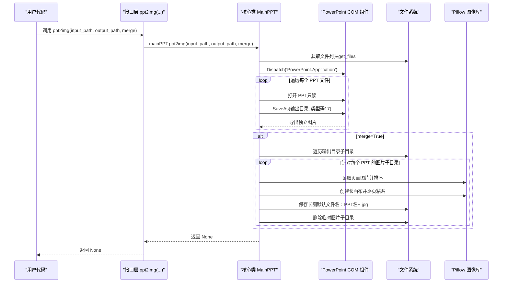
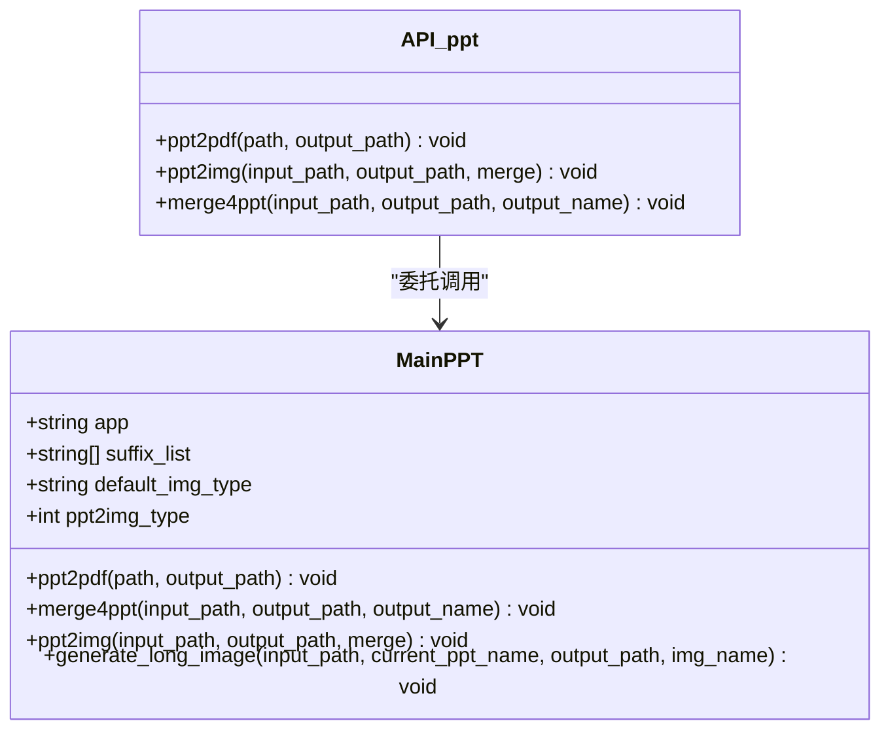
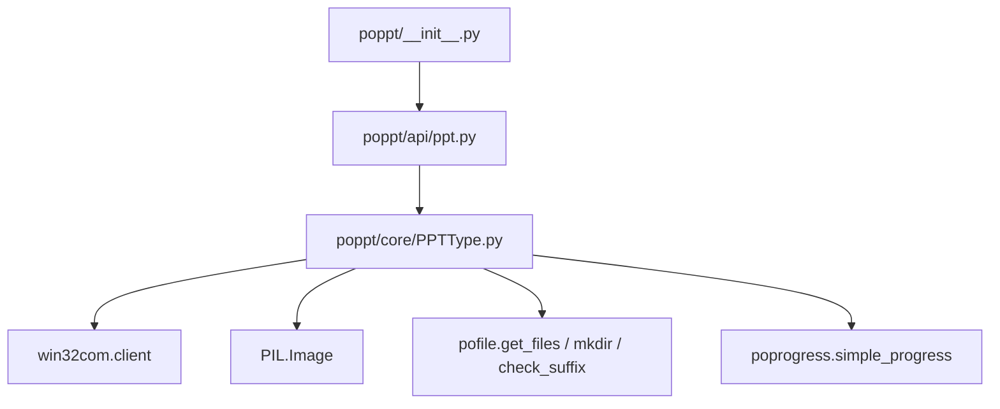

# ppt2img函数

<cite>
**本文引用的文件**
- [poppt/api/ppt.py](file://poppt/api/ppt.py)
- [poppt/core/PPTType.py](file://poppt/core/PPTType.py)
- [poppt/__init__.py](file://poppt/__init__.py)
- [tests/test_ppt.py](file://tests/test_ppt.py)
- [demo/ppt2img.py](file://demo/ppt2img.py)
- [dev/ppt2img.py](file://dev/ppt2img.py)
- [README.md](file://README.md)
</cite>

## 目录
1. [简介](#简介)
2. [项目结构](#项目结构)
3. [核心组件](#核心组件)
4. [架构总览](#架构总览)
5. [详细组件分析](#详细组件分析)
6. [依赖关系分析](#依赖关系分析)
7. [性能考量](#性能考量)
8. [故障排查指南](#故障排查指南)
9. [结论](#结论)
10. [附录](#附录)

## 简介
本文件为 poppt 库中 ppt2img 函数的完整 API 文档，聚焦以下目标：
- 解释 input_path 参数的双重用途：既可传入单个 PPT 文件路径，也可传入包含多个 PPT 文件的文件夹路径；
- 阐明 output_path 参数的默认行为（默认为当前目录“./”）及其在文件系统中的作用；
- 重点说明 merge 参数的控制逻辑：当 merge=False 时，将每个 PPT 文件的每页幻灯片转换为独立的 JPG 图片，并在输出目录下为每个 PPT 文件创建单独的子目录；当 merge=True 时，除生成独立图片外，还会调用 generate_long_image 方法将同一 PPT 的所有页面拼接成一张长图，并删除原始的图片子目录；
- 引用 api/ppt.py 中的函数签名与 docstring，并链接到 core/PPTType.py 中 MainPPT.ppt2img 与 generate_long_image 的实现逻辑；
- 描述图片处理流程：如何使用 PowerPoint COM 组件的 SaveAs 方法（类型码 17）导出 JPG，以及如何使用 Pillow 库进行图片拼接；
- 提供多个使用示例，包括转换单个 PPT 为独立图片、批量转换文件夹内 PPT 为独立图片、将 PPT 转换为长图；
- 包含配置说明，如默认图片格式（.jpg）与 PPT 转图片类型码（17）。

## 项目结构
该功能位于 poppt 包的接口层与核心实现层之间，接口层负责对外暴露 API，核心层负责具体业务逻辑与系统集成。

图表来源
- [poppt/api/ppt.py](file://poppt/api/ppt.py#L1-L66)
- [poppt/core/PPTType.py](file://poppt/core/PPTType.py#L1-L204)
- [poppt/__init__.py](file://poppt/__init__.py#L1-L3)
- [demo/ppt2img.py](file://demo/ppt2img.py#L1-L25)
- [tests/test_ppt.py](file://tests/test_ppt.py#L1-L98)
- [dev/ppt2img.py](file://dev/ppt2img.py#L1-L149)
- [README.md](file://README.md#L1-L94)

章节来源
- [poppt/api/ppt.py](file://poppt/api/ppt.py#L1-L66)
- [poppt/core/PPTType.py](file://poppt/core/PPTType.py#L1-L204)
- [poppt/__init__.py](file://poppt/__init__.py#L1-L3)
- [README.md](file://README.md#L1-L94)

## 核心组件
- 接口层函数：ppt2img(input_path: str, output_path=r'./', merge: bool = False)
  - 作用：将 PPT/PPTX 转换为图片，支持独立图片或合并为长图；
  - 来源：参见 [poppt/api/ppt.py](file://poppt/api/ppt.py#L34-L50)，docstring 明确了参数语义与默认值。
- 核心实现类：MainPPT
  - 方法：ppt2img(input_path, output_path, merge=False)
    - 作用：批量获取 PPT 文件、启动 PowerPoint COM、调用 SaveAs 导出图片、按 merge 控制是否生成长图；
    - 来源：参见 [poppt/core/PPTType.py](file://poppt/core/PPTType.py#L114-L167)。
  - 方法：generate_long_image(input_path: str, current_ppt_name, output_path, img_name='merge.jpg')
    - 作用：将同一 PPT 的各页面图片按顺序垂直拼接为一张长图；
    - 来源：参见 [poppt/core/PPTType.py](file://poppt/core/PPTType.py#L168-L204)。
- 包入口：poppt/__init__.py
  - 作用：统一导入并暴露 API 接口，便于外部通过 import poppt 或 from poppt import * 使用；
  - 来源：参见 [poppt/__init__.py](file://poppt/__init__.py#L1-L3)。

章节来源
- [poppt/api/ppt.py](file://poppt/api/ppt.py#L34-L50)
- [poppt/core/PPTType.py](file://poppt/core/PPTType.py#L114-L204)
- [poppt/__init__.py](file://poppt/__init__.py#L1-L3)

## 架构总览
ppt2img 的调用链路如下：

图表来源
- [poppt/api/ppt.py](file://poppt/api/ppt.py#L34-L50)
- [poppt/core/PPTType.py](file://poppt/core/PPTType.py#L114-L204)

## 详细组件分析

### 函数签名与参数说明
- 函数定义位置：[poppt/api/ppt.py](file://poppt/api/ppt.py#L34-L50)
- 函数签名与 docstring
  - 输入参数：
    - input_path：PPT 文件或包含多个 PPT 的文件夹路径；
    - output_path：结果图片的存储位置，默认为当前目录；
    - merge：是否将同一 PPT 的所有页面合并为一张长图；
  - 返回值：None。
- 调用关系：接口层函数将参数转发至核心类 MainPPT.ppt2img。

章节来源
- [poppt/api/ppt.py](file://poppt/api/ppt.py#L34-L50)

### 主流程与控制逻辑（merge 参数）
- 核心实现位置：[poppt/core/PPTType.py](file://poppt/core/PPTType.py#L114-L167)
- 流程要点：
  - 获取文件列表：对 input_path 调用 get_files，支持单文件与文件夹；
  - 启动 PowerPoint COM 并打开每个 PPT（只读），调用 SaveAs 导出为 JPG；
  - 若 merge=True：
    - 遍历输出目录下的每个子目录（对应每个 PPT 的独立图片）；
    - 调用 generate_long_image 将页面图片拼接为长图；
    - 删除临时图片子目录，仅保留长图。
- 默认行为：
  - output_path 默认为当前目录（参见接口层 docstring）；
  - 对于每个 PPT 文件，会在 output_path 下创建以其文件名（不含扩展名）命名的子目录，用于存放该 PPT 的独立页面图片。

章节来源
- [poppt/core/PPTType.py](file://poppt/core/PPTType.py#L114-L167)

### 图片导出与长图拼接细节
- 导出机制（PowerPoint COM）：
  - 使用 SaveAs 方法导出图片，类型码为 17（JPG）；
  - 代码位置：[poppt/core/PPTType.py](file://poppt/core/PPTType.py#L144-L145)。
- 图片拼接（Pillow）：
  - 读取页面图片列表并排序；
  - 依据首张图片的尺寸与模式创建纵向拼接画布；
  - 逐页粘贴到画布上，最终保存为长图；
  - 代码位置：[poppt/core/PPTType.py](file://poppt/core/PPTType.py#L168-L204)。
- 开发样例对比：
  - 开发脚本 dev/ppt2img.py 展示了 SaveAs 类型码 17 的使用与长图拼接流程，可作为理解实现的参考；
  - 代码位置：[dev/ppt2img.py](file://dev/ppt2img.py#L57-L135)。

章节来源
- [poppt/core/PPTType.py](file://poppt/core/PPTType.py#L144-L204)
- [dev/ppt2img.py](file://dev/ppt2img.py#L57-L135)

### 类关系与职责划分

图表来源
- [poppt/core/PPTType.py](file://poppt/core/PPTType.py#L20-L204)
- [poppt/api/ppt.py](file://poppt/api/ppt.py#L1-L66)

章节来源
- [poppt/core/PPTType.py](file://poppt/core/PPTType.py#L20-L204)
- [poppt/api/ppt.py](file://poppt/api/ppt.py#L1-L66)

### 使用示例与最佳实践
- 示例一：转换单个 PPT 为独立图片
  - 调用方式：poppt.ppt2img('single.pptx', output_path='./images', merge=False)
  - 预期结果：在 images 目录下为 single.pptx 创建子目录，子目录内包含每页独立的 JPG 图片。
  - 参考：[tests/test_ppt.py](file://tests/test_ppt.py#L44-L53)
- 示例二：批量转换文件夹内 PPT 为独立图片
  - 调用方式：poppt.ppt2img('folder/', output_path='./images', merge=False)
  - 预期结果：对 folder 内所有 .ppt/.pptx 文件分别创建独立子目录并导出各自页面图片。
  - 参考：[tests/test_ppt.py](file://tests/test_ppt.py#L44-L53)
- 示例三：将 PPT 转换为长图
  - 调用方式：poppt.ppt2img('report.pptx', output_path='./images', merge=True)
  - 预期结果：先生成独立图片，再将 report.pptx 的页面拼接为一张长图，并删除临时图片子目录。
  - 参考：[tests/test_ppt.py](file://tests/test_ppt.py#L54-L62)
- 示例四：通过 office.ppt.ppt2img 使用
  - 参考：[demo/ppt2img.py](file://demo/ppt2img.py#L1-L25)

章节来源
- [tests/test_ppt.py](file://tests/test_ppt.py#L44-L62)
- [demo/ppt2img.py](file://demo/ppt2img.py#L1-L25)

### 配置说明
- 默认图片格式：JPG（扩展名为 .jpg）
  - 配置字段：default_img_type=".jpg"
  - 代码位置：[poppt/core/PPTType.py](file://poppt/core/PPTType.py#L33-L33)
- PPT 转图片类型码：17（JPG）
  - 配置字段：ppt2img_type=17
  - 代码位置：[poppt/core/PPTType.py](file://poppt/core/PPTType.py#L36-L36)
- 导出调用：SaveAs(输出目录, 类型码17)
  - 代码位置：[poppt/core/PPTType.py](file://poppt/core/PPTType.py#L144-L145)

章节来源
- [poppt/core/PPTType.py](file://poppt/core/PPTType.py#L33-L36)
- [poppt/core/PPTType.py](file://poppt/core/PPTType.py#L144-L145)

## 依赖关系分析
- 外部依赖
  - Windows COM 组件：用于与 PowerPoint 交互；
  - Pillow（PIL）：用于图像拼接；
  - pofile 工具：get_files、mkdir、check_suffix 等文件与目录辅助函数；
  - poprogress：简单进度条工具。
- 内部依赖
  - 接口层依赖核心类 MainPPT；
  - 包入口统一导入 API 接口，便于外部使用。

图表来源
- [poppt/api/ppt.py](file://poppt/api/ppt.py#L1-L66)
- [poppt/core/PPTType.py](file://poppt/core/PPTType.py#L1-L204)
- [poppt/__init__.py](file://poppt/__init__.py#L1-L3)

章节来源
- [poppt/api/ppt.py](file://poppt/api/ppt.py#L1-L66)
- [poppt/core/PPTType.py](file://poppt/core/PPTType.py#L1-L204)
- [poppt/__init__.py](file://poppt/__init__.py#L1-L3)

## 性能考量
- PowerPoint COM 启动与关闭成本：每次转换都会启动/退出 PowerPoint 应用，建议批量处理时尽量减少不必要的重复启动；
- 图像拼接复杂度：长图拼接的时间复杂度与页面数量线性相关，空间复杂度与页面数量成正比；
- I/O 与磁盘占用：导出独立图片与长图均会产生大量中间文件，建议合理规划 output_path 并在 merge=True 时关注磁盘空间；
- 可选优化方向：
  - 在同一进程内复用 PowerPoint 实例（需谨慎处理可见性与资源释放）；
  - 对页面图片排序与读取进行缓存；
  - 分批处理大批量 PPT 文件，避免一次性占用过多内存。

## 故障排查指南
- 常见问题与定位
  - 无法找到 PowerPoint：确认系统已安装 PowerPoint，且 COM 组件可用；
  - 权限不足或路径错误：确保 input_path 与 output_path 具备读写权限，路径使用绝对路径更稳妥；
  - 文件后缀不匹配：仅支持 .ppt 与 .pptx，若非预期请检查文件扩展名；
  - merge=True 后缺少长图：检查是否成功调用 generate_long_image 并确认未被误删；
  - 独立图片未生成：确认 SaveAs 调用是否执行，以及输出目录是否正确创建。
- 单元测试参考
  - 测试用例覆盖了独立图片与长图两种模式，可作为行为验证的参考；
  - 参考：[tests/test_ppt.py](file://tests/test_ppt.py#L44-L62)

章节来源
- [tests/test_ppt.py](file://tests/test_ppt.py#L44-L62)

## 结论
ppt2img 函数通过接口层与核心类的清晰分工，实现了对 PPT/PPTX 的灵活转换：既能导出独立页面图片，也能一键生成长图。其关键特性包括：
- input_path 支持单文件与文件夹；
- output_path 默认为当前目录，并按 PPT 文件名创建子目录；
- merge=False 生成独立图片；merge=True 生成长图并清理临时目录；
- 默认导出格式为 JPG（类型码 17），长图拼接使用 Pillow；
- 通过单元测试与示例代码验证了主要使用场景。

## 附录
- 相关文档与示例
  - README 中的功能列表与演示代码链接：[README.md](file://README.md#L36-L42)
  - 示例脚本：[demo/ppt2img.py](file://demo/ppt2img.py#L1-L25)
  - 开发样例（SaveAs 与长图拼接）：[dev/ppt2img.py](file://dev/ppt2img.py#L57-L135)