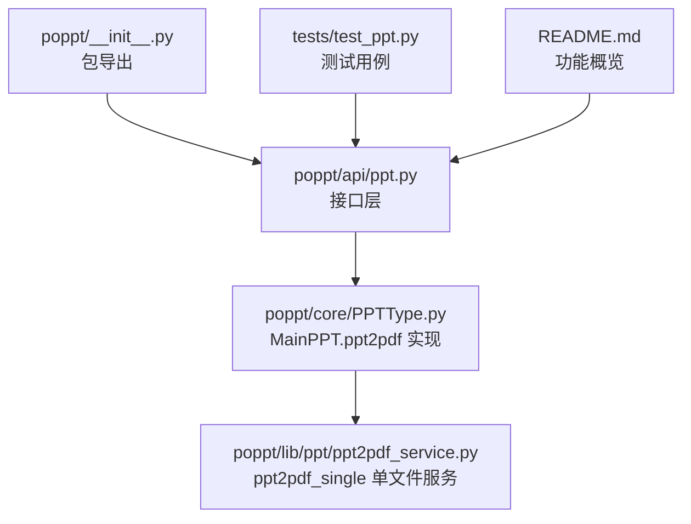
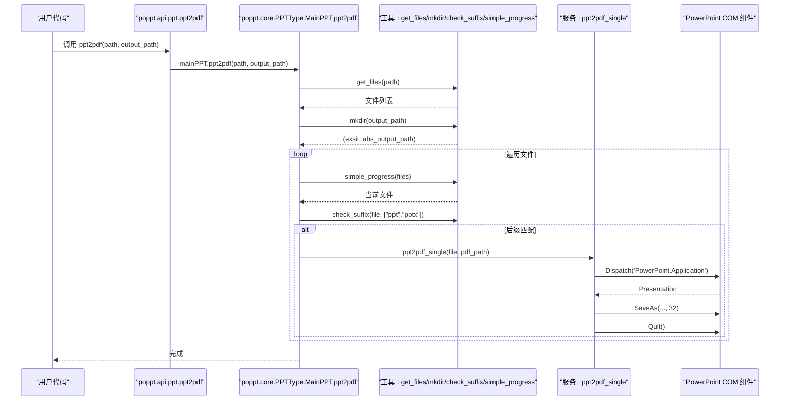
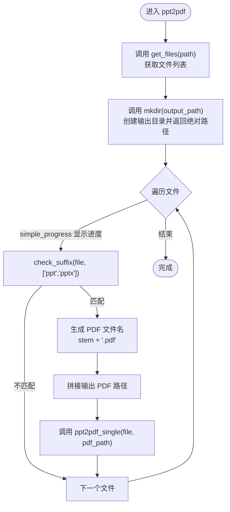
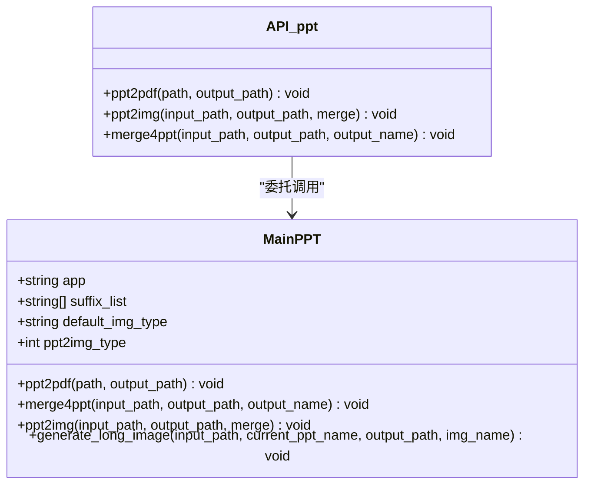

# ppt2pdf函数

<cite>
**本文引用的文件**
- [poppt/api/ppt.py](file://poppt/api/ppt.py)
- [poppt/core/PPTType.py](file://poppt/core/PPTType.py)
- [poppt/lib/ppt/ppt2pdf_service.py](file://poppt/lib/ppt/ppt2pdf_service.py)
- [poppt/__init__.py](file://poppt/__init__.py)
- [tests/test_ppt.py](file://tests/test_ppt.py)
- [README.md](file://README.md)
</cite>

## 目录
1. [简介](#简介)
2. [项目结构](#项目结构)
3. [核心组件](#核心组件)
4. [架构总览](#架构总览)
5. [详细组件分析](#详细组件分析)
6. [依赖关系分析](#依赖关系分析)
7. [性能与使用建议](#性能与使用建议)
8. [故障排查指南](#故障排查指南)
9. [结论](#结论)
10. [附录：使用示例与最佳实践](#附录使用示例与最佳实践)

## 简介
本文件为 poppt.ppt2pdf 函数的完整API文档，面向使用者与开发者，详细说明：
- 参数 path 与 output_path 的语义、数据类型与默认值
- 批量处理机制：如何通过 get_files 获取目标PPT集合、simple_progress 显示进度、以及逐个调用底层服务函数
- 参数校验与目录创建流程：check_suffix 后缀检查、mkdir 输出目录创建
- 异常场景与常见问题：PowerPoint COM 组件调用失败、文件权限错误等
- 性能提示：大型PPT文件的内存管理与进度条使用建议
- 使用示例：单文件与批量转换的典型场景

## 项目结构
围绕 ppt2pdf 的关键文件组织如下：
- 接口层：poppt/api/ppt.py 提供对外API入口
- 核心实现：poppt/core/PPTType.py 中 MainPPT.ppt2pdf 实现批量转换逻辑
- 底层服务：poppt/lib/ppt/ppt2pdf_service.py 提供单文件转换服务
- 包导出：poppt/__init__.py 将API暴露至包级
- 示例与测试：tests/test_ppt.py 展示调用方式；README.md 提供功能概览

图表来源
- [poppt/api/ppt.py](file://poppt/api/ppt.py#L1-L66)
- [poppt/core/PPTType.py](file://poppt/core/PPTType.py#L1-L204)
- [poppt/lib/ppt/ppt2pdf_service.py](file://poppt/lib/ppt/ppt2pdf_service.py#L1-L42)
- [poppt/__init__.py](file://poppt/__init__.py#L1-L3)
- [tests/test_ppt.py](file://tests/test_ppt.py#L1-L98)
- [README.md](file://README.md#L1-L94)

章节来源
- [poppt/api/ppt.py](file://poppt/api/ppt.py#L1-L66)
- [poppt/core/PPTType.py](file://poppt/core/PPTType.py#L1-L204)
- [poppt/lib/ppt/ppt2pdf_service.py](file://poppt/lib/ppt/ppt2pdf_service.py#L1-L42)
- [poppt/__init__.py](file://poppt/__init__.py#L1-L3)
- [tests/test_ppt.py](file://tests/test_ppt.py#L1-L98)
- [README.md](file://README.md#L1-L94)

## 核心组件
- 接口函数：poppt.api.ppt.ppt2pdf(path: str, output_path='./') -> None
  - 作用：将 PPT/PPTX 文件转换为 PDF
  - 参数：
    - path: 字符串，支持单个PPT文件路径或包含多个PPT文件的文件夹路径
    - output_path: 字符串，PDF输出目录，默认为当前目录 './'
  - 返回：None
  - 文档字符串与签名参见：[poppt/api/ppt.py](file://poppt/api/ppt.py#L18-L32)

- 核心实现：poppt.core.PPTType.MainPPT.ppt2pdf(path, output_path)
  - 作用：批量转换PPT到PDF，内部流程包含文件收集、输出目录创建、进度展示与逐个调用单文件服务
  - 关键步骤：
    - 通过 get_files(path) 获取所有候选文件
    - 通过 mkdir(output_path) 创建输出目录并返回绝对路径
    - 通过 simple_progress(filenames) 遍历并显示进度
    - 对每个文件使用 check_suffix(filename, ["ppt","pptx"]) 过滤
    - 生成PDF文件名并调用 ppt2pdf_single(filename, output_pdf_path)
  - 详见：[poppt/core/PPTType.py](file://poppt/core/PPTType.py#L38-L66)

- 底层服务：poppt.lib.ppt.ppt2pdf_service.ppt2pdf_single(filename, output_filename)
  - 作用：通过PowerPoint COM组件将单个PPT/PPTX另存为PDF
  - 关键点：Dispatch('PowerPoint.Application')、SaveAs(..., 32)、Quit()
  - 详见：[poppt/lib/ppt/ppt2pdf_service.py](file://poppt/lib/ppt/ppt2pdf_service.py#L15-L42)

章节来源
- [poppt/api/ppt.py](file://poppt/api/ppt.py#L18-L32)
- [poppt/core/PPTType.py](file://poppt/core/PPTType.py#L38-L66)
- [poppt/lib/ppt/ppt2pdf_service.py](file://poppt/lib/ppt/ppt2pdf_service.py#L15-L42)

## 架构总览
ppt2pdf 的调用链路如下：

图表来源
- [poppt/api/ppt.py](file://poppt/api/ppt.py#L18-L32)
- [poppt/core/PPTType.py](file://poppt/core/PPTType.py#L38-L66)
- [poppt/lib/ppt/ppt2pdf_service.py](file://poppt/lib/ppt/ppt2pdf_service.py#L15-L42)

## 详细组件分析

### 接口层：ppt2pdf
- 函数签名与文档字符串
  - 签名：ppt2pdf(path: str, output_path='./') -> None
  - 文档字符串：将 PPT/PPTX 文件转换为 PDF 格式；path 支持单文件或文件夹；output_path 为 PDF 输出路径，默认当前目录
  - 参考路径：[poppt/api/ppt.py](file://poppt/api/ppt.py#L18-L32)

- 依赖关系
  - 通过 mainPPT 实例委托到核心实现
  - 参考路径：[poppt/api/ppt.py](file://poppt/api/ppt.py#L12-L16)

章节来源
- [poppt/api/ppt.py](file://poppt/api/ppt.py#L12-L32)

### 核心实现：MainPPT.ppt2pdf
- 主要职责
  - 批量处理：对 path 下所有PPT文件进行转换
  - 目录管理：确保输出目录存在并获取绝对路径
  - 进度展示：使用 simple_progress 遍历文件
  - 文件过滤：仅处理 .ppt 与 .pptx
  - 单文件转换：调用 ppt2pdf_single 完成实际转换

- 关键流程图

图表来源
- [poppt/core/PPTType.py](file://poppt/core/PPTType.py#L38-L66)

- 参数与行为
  - path：字符串，单文件或文件夹
  - output_path：字符串，默认 './'
  - 返回：None
  - 参考路径：[poppt/core/PPTType.py](file://poppt/core/PPTType.py#L38-L66)

- 错误处理要点
  - 若 path 不存在或不可访问，get_files 可能抛出异常
  - 若 output_path 权限不足，mkdir 可能失败
  - 若文件非 .ppt/.pptx，不会被处理（由 check_suffix 控制）

章节来源
- [poppt/core/PPTType.py](file://poppt/core/PPTType.py#L38-L66)

### 底层服务：ppt2pdf_single
- 职责
  - 通过 COM 组件打开PPT并另存为PDF
  - 使用 SaveAs(..., 32) 指定PDF格式
  - 调用 Quit() 释放资源

- 关键点
  - Dispatch('PowerPoint.Application') 启动PowerPoint应用
  - WithWindow=False 可避免UI闪烁（但当前实现 Visible=True）
  - 32 为PDF格式标识
  - 参考路径：[poppt/lib/ppt/ppt2pdf_service.py](file://poppt/lib/ppt/ppt2pdf_service.py#L15-L42)

章节来源
- [poppt/lib/ppt/ppt2pdf_service.py](file://poppt/lib/ppt/ppt2pdf_service.py#L15-L42)

### 工具函数与外部依赖
- get_files(path)
  - 作用：递归或按需获取文件列表
  - 位置：由 pofile 导入
  - 参考路径：[poppt/core/PPTType.py](file://poppt/core/PPTType.py#L12-L12)

- mkdir(output_path)
  - 作用：创建输出目录，返回是否存在与绝对路径
  - 位置：由 pofile 导入
  - 参考路径：[poppt/core/PPTType.py](file://poppt/core/PPTType.py#L54-L54)

- check_suffix(filename, suffix_list)
  - 作用：校验文件后缀是否为 ["ppt","pptx"]
  - 位置：由 pofile 导入
  - 参考路径：[poppt/core/PPTType.py](file://poppt/core/PPTType.py#L58-L58)

- simple_progress(iterable)
  - 作用：包装迭代过程并显示进度
  - 位置：由 poprogress 导入
  - 参考路径：[poppt/core/PPTType.py](file://poppt/core/PPTType.py#L56-L56)

章节来源
- [poppt/core/PPTType.py](file://poppt/core/PPTType.py#L12-L12)
- [poppt/core/PPTType.py](file://poppt/core/PPTType.py#L54-L58)
- [poppt/core/PPTType.py](file://poppt/core/PPTType.py#L56-L56)

## 依赖关系分析
- 包导出
  - poppt/__init__.py 将 api.ppt 的所有符号导入，使 poppt.ppt2pdf 可直接使用
  - 参考路径：[poppt/__init__.py](file://poppt/__init__.py#L1-L3)

- 类关系图

图表来源
- [poppt/core/PPTType.py](file://poppt/core/PPTType.py#L20-L204)
- [poppt/api/ppt.py](file://poppt/api/ppt.py#L18-L66)

章节来源
- [poppt/__init__.py](file://poppt/__init__.py#L1-L3)
- [poppt/api/ppt.py](file://poppt/api/ppt.py#L18-L66)
- [poppt/core/PPTType.py](file://poppt/core/PPTType.py#L20-L204)

## 性能与使用建议
- 大型PPT文件的内存管理
  - PowerPoint COM组件在转换过程中会加载PPT内容，大型文件可能导致内存占用上升。建议：
    - 分批处理：将大量文件拆分为多个批次执行
    - 降低并发：避免同时启动多个PowerPoint实例
    - 选择合适时机：在系统空闲时段执行批量转换
- 进度条使用
  - simple_progress 会为文件列表提供进度反馈，便于监控长时间任务
- 输出目录
  - 建议使用绝对路径作为 output_path，避免相对路径导致的歧义
- 幂等性
  - 若同一输出文件已存在，底层服务会覆盖写入；若需避免覆盖，可在调用前自行检查或重命名

[本节为通用性能建议，不直接分析具体文件，故无章节来源]

## 故障排查指南
- PowerPoint COM组件调用失败
  - 现象：调用 ppt2pdf_single 时抛出异常
  - 可能原因：
    - 未安装Microsoft PowerPoint
    - 系统未正确注册PowerPoint COM组件
    - 权限不足或安全策略阻止自动化
  - 建议：
    - 确认PowerPoint已安装且可正常启动
    - 以管理员权限运行脚本
    - 检查系统安全策略与自动化设置
- 文件权限错误
  - 现象：mkdir 或 SaveAs 抛出权限异常
  - 建议：
    - 确保 output_path 指向可写目录
    - 避免指向受保护的系统目录
- 文件后缀不匹配
  - 现象：某些文件未被处理
  - 原因：check_suffix 仅处理 .ppt 与 .pptx
  - 建议：
    - 确保文件扩展名为 .ppt 或 .pptx
- 路径问题
  - 现象：找不到文件或输出目录
  - 建议：
    - 使用绝对路径
    - 确认路径存在且可访问

章节来源
- [poppt/lib/ppt/ppt2pdf_service.py](file://poppt/lib/ppt/ppt2pdf_service.py#L15-L42)
- [poppt/core/PPTType.py](file://poppt/core/PPTType.py#L38-L66)

## 结论
ppt2pdf 通过简洁的API入口，将PPT/PPTX批量转换为PDF的任务封装在 MainPPT.ppt2pdf 中，并借助工具函数与COM组件完成文件收集、目录创建、进度展示与单文件转换。遵循本文档的参数约定、校验规则与性能建议，可稳定地完成大批量转换任务。

[本节为总结性内容，不直接分析具体文件，故无章节来源]

## 附录：使用示例与最佳实践
- 单文件转换
  - 示例：将单个 PPTX 转换为 PDF，输出到指定目录
  - 参考测试用例：[tests/test_ppt.py](file://tests/test_ppt.py#L34-L43)
- 批量转换文件夹内所有PPT
  - 示例：传入包含多个PPT/PPTX的文件夹路径，自动遍历并转换
  - 参考测试用例：[tests/test_ppt.py](file://tests/test_ppt.py#L84-L93)
- 最佳实践
  - 使用绝对路径作为 output_path，避免相对路径问题
  - 确保文件扩展名为 .ppt 或 .pptx
  - 大批量转换时分批执行并关注系统资源占用
  - 在Windows环境下使用PowerPoint COM组件，确保PowerPoint已安装

章节来源
- [tests/test_ppt.py](file://tests/test_ppt.py#L34-L43)
- [tests/test_ppt.py](file://tests/test_ppt.py#L84-L93)
- [README.md](file://README.md#L37-L41)