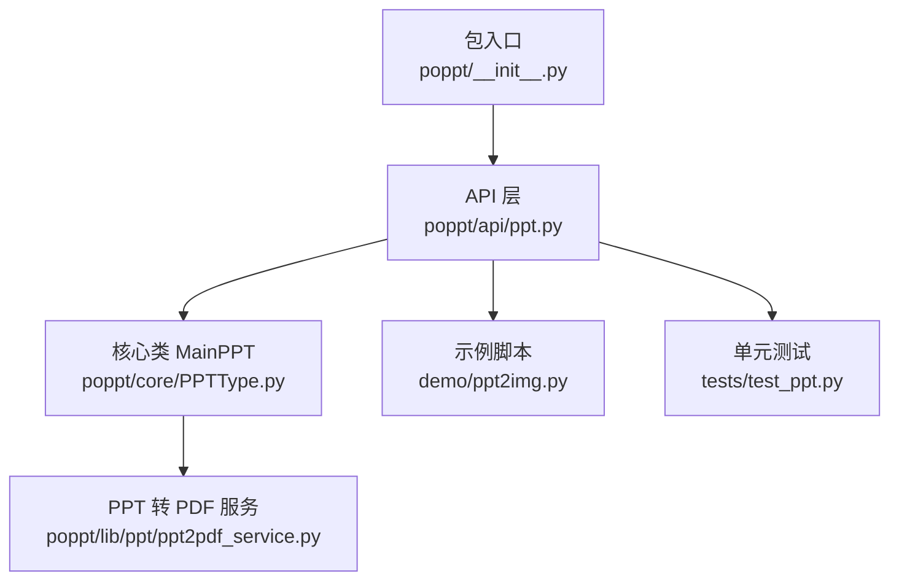
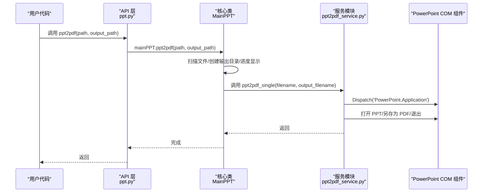
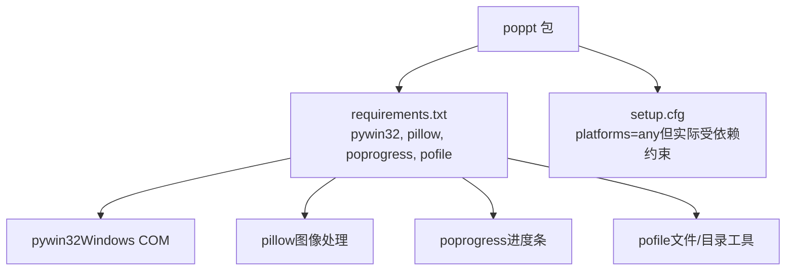
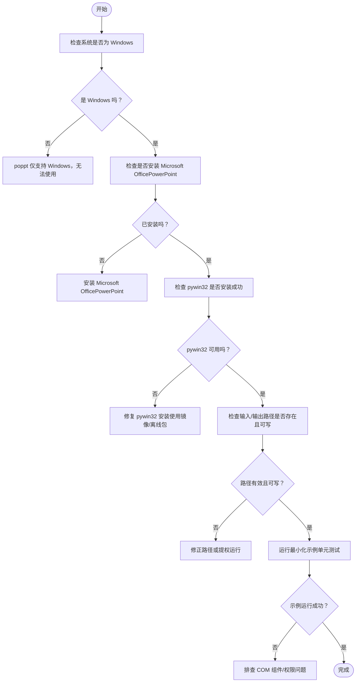

# 常见问题解答

<cite>
**本文引用的文件**
- [README.md](file://README.md)
- [requirements.txt](file://requirements.txt)
- [setup.cfg](file://setup.cfg)
- [poppt/__init__.py](file://poppt/__init__.py)
- [poppt/api/ppt.py](file://poppt/api/ppt.py)
- [poppt/core/PPTType.py](file://poppt/core/PPTType.py)
- [poppt/lib/ppt/ppt2pdf_service.py](file://poppt/lib/ppt/ppt2pdf_service.py)
- [tests/test_ppt.py](file://tests/test_ppt.py)
- [demo/ppt2img.py](file://demo/ppt2img.py)
</cite>

## 目录
1. [简介](#简介)
2. [项目结构](#项目结构)
3. [核心组件](#核心组件)
4. [架构总览](#架构总览)
5. [详细组件分析](#详细组件分析)
6. [依赖关系分析](#依赖关系分析)
7. [性能考虑](#性能考虑)
8. [故障排除指南](#故障排除指南)
9. [结论](#结论)
10. [附录](#附录)

## 简介
本FAQ面向使用 poppt 的用户，聚焦安装、运行时错误、功能限制与性能问题，帮助快速定位并解决问题。poppt 通过 Windows COM 组件与 PowerPoint 交互，因此仅支持 Windows 平台；同时提供 PPT/PPTX 转 PDF、PPT 转图片（支持独立图片与长图）、以及合并多个 PPT 的能力。

## 项目结构
- 包入口与对外 API：通过包级导出统一暴露接口，便于用户直接调用。
- API 层：定义高层 API（如 ppt2pdf、ppt2img、merge4ppt），内部委托核心类处理。
- 核心类：MainPPT 封装 PPT 转 PDF、PPT 转图片、合并 PPT 的全部逻辑，使用 win32com.client 与 PowerPoint 交互。
- 服务模块：PPT 转 PDF 的具体实现封装在独立服务函数中，避免重复连接 PowerPoint。
- 示例与测试：提供演示脚本与单元测试，覆盖主要功能路径。

图表来源
- [poppt/__init__.py](file://poppt/__init__.py#L1-L3)
- [poppt/api/ppt.py](file://poppt/api/ppt.py#L1-L66)
- [poppt/core/PPTType.py](file://poppt/core/PPTType.py#L1-L204)
- [poppt/lib/ppt/ppt2pdf_service.py](file://poppt/lib/ppt/ppt2pdf_service.py#L1-L42)
- [demo/ppt2img.py](file://demo/ppt2img.py#L1-L25)
- [tests/test_ppt.py](file://tests/test_ppt.py#L1-L98)

章节来源
- [poppt/__init__.py](file://poppt/__init__.py#L1-L3)
- [poppt/api/ppt.py](file://poppt/api/ppt.py#L1-L66)
- [poppt/core/PPTType.py](file://poppt/core/PPTType.py#L1-L204)
- [poppt/lib/ppt/ppt2pdf_service.py](file://poppt/lib/ppt/ppt2pdf_service.py#L1-L42)
- [demo/ppt2img.py](file://demo/ppt2img.py#L1-L25)
- [tests/test_ppt.py](file://tests/test_ppt.py#L1-L98)

## 核心组件
- 包入口：统一导出 API，简化用户调用。
- API 层：提供 ppt2pdf、ppt2img、merge4ppt 三个高层接口，参数与行为由核心类实现。
- 核心类 MainPPT：
  - 支持的文件后缀：.ppt/.pptx
  - 图片输出格式：默认 .jpg（数值常量 17）
  - 与 PowerPoint 的交互：通过 win32com.client Dispatch/EnsureDispatch
  - 提供批量转换、合并、长图拼接等能力
- 服务模块：PPT 转 PDF 的具体实现，负责打开 PowerPoint、打开 PPT、另存为 PDF、退出应用。

章节来源
- [poppt/__init__.py](file://poppt/__init__.py#L1-L3)
- [poppt/api/ppt.py](file://poppt/api/ppt.py#L1-L66)
- [poppt/core/PPTType.py](file://poppt/core/PPTType.py#L1-L204)
- [poppt/lib/ppt/ppt2pdf_service.py](file://poppt/lib/ppt/ppt2pdf_service.py#L1-L42)

## 架构总览
以下序列图展示“PPT 转 PDF”的典型调用链，体现从 API 到核心类再到服务模块的分层设计。

图表来源
- [poppt/api/ppt.py](file://poppt/api/ppt.py#L18-L33)
- [poppt/core/PPTType.py](file://poppt/core/PPTType.py#L38-L66)
- [poppt/lib/ppt/ppt2pdf_service.py](file://poppt/lib/ppt/ppt2pdf_service.py#L15-L42)

## 详细组件分析

### 1. 安装问题：pywin32 安装失败
- 现象
  - 在非 Windows 系统或 Python 环境缺少 Microsoft Office 时，安装 pywin32 可能失败。
- 根因
  - pywin32 依赖 Windows COM 组件，且通常需要与已安装的 Office 组件协同工作。
- 解决方案
  - 在 Windows 系统上安装 Microsoft Office（PowerPoint），再安装 poppt。
  - 若仍失败，尝试使用离线 wheel 包或通过包管理器指定镜像源安装。
- 参考
  - 依赖声明与平台要求见安装配置。

章节来源
- [requirements.txt](file://requirements.txt#L1-L5)
- [setup.cfg](file://setup.cfg#L19-L31)

### 2. 运行时错误：PowerPoint 未安装或 COM 组件调用失败
- 现象
  - 运行 PPT 转 PDF/图片或合并 PPT 时报错，提示无法启动 PowerPoint 或 COM 组件不可用。
- 根因
  - 系统未安装 Microsoft Office（PowerPoint），或 Python 环境与 Office 的 COM 组件不兼容。
- 解决方案
  - 安装 Microsoft Office（PowerPoint），确保系统具备 COM 组件。
  - 使用管理员权限运行 Python 脚本，避免权限不足导致的 COM 初始化失败。
  - 确认 Python 版本满足最低要求（>=3.7）。
- 参考
  - API 层与核心类均通过 win32com.client 与 PowerPoint 交互。

章节来源
- [poppt/api/ppt.py](file://poppt/api/ppt.py#L18-L66)
- [poppt/core/PPTType.py](file://poppt/core/PPTType.py#L1-L204)
- [setup.cfg](file://setup.cfg#L27-L31)

### 3. 功能疑问：支持的 PPT 版本与输出格式
- 支持的输入格式
  - .ppt 与 .pptx
- 输出格式
  - PPT 转 PDF：输出为 PDF
  - PPT 转图片：默认输出为 .jpg（数值常量 17），合并长图时同样以 .jpg 作为默认文件名后缀
- 参考
  - 核心类中对后缀列表与默认图片类型的定义。

章节来源
- [poppt/core/PPTType.py](file://poppt/core/PPTType.py#L20-L40)
- [poppt/core/PPTType.py](file://poppt/core/PPTType.py#L114-L167)

### 4. 为什么 poppt 仅支持 Windows？
- 根因
  - 项目大量使用 win32com.client 与 PowerPoint 交互，这是 Windows 特有的 COM 组件。
- 影响
  - 在 Linux/macOS 上无法直接使用该库进行 PPT 自动化。
- 参考
  - 核心类与服务模块均显式导入并使用 win32com.client。

章节来源
- [poppt/core/PPTType.py](file://poppt/core/PPTType.py#L1-L20)
- [poppt/lib/ppt/ppt2pdf_service.py](file://poppt/lib/ppt/ppt2pdf_service.py#L1-L20)

### 5. 性能问题：处理大型 PPT 文件缓慢
- 现象
  - 大型 PPT 文件转换耗时较长，尤其是转图片或合并长图时。
- 根因
  - 与 PowerPoint 交互为同步过程，且涉及磁盘 IO（读取 PPT、写入 PDF/图片）。
- 优化建议
  - 批量处理时尽量减少不必要的中间目录层级，合理规划输出路径。
  - 合并长图时避免重复读写，优先使用内存中处理（当前实现为磁盘读写，可按需优化）。
  - 在 Windows 上使用 SSD 可显著提升 IO 性能。
- 参考
  - 核心类中对批量文件处理与长图拼接的实现。

章节来源
- [poppt/core/PPTType.py](file://poppt/core/PPTType.py#L38-L66)
- [poppt/core/PPTType.py](file://poppt/core/PPTType.py#L168-L204)

### 6. 文件路径相关错误：路径不存在或权限不足
- 现象
  - 报错提示找不到文件或无法写入输出目录。
- 根因
  - 输入路径无效、输出路径不存在且未自动创建、或当前用户无写权限。
- 解决方案
  - 确保输入路径指向有效的 .ppt/.pptx 文件或包含这些文件的目录。
  - 确保输出目录存在或允许自动创建（核心类会尝试创建目录）。
  - 使用管理员权限运行，避免权限不足。
- 参考
  - 核心类在转换前会扫描文件并创建输出目录。

章节来源
- [poppt/core/PPTType.py](file://poppt/core/PPTType.py#L52-L66)
- [tests/test_ppt.py](file://tests/test_ppt.py#L34-L93)

### 7. 合并 PPT 的注意事项
- 现象
  - 合并后 PPT 未生成或内容异常。
- 根因
  - 输入目录中未包含 .ppt/.pptx 文件，或 PowerPoint 未正确打开/关闭。
- 解决方案
  - 确保输入目录包含多个 PPT 文件，且文件后缀正确。
  - 确认 PowerPoint 已安装且可正常启动。
- 参考
  - 合并逻辑通过 EnsureDispatch/Dispatch 启动 PowerPoint，并逐个插入幻灯片。

章节来源
- [poppt/core/PPTType.py](file://poppt/core/PPTType.py#L67-L113)

## 依赖关系分析
- 外部依赖
  - pywin32：提供 Windows COM 组件访问能力
  - Pillow：用于图片拼接与长图生成
  - poprogress：提供进度显示
  - pofile：提供文件扫描与目录创建等辅助能力
- 平台要求
  - 仅支持 Windows（由 pywin32 与 COM 组件决定）

图表来源
- [requirements.txt](file://requirements.txt#L1-L5)
- [setup.cfg](file://setup.cfg#L19-L31)

章节来源
- [requirements.txt](file://requirements.txt#L1-L5)
- [setup.cfg](file://setup.cfg#L19-L31)

## 性能考虑
- IO 密集：PPT 转 PDF/图片涉及磁盘读写，建议使用 SSD。
- PowerPoint 同步：与 PowerPoint 的交互为同步过程，建议在空闲时段批量处理。
- 图片合并：长图拼接为顺序读取与写入，避免过多中间文件，减少磁盘压力。
- 并发策略：当前实现为串行处理，若需更高吞吐，可在业务层引入进程池（需自行封装）。

## 故障排除指南
以下流程图帮助用户逐步诊断问题：

## 结论
poppt 通过 Windows COM 组件与 PowerPoint 深度集成，提供了稳定可靠的 PPT 转 PDF/图片与合并能力。由于依赖 pywin32 与 Office，项目天然仅支持 Windows。针对安装、运行时错误、路径与权限问题，建议按本 FAQ 的步骤逐一排查。对于性能问题，可通过优化 IO、减少中间文件与合理安排任务时间来改善。

## 附录
- 官方交流群与问题反馈
  - 项目官网与交流群链接详见 README
  - GitHub Issues 用于提交 bug 反馈与功能建议
- 快速参考
  - 安装命令与依赖：参见 README 与 setup.cfg
  - API 使用：参见 API 层与示例脚本
  - 单元测试：可作为最小复现场景验证环境

章节来源
- [README.md](file://README.md#L1-L94)
- [setup.cfg](file://setup.cfg#L1-L31)
- [demo/ppt2img.py](file://demo/ppt2img.py#L1-L25)
- [tests/test_ppt.py](file://tests/test_ppt.py#L1-L98)