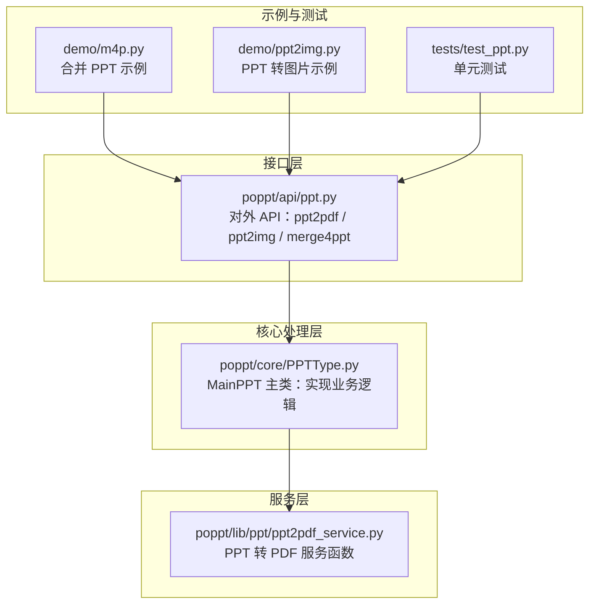
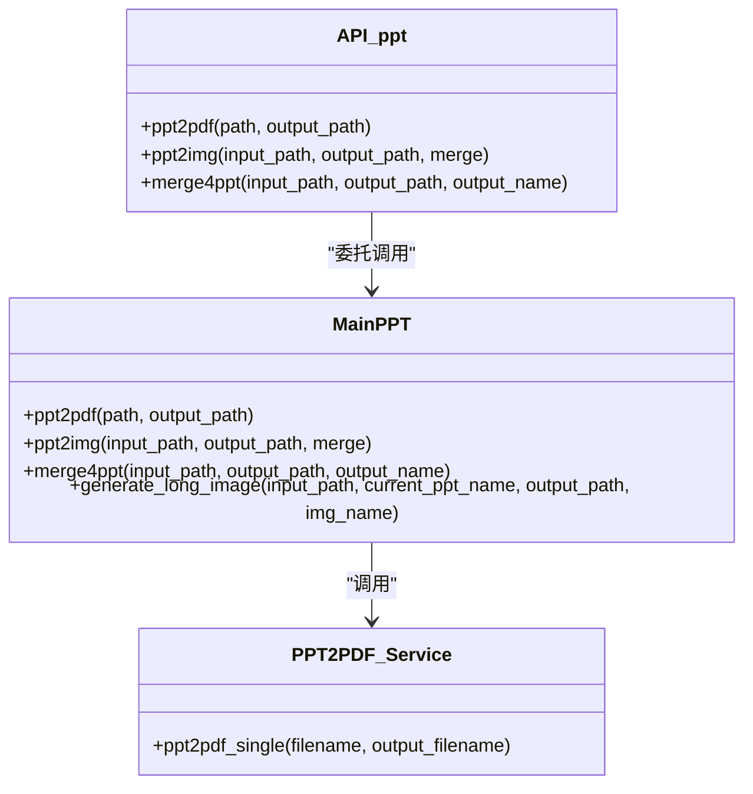
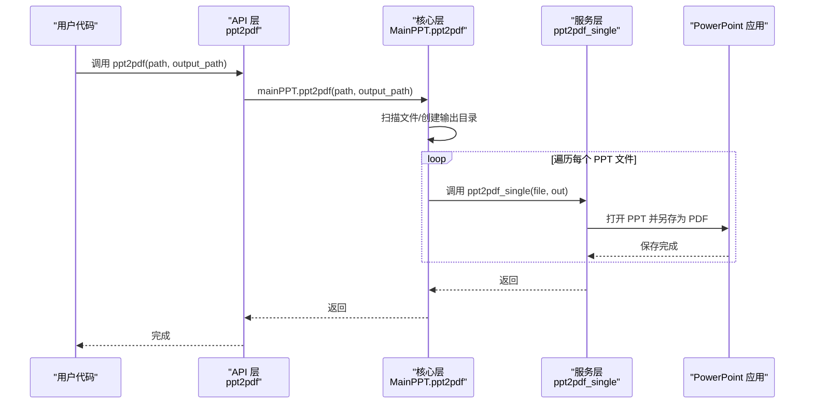
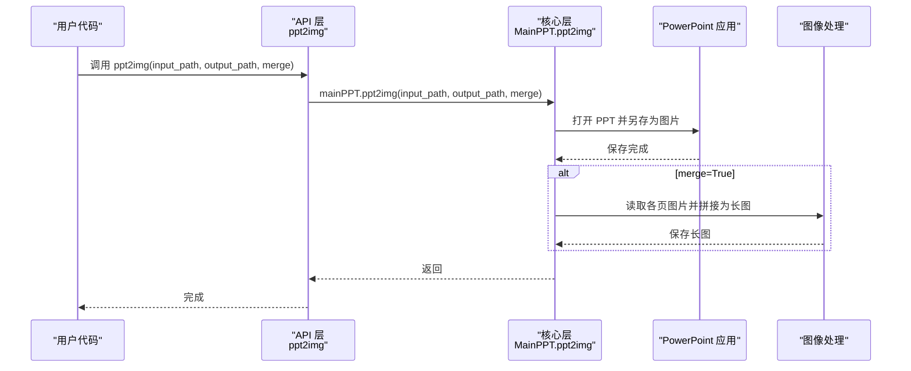
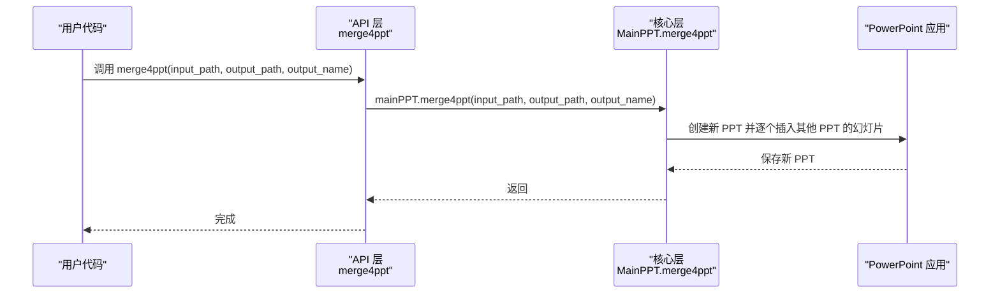
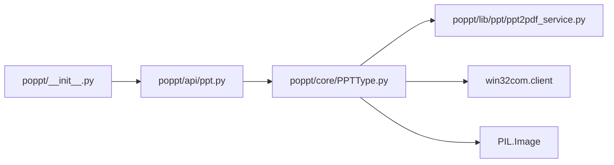

# 快速开始

<cite>
**本文引用的文件**
- [README.md](file://README.md)
- [requirements.txt](file://requirements.txt)
- [setup.py](file://setup.py)
- [poppt/__init__.py](file://poppt/__init__.py)
- [poppt/api/ppt.py](file://poppt/api/ppt.py)
- [poppt/core/PPTType.py](file://poppt/core/PPTType.py)
- [poppt/lib/ppt/ppt2pdf_service.py](file://poppt/lib/ppt/ppt2pdf_service.py)
- [tests/test_ppt.py](file://tests/test_ppt.py)
- [demo/m4p.py](file://demo/m4p.py)
- [demo/ppt2img.py](file://demo/ppt2img.py)
</cite>

## 目录
1. [简介](#简介)
2. [项目结构](#项目结构)
3. [核心组件](#核心组件)
4. [架构总览](#架构总览)
5. [详细组件解析](#详细组件解析)
6. [依赖关系分析](#依赖关系分析)
7. [性能与注意事项](#性能与注意事项)
8. [故障排查指南](#故障排查指南)
9. [结论](#结论)
10. [附录：端到端工作流示例](#附录端到端工作流示例)

## 简介
本指南面向新手，带你从零开始使用 poppt 库完成三个核心任务：
- 将单个 PPT/PPTX 转换为 PDF
- 将 PPT 转换为图片（独立图片或合并为长图）
- 合并多个 PPT 文件为一个 PPT

你将学会如何安装、准备文件路径（相对路径与绝对路径）、调用三个核心函数、观察预期输出，并完成一个完整的端到端工作流。

## 项目结构
仓库采用“接口层 + 核心处理层 + 服务层”的分层设计：
- 接口层：对外暴露的 API，位于 poppt/api/ppt.py
- 核心处理层：封装具体逻辑，位于 poppt/core/PPTType.py
- 服务层：底层服务函数，如 PPT 转 PDF 的服务函数位于 poppt/lib/ppt/ppt2pdf_service.py
- 示例与测试：demo 目录提供示例脚本；tests 目录提供单元测试

图表来源
- [poppt/api/ppt.py](file://poppt/api/ppt.py#L1-L66)
- [poppt/core/PPTType.py](file://poppt/core/PPTType.py#L1-L204)
- [poppt/lib/ppt/ppt2pdf_service.py](file://poppt/lib/ppt/ppt2pdf_service.py#L1-L42)
- [demo/m4p.py](file://demo/m4p.py#L1-L16)
- [demo/ppt2img.py](file://demo/ppt2img.py#L1-L25)
- [tests/test_ppt.py](file://tests/test_ppt.py#L1-L98)

章节来源
- [README.md](file://README.md#L21-L41)
- [poppt/__init__.py](file://poppt/__init__.py#L1-L3)
- [poppt/api/ppt.py](file://poppt/api/ppt.py#L1-L66)
- [poppt/core/PPTType.py](file://poppt/core/PPTType.py#L1-L204)
- [poppt/lib/ppt/ppt2pdf_service.py](file://poppt/lib/ppt/ppt2pdf_service.py#L1-L42)
- [demo/m4p.py](file://demo/m4p.py#L1-L16)
- [demo/ppt2img.py](file://demo/ppt2img.py#L1-L25)
- [tests/test_ppt.py](file://tests/test_ppt.py#L1-L98)

## 核心组件
- 对外 API：位于 poppt/api/ppt.py，提供三个函数：
  - ppt2pdf(path, output_path)
  - ppt2img(input_path, output_path, merge)
  - merge4ppt(input_path, output_path, output_name)
- 核心实现：MainPPT 类封装了 PPT 转 PDF、PPT 转图片、合并 PPT 的逻辑
- 服务函数：PPT 转 PDF 的底层服务函数位于 poppt/lib/ppt/ppt2pdf_service.py

章节来源
- [poppt/api/ppt.py](file://poppt/api/ppt.py#L18-L66)
- [poppt/core/PPTType.py](file://poppt/core/PPTType.py#L20-L204)
- [poppt/lib/ppt/ppt2pdf_service.py](file://poppt/lib/ppt/ppt2pdf_service.py#L1-L42)

## 架构总览
下面的类图展示了接口层、核心处理层与服务层之间的关系。

图表来源
- [poppt/api/ppt.py](file://poppt/api/ppt.py#L18-L66)
- [poppt/core/PPTType.py](file://poppt/core/PPTType.py#L38-L204)
- [poppt/lib/ppt/ppt2pdf_service.py](file://poppt/lib/ppt/ppt2pdf_service.py#L15-L42)

## 详细组件解析

### 安装与环境准备
- 使用 pip 从阿里云镜像安装最新版 poppt
- 安装完成后，确保系统已安装 Microsoft PowerPoint（因为内部通过 COM 组件调用）

章节来源
- [README.md](file://README.md#L21-L30)
- [requirements.txt](file://requirements.txt#L1-L5)

### 函数一：ppt2pdf（将 PPT/PPTX 转 PDF）
- 功能：将单个或多个 PPT/PPTX 文件批量转换为 PDF
- 最基本参数：
  - path：PPT 文件或文件夹路径
  - output_path：PDF 输出目录（默认当前目录）
- 预期输出：在 output_path 下生成与输入同名的 PDF 文件（去后缀）

图表来源
- [poppt/api/ppt.py](file://poppt/api/ppt.py#L20-L32)
- [poppt/core/PPTType.py](file://poppt/core/PPTType.py#L38-L66)
- [poppt/lib/ppt/ppt2pdf_service.py](file://poppt/lib/ppt/ppt2pdf_service.py#L15-L42)

章节来源
- [poppt/api/ppt.py](file://poppt/api/ppt.py#L20-L32)
- [poppt/core/PPTType.py](file://poppt/core/PPTType.py#L38-L66)
- [tests/test_ppt.py](file://tests/test_ppt.py#L34-L43)

### 函数二：ppt2img（将 PPT 转图片）
- 功能：将 PPT 转换为图片，支持独立图片或合并为长图
- 最基本参数：
  - input_path：PPT 文件路径（单个）或包含多个 PPT 的文件夹路径
  - output_path：输出目录（默认当前目录）
  - merge：True 将所有页面合并为一张长图；False 每页独立保存
- 预期输出：
  - merge=False：在 output_path 下按 PPT 名创建子目录，每页保存为独立图片
  - merge=True：在 output_path 下生成一个与 PPT 同名的长图文件

图表来源
- [poppt/api/ppt.py](file://poppt/api/ppt.py#L34-L51)
- [poppt/core/PPTType.py](file://poppt/core/PPTType.py#L114-L167)
- [poppt/core/PPTType.py](file://poppt/core/PPTType.py#L168-L204)

章节来源
- [poppt/api/ppt.py](file://poppt/api/ppt.py#L34-L51)
- [poppt/core/PPTType.py](file://poppt/core/PPTType.py#L114-L167)
- [poppt/core/PPTType.py](file://poppt/core/PPTType.py#L168-L204)
- [tests/test_ppt.py](file://tests/test_ppt.py#L44-L62)

### 函数三：merge4ppt（合并多个 PPT）
- 功能：将文件夹中多个 PPT 合并为一个 PPT
- 最基本参数：
  - input_path：包含多个 PPT 的文件夹路径
  - output_path：合并后 PPT 的输出目录（默认当前目录）
  - output_name：合并后 PPT 的文件名（默认 merge4ppt.pptx）
- 预期输出：在 output_path 下生成 output_name 的合并结果

图表来源
- [poppt/api/ppt.py](file://poppt/api/ppt.py#L53-L66)
- [poppt/core/PPTType.py](file://poppt/core/PPTType.py#L67-L113)

章节来源
- [poppt/api/ppt.py](file://poppt/api/ppt.py#L53-L66)
- [poppt/core/PPTType.py](file://poppt/core/PPTType.py#L67-L113)
- [tests/test_ppt.py](file://tests/test_ppt.py#L64-L93)
- [demo/m4p.py](file://demo/m4p.py#L1-L16)

## 依赖关系分析
- poppt/__init__.py 将 API 层的函数全部导出，便于用户直接 import poppt 调用
- API 层通过 mainPPT 实例调用核心逻辑
- 核心层依赖 win32com.client 与 PIL 等外部库
- PPT 转 PDF 的核心逻辑委托给服务层函数

图表来源
- [poppt/__init__.py](file://poppt/__init__.py#L1-L3)
- [poppt/api/ppt.py](file://poppt/api/ppt.py#L1-L17)
- [poppt/core/PPTType.py](file://poppt/core/PPTType.py#L1-L20)
- [poppt/lib/ppt/ppt2pdf_service.py](file://poppt/lib/ppt/ppt2pdf_service.py#L1-L14)

章节来源
- [poppt/__init__.py](file://poppt/__init__.py#L1-L3)
- [poppt/api/ppt.py](file://poppt/api/ppt.py#L1-L17)
- [poppt/core/PPTType.py](file://poppt/core/PPTType.py#L1-L20)
- [poppt/lib/ppt/ppt2pdf_service.py](file://poppt/lib/ppt/ppt2pdf_service.py#L1-L14)

## 性能与注意事项
- 由于内部通过 COM 组件调用 PowerPoint，转换过程会启动 PowerPoint 应用，耗时与 PPT 的页数、图片资源大小相关
- merge=True 时，PPT 转图片后再进行长图拼接，会产生中间图片文件，磁盘占用较高
- 建议在空闲时段执行批量转换，避免影响系统性能
- 若需静默执行，可调整 PowerPoint 的可见性设置（当前实现中 Visible 被设为 True）

章节来源
- [poppt/core/PPTType.py](file://poppt/core/PPTType.py#L129-L133)
- [poppt/core/PPTType.py](file://poppt/core/PPTType.py#L92-L96)
- [poppt/lib/ppt/ppt2pdf_service.py](file://poppt/lib/ppt/ppt2pdf_service.py#L27-L31)

## 故障排查指南
- 无法找到 PowerPoint：请确认系统已安装 Microsoft PowerPoint
- 权限不足或路径错误：确保传入的是有效路径（相对路径会被转换为绝对路径），且输出目录可写
- 合并失败：检查 input_path 中是否包含有效的 PPT/PPTX 文件
- 图片未合并为长图：确认 merge=True 且中间图片已生成后再进行长图拼接

章节来源
- [poppt/core/PPTType.py](file://poppt/core/PPTType.py#L82-L91)
- [poppt/core/PPTType.py](file://poppt/core/PPTType.py#L149-L167)
- [tests/test_ppt.py](file://tests/test_ppt.py#L64-L93)

## 结论
通过本指南，你已了解如何安装 poppt、准备文件路径、调用三个核心函数，并验证输出结果。建议在掌握基础用法后，进一步阅读更详细的 API 文档与源码注释，以深入理解参数细节与扩展能力。

## 附录：端到端工作流示例
以下流程从安装到执行一个转换任务，帮助你快速上手。

步骤 1：安装
- 使用 pip 从阿里云镜像安装最新版 poppt

步骤 2：准备文件
- 准备一个 PPT/PPTX 文件，或准备包含多个 PPT 的文件夹
- 准备输出目录（可为空目录）

步骤 3：执行转换
- 将 PPT 转 PDF：调用 ppt2pdf(path, output_path)
- 将 PPT 转图片：调用 ppt2img(input_path, output_path, merge=False)
- 合并多个 PPT：调用 merge4ppt(input_path, output_path, output_name)

步骤 4：验证结果
- PDF：在 output_path 下看到与输入同名的 PDF 文件
- 图片（独立）：在 output_path 下按 PPT 名创建子目录，每页保存为独立图片
- 图片（长图）：在 output_path 下生成一个与 PPT 同名的长图文件
- 合并 PPT：在 output_path 下生成 output_name 的合并结果

章节来源
- [README.md](file://README.md#L21-L30)
- [poppt/api/ppt.py](file://poppt/api/ppt.py#L20-L66)
- [poppt/core/PPTType.py](file://poppt/core/PPTType.py#L38-L113)
- [tests/test_ppt.py](file://tests/test_ppt.py#L34-L93)
- [demo/m4p.py](file://demo/m4p.py#L1-L16)
- [demo/ppt2img.py](file://demo/ppt2img.py#L1-L25)