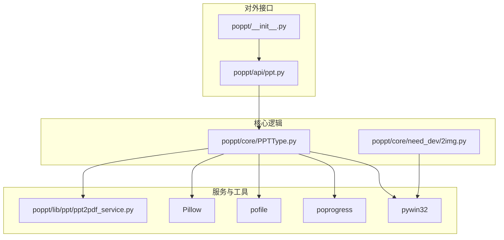
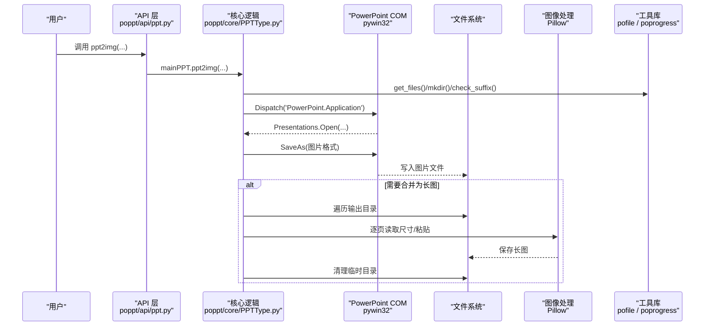
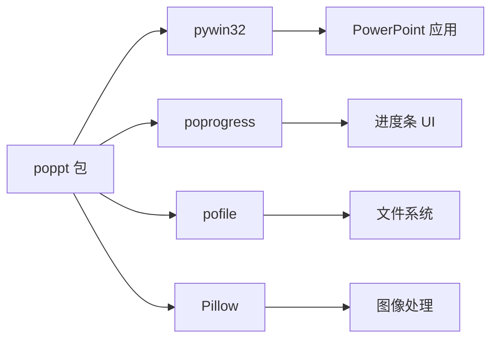
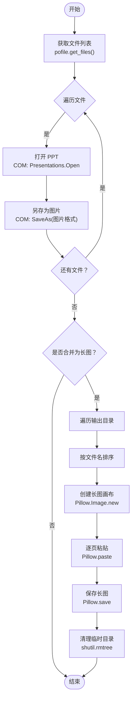

# 技术栈与依赖

<cite>
**本文引用的文件**
- [setup.cfg](file://setup.cfg)
- [requirements.txt](file://requirements.txt)
- [setup.py](file://setup.py)
- [README.md](file://README.md)
- [poppt/__init__.py](file://poppt/__init__.py)
- [poppt/api/ppt.py](file://poppt/api/ppt.py)
- [poppt/core/PPTType.py](file://poppt/core/PPTType.py)
- [poppt/lib/ppt/ppt2pdf_service.py](file://poppt/lib/ppt/ppt2pdf_service.py)
- [poppt/core/need_dev/2img.py](file://poppt/core/need_dev/2img.py)
- [tests/test_ppt.py](file://tests/test_ppt.py)
- [demo/ppt2img.py](file://demo/ppt2img.py)
- [script/allpackages.txt](file://script/allpackages.txt)
</cite>

## 目录
1. [引言](#引言)
2. [项目结构](#项目结构)
3. [核心组件](#核心组件)
4. [架构总览](#架构总览)
5. [详细组件分析](#详细组件分析)
6. [依赖关系分析](#依赖关系分析)
7. [性能考虑](#性能考虑)
8. [故障排除指南](#故障排除指南)
9. [结论](#结论)
10. [附录](#附录)

## 引言
本文件围绕 poppt 技术栈与依赖展开，系统梳理项目对外部库的使用方式与职责边界，重点解释：
- pywin32 通过 COM 组件实现对 PowerPoint 的自动化控制；
- poprogress 提供进度可视化；
- pofile 在文件操作中的实用功能；
- Pillow 在 PPT 转图片流程中进行图像处理的关键作用；
- 各依赖的版本要求与安装说明；
- 依赖组合如何支撑项目核心功能；
- 依赖关系图与调用链路；
- 依赖管理最佳实践与常见问题排查。

## 项目结构
poppt 采用分层组织：对外 API 层、核心业务逻辑层、底层服务与工具库。核心入口通过包导出统一接口，内部通过模块间协作完成 PPT 转 PDF、PPT 转图片、合并 PPT 等能力。

图表来源
- [poppt/__init__.py](file://poppt/__init__.py#L1-L3)
- [poppt/api/ppt.py](file://poppt/api/ppt.py#L1-L66)
- [poppt/core/PPTType.py](file://poppt/core/PPTType.py#L1-L204)
- [poppt/lib/ppt/ppt2pdf_service.py](file://poppt/lib/ppt/ppt2pdf_service.py#L1-L42)
- [poppt/core/need_dev/2img.py](file://poppt/core/need_dev/2img.py#L1-L105)

章节来源
- [README.md](file://README.md#L1-L94)
- [setup.cfg](file://setup.cfg#L1-L31)
- [requirements.txt](file://requirements.txt#L1-L5)

## 核心组件
- 对外 API 层：提供统一的函数接口，封装核心逻辑，便于用户调用。
- 核心业务层：MainPPT 类集中实现 PPT 转 PDF、PPT 转图片、合并 PPT 的主要流程。
- 服务与工具层：PPT 转 PDF 的服务函数、文件工具（pofile）、进度条（poprogress）、图像处理（Pillow）、PowerPoint 自动化（pywin32）。

章节来源
- [poppt/api/ppt.py](file://poppt/api/ppt.py#L1-L66)
- [poppt/core/PPTType.py](file://poppt/core/PPTType.py#L1-L204)
- [poppt/lib/ppt/ppt2pdf_service.py](file://poppt/lib/ppt/ppt2pdf_service.py#L1-L42)

## 架构总览
以下序列图展示了“PPT 转图片”从 API 到核心逻辑再到 COM 与图像处理的整体调用链。

图表来源
- [poppt/api/ppt.py](file://poppt/api/ppt.py#L1-L66)
- [poppt/core/PPTType.py](file://poppt/core/PPTType.py#L114-L167)
- [poppt/lib/ppt/ppt2pdf_service.py](file://poppt/lib/ppt/ppt2pdf_service.py#L1-L42)

## 详细组件分析

### pywin32：通过 COM 控制 PowerPoint
- 作用概述
  - 通过 win32com.client 与 PowerPoint 应用建立连接，实现打开 PPT、另存为 PDF/图片、插入幻灯片、保存等自动化操作。
- 关键使用点
  - 合并 PPT：使用 EnsureDispatch 获取应用实例，打开源 PPT 并将幻灯片插入到新 PPT 中，最后保存并退出。
  - 转图片：使用 Dispatch 打开 PPT，调用 SaveAs 指定图片格式（如 JPG），随后退出应用。
  - 转 PDF：在服务函数中打开 PPT 并以 PDF 格式导出。
- 版本与安装
  - 版本要求：来自开发脚本清单，pywin32 版本为 306。
  - 安装方式：pip 安装；若遇到兼容性问题，可参考故障排除章节。
- 性能与稳定性
  - PowerPoint 作为外部进程，启动与保存耗时较长，建议批处理时减少可视交互，避免不必要的界面渲染。

章节来源
- [poppt/core/PPTType.py](file://poppt/core/PPTType.py#L91-L113)
- [poppt/core/PPTType.py](file://poppt/core/PPTType.py#L129-L148)
- [poppt/lib/ppt/ppt2pdf_service.py](file://poppt/lib/ppt/ppt2pdf_service.py#L15-L42)
- [script/allpackages.txt](file://script/allpackages.txt#L1-L13)

### poprogress：提供进度可视化
- 作用概述
  - 为批量文件处理提供简单进度条，提升用户体验与可观测性。
- 关键使用点
  - 在 PPT 转 PDF 与合并 PPT 的循环中包裹 simple_progress，自动显示进度。
- 版本与安装
  - 版本要求：来自开发脚本清单，poprogress 版本为 0.0.2。
  - 安装方式：pip 安装。
- 性能与稳定性
  - 进度条仅做 UI 展示，不影响核心逻辑；在大量文件场景下建议合理刷新频率。

章节来源
- [poppt/core/PPTType.py](file://poppt/core/PPTType.py#L56-L66)
- [poppt/core/PPTType.py](file://poppt/core/PPTType.py#L99-L112)
- [script/allpackages.txt](file://script/allpackages.txt#L1-L13)

### pofile：文件操作实用工具
- 作用概述
  - 提供获取文件列表、创建目录、校验后缀等功能，简化文件路径与目录管理。
- 关键使用点
  - 获取文件列表：get_files(path) 返回目标路径下的文件集合。
  - 创建目录：mkdir(path) 返回是否存在与绝对路径，确保输出目录可用。
  - 校验后缀：check_suffix(file, suffix_list) 过滤非 PPT 文件。
- 版本与安装
  - 版本要求：来自开发脚本清单，pofile 以本地路径形式引入，版本由其仓库定义。
  - 安装方式：pip 安装或本地源码安装。
- 性能与稳定性
  - 文件系统 IO 为主要开销，建议在循环中尽量减少重复 IO 操作。

章节来源
- [poppt/core/PPTType.py](file://poppt/core/PPTType.py#L52-L66)
- [poppt/core/PPTType.py](file://poppt/core/PPTType.py#L83-L90)
- [poppt/core/PPTType.py](file://poppt/core/PPTType.py#L138-L141)
- [script/allpackages.txt](file://script/allpackages.txt#L1-L13)

### Pillow：PPT 转图片的图像处理
- 作用概述
  - 在“合并为长图”阶段，读取每页图片尺寸、创建画布、按顺序粘贴，最终保存长图。
- 关键使用点
  - 读取图片尺寸与模式：Image.open(...).size 与 mode。
  - 创建画布：Image.new(mode, (width, height * len(img_list)))。
  - 粘贴与保存：paste(...) 与 save(...)。
- 版本与安装
  - 版本要求：来自开发脚本清单，Pillow 版本为 9.5.0。
  - 安装方式：pip 安装。
- 性能与稳定性
  - 大图拼接内存占用较高，建议控制并发与及时释放中间资源。

章节来源
- [poppt/core/PPTType.py](file://poppt/core/PPTType.py#L168-L204)
- [script/allpackages.txt](file://script/allpackages.txt#L1-L13)

### API 层与核心逻辑
- API 层：对外暴露 ppt2pdf、ppt2img、merge4ppt 三个函数，统一入口，屏蔽内部细节。
- 核心逻辑：MainPPT 类封装三大功能，协调文件工具、进度条、COM 与图像处理。
- 示例与测试：demo 与 tests 展示典型用法与验证流程。

章节来源
- [poppt/api/ppt.py](file://poppt/api/ppt.py#L1-L66)
- [poppt/core/PPTType.py](file://poppt/core/PPTType.py#L1-L204)
- [demo/ppt2img.py](file://demo/ppt2img.py#L1-L25)
- [tests/test_ppt.py](file://tests/test_ppt.py#L1-L98)

## 依赖关系分析
- 直接依赖
  - pywin32：PowerPoint 自动化控制。
  - poprogress：进度可视化。
  - pofile：文件操作工具。
  - Pillow：图像处理。
- 间接依赖
  - Python 运行时与标准库（os、pathlib、shutil 等）。
- 依赖版本与安装
  - 来自 setup.cfg 的 install_requires 与 requirements.txt 显示依赖清单。
  - 来自 script/allpackages.txt 的版本要求（pywin32=306、poprogress=0.0.2、Pillow=9.5.0、pofile 本地源）。

图表来源
- [setup.cfg](file://setup.cfg#L19-L26)
- [requirements.txt](file://requirements.txt#L1-L5)
- [script/allpackages.txt](file://script/allpackages.txt#L1-L13)

章节来源
- [setup.cfg](file://setup.cfg#L19-L26)
- [requirements.txt](file://requirements.txt#L1-L5)
- [script/allpackages.txt](file://script/allpackages.txt#L1-L13)

## 性能考虑
- COM 交互成本高：PowerPoint 作为外部进程，启动与保存耗时显著，建议：
  - 批量处理时减少 Visible=1 的交互显示；
  - 合理分批处理，避免一次性打开过多文件；
  - 使用进度条降低等待焦虑，但注意刷新频率。
- 图像处理优化：
  - 长图拼接时优先按文件名排序，减少额外排序开销；
  - 大图保存前确认磁盘空间与内存余量。
- 文件系统优化：
  - pofile 的 mkdir/get_files/check_suffix 已封装常用逻辑，避免重复 IO。

## 故障排除指南
- pywin32 在不同 Python 版本下的兼容性问题
  - 现象：安装失败、无法导入 win32com.client、COM 组件找不到。
  - 解决方案：
    - 确认 Python 版本与 pywin32 发行版匹配（常见为 32/64 位一致性）；
    - 使用 pip 安装并执行 post-install 脚本（如需）；
    - 在 Windows 上确保已安装 Microsoft Office 或 PowerPoint；
    - 若仍失败，尝试卸载后重新安装，或使用预编译 wheel。
- 进度条 poprogress 未显示或异常
  - 现象：无进度条或报错。
  - 解决方案：检查 poprogress 安装版本与依赖环境；在 CI 环境中可降级为普通日志输出。
- 文件操作 pofile 报错
  - 现象：目录创建失败、路径解析异常。
  - 解决方案：确认路径权限与字符编码；使用绝对路径；检查后缀过滤逻辑。
- Pillow 图像处理错误
  - 现象：读取图片失败、模式不匹配、内存不足。
  - 解决方案：确认图片格式与模式；分批处理或降低分辨率；清理中间缓存。
- 依赖安装顺序与冲突
  - 建议：先安装 pywin32，再安装 Pillow、pofile、poprogress，最后安装 poppt；使用虚拟环境隔离依赖。

章节来源
- [script/allpackages.txt](file://script/allpackages.txt#L1-L13)
- [poppt/core/PPTType.py](file://poppt/core/PPTType.py#L129-L148)
- [poppt/lib/ppt/ppt2pdf_service.py](file://poppt/lib/ppt/ppt2pdf_service.py#L26-L41)

## 结论
poppt 通过 pywin32、poprogress、pofile、Pillow 四大外部依赖，构建了完整的 PPT 自动化处理体系：pywin32 负责与 PowerPoint 的交互，poprogress 提升可观测性，pofile 简化文件操作，Pillow 完成图像拼接与保存。四者协同，既保证了功能完整性，也兼顾了易用性与可维护性。建议在生产环境中配合虚拟环境与版本锁定策略，确保依赖稳定与可复现。

## 附录

### 依赖版本与安装说明
- pywin32
  - 版本要求：来自脚本清单，版本为 306。
  - 安装方式：pip 安装。
- poprogress
  - 版本要求：来自脚本清单，版本为 0.0.2。
  - 安装方式：pip 安装。
- pofile
  - 版本要求：来自脚本清单，以本地源形式引入。
  - 安装方式：pip 安装或本地源码安装。
- Pillow
  - 版本要求：来自脚本清单，版本为 9.5.0。
  - 安装方式：pip 安装。
- Python 运行时
  - 最低版本：来自 setup.cfg，>=3.7。

章节来源
- [setup.cfg](file://setup.cfg#L27-L27)
- [requirements.txt](file://requirements.txt#L1-L5)
- [script/allpackages.txt](file://script/allpackages.txt#L1-L13)

### 依赖管理最佳实践
- 使用虚拟环境隔离依赖，避免全局污染；
- 锁定关键依赖版本，结合 requirements.txt 与 setup.cfg；
- 分阶段安装：先安装 pywin32，再安装 Pillow、pofile、poprogress；
- 在 CI/CD 中固定依赖版本，减少环境差异导致的失败；
- 定期审阅依赖安全公告，及时更新。

### 关键流程算法示意（PPT 转图片）

图表来源
- [poppt/core/PPTType.py](file://poppt/core/PPTType.py#L129-L167)
- [poppt/core/PPTType.py](file://poppt/core/PPTType.py#L168-L204)