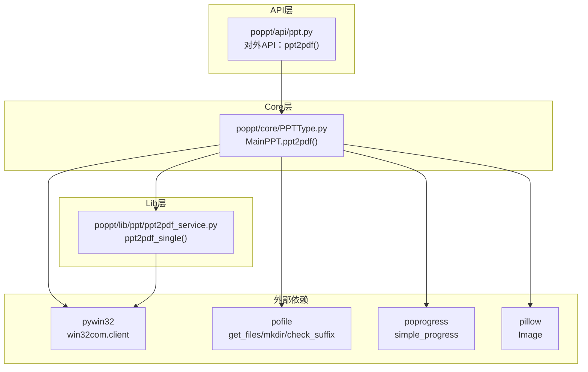
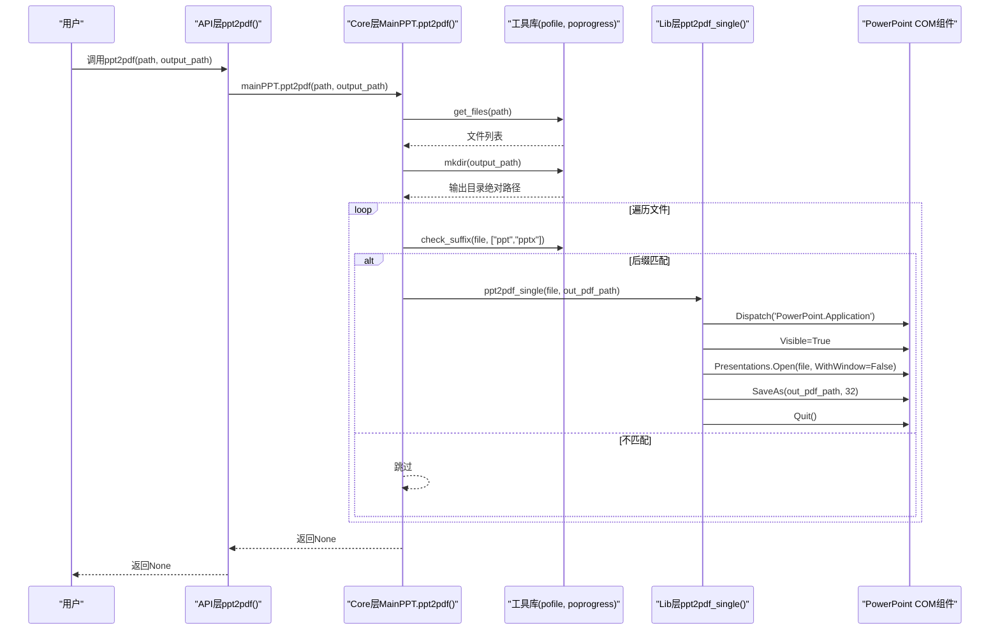
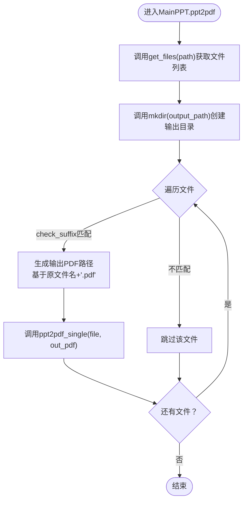
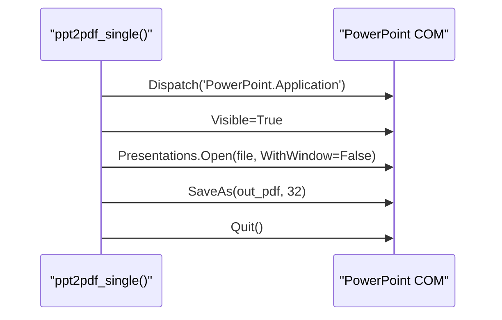
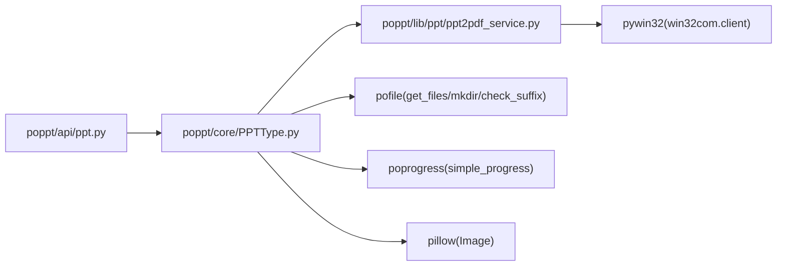

# PPT转PDF实现原理

<cite>
**本文引用的文件**
- [poppt/api/ppt.py](file://poppt/api/ppt.py)
- [poppt/core/PPTType.py](file://poppt/core/PPTType.py)
- [poppt/lib/ppt/ppt2pdf_service.py](file://poppt/lib/ppt/ppt2pdf_service.py)
- [requirements.txt](file://requirements.txt)
- [README.md](file://README.md)
- [tests/test_ppt.py](file://tests/test_ppt.py)
</cite>

## 目录
1. [引言](#引言)
2. [项目结构](#项目结构)
3. [核心组件](#核心组件)
4. [架构总览](#架构总览)
5. [详细组件分析](#详细组件分析)
6. [依赖关系分析](#依赖关系分析)
7. [性能考量](#性能考量)
8. [故障排查指南](#故障排查指南)
9. [结论](#结论)

## 引言
本技术文档聚焦于PPT转PDF功能的实现原理，围绕MainPPT类中的ppt2pdf方法展开，说明其作为门面接口如何协调文件发现、目录准备、进度展示与批处理转换流程；并深入解析lib层的ppt2pdf_single服务函数如何通过win32com客户端与PowerPoint COM组件交互，完成PPT/PPTX到PDF的导出，最终释放资源。同时提供从API调用到COM交互的完整序列图，讨论批处理设计的优势与潜在性能瓶颈，并给出优化建议。

## 项目结构
该项目采用分层架构：
- API层：对外暴露简洁的函数接口，如ppt2pdf，内部委托给MainPPT实例。
- Core层：封装业务逻辑与系统调用，负责文件扫描、目录管理、进度展示、后缀校验以及与COM组件的交互。
- Lib层：提供具体的服务函数，如单文件PPT转PDF的实现。
- 工具依赖：通过requirements.txt声明pywin32、poprogress、pofile、pillow等外部库。

图表来源
- [poppt/api/ppt.py](file://poppt/api/ppt.py#L1-L66)
- [poppt/core/PPTType.py](file://poppt/core/PPTType.py#L1-L204)
- [poppt/lib/ppt/ppt2pdf_service.py](file://poppt/lib/ppt/ppt2pdf_service.py#L1-L42)
- [requirements.txt](file://requirements.txt#L1-L5)

章节来源
- [README.md](file://README.md#L1-L94)
- [requirements.txt](file://requirements.txt#L1-L5)

## 核心组件
- API入口：poppt/api/ppt.py中的ppt2pdf函数，作为用户侧唯一入口，内部委托MainPPT实例执行。
- 主控制器：poppt/core/PPTType.py中的MainPPT类，封装ppt2pdf、ppt2img、merge4ppt等能力，负责批处理调度、文件过滤、目录创建与进度展示。
- 服务函数：poppt/lib/ppt/ppt2pdf_service.py中的ppt2pdf_single，负责单文件PowerPoint COM交互与PDF导出。
- 工具依赖：pofile提供文件扫描、目录创建、后缀检查；poprogress提供进度条；pywin32提供COM组件访问；pillow用于图片拼接（在PPT转图片场景中）。

章节来源
- [poppt/api/ppt.py](file://poppt/api/ppt.py#L1-L66)
- [poppt/core/PPTType.py](file://poppt/core/PPTType.py#L1-L204)
- [poppt/lib/ppt/ppt2pdf_service.py](file://poppt/lib/ppt/ppt2pdf_service.py#L1-L42)
- [requirements.txt](file://requirements.txt#L1-L5)

## 架构总览
PPT转PDF的调用链路自顶向下：
- 用户调用API层ppt2pdf
- API层委托MainPPT.ppt2pdf
- MainPPT使用pofile扫描路径、mkdir创建输出目录、check_suffix过滤后缀、simple_progress展示进度
- MainPPT逐个调用lib层ppt2pdf_single
- ppt2pdf_single通过win32com.Dispatch初始化PowerPoint应用，以不可见模式打开PPT，调用SaveAs(参数32)导出PDF，最后Quit释放资源

图表来源
- [poppt/api/ppt.py](file://poppt/api/ppt.py#L18-L32)
- [poppt/core/PPTType.py](file://poppt/core/PPTType.py#L38-L66)
- [poppt/lib/ppt/ppt2pdf_service.py](file://poppt/lib/ppt/ppt2pdf_service.py#L15-L42)

## 详细组件分析

### API层：ppt2pdf门面
- 职责：提供简洁的函数签名，屏蔽内部实现细节，统一入口。
- 行为：接收用户传入的path与output_path，直接委托给MainPPT实例的ppt2pdf方法。

章节来源
- [poppt/api/ppt.py](file://poppt/api/ppt.py#L18-L32)

### Core层：MainPPT.ppt2pdf批处理编排
- 文件发现：使用pofile.get_files递归扫描path，支持单文件或文件夹。
- 目录准备：使用pofile.mkdir确保输出目录存在并返回绝对路径。
- 进度展示：使用poprogress.simple_progress包装文件列表，逐个处理。
- 后缀过滤：使用pofile.check_suffix对文件后缀进行白名单过滤（仅保留ppt、pptx）。
- 输出命名：基于原文件名去后缀，追加.pdf扩展名，拼接至输出目录得到目标PDF路径。
- 单文件转换：调用lib层ppt2pdf_single完成实际导出。

图表来源
- [poppt/core/PPTType.py](file://poppt/core/PPTType.py#L38-L66)

章节来源
- [poppt/core/PPTType.py](file://poppt/core/PPTType.py#L38-L66)

### Lib层：ppt2pdf_single COM交互
- 初始化PowerPoint应用：通过win32com.client.Dispatch('PowerPoint.Application')创建应用实例。
- 可视化控制：设置Visible=True，便于观察操作过程（生产环境可按需改为False）。
- 打开PPT：使用Presentations.Open(file, WithWindow=False)以不可见模式加载PPT。
- 导出PDF：调用SaveAs(output_filename, 32)，其中32代表PDF格式。
- 资源释放：调用Quit()退出PowerPoint应用，避免进程残留。

图表来源
- [poppt/lib/ppt/ppt2pdf_service.py](file://poppt/lib/ppt/ppt2pdf_service.py#L15-L42)

章节来源
- [poppt/lib/ppt/ppt2pdf_service.py](file://poppt/lib/ppt/ppt2pdf_service.py#L15-L42)

### 数据流与控制流
- 输入：用户传入的path（单文件或文件夹）、output_path。
- 处理：Core层负责筛选与组织，Lib层负责COM交互与导出。
- 输出：每个PPT/PPTX文件对应一个PDF文件，位于指定输出目录。
- 错误处理：当前实现未显式捕获异常，建议在关键环节增加try/except与日志记录。

章节来源
- [poppt/core/PPTType.py](file://poppt/core/PPTType.py#L38-L66)
- [poppt/lib/ppt/ppt2pdf_service.py](file://poppt/lib/ppt/ppt2pdf_service.py#L15-L42)

## 依赖关系分析
- 外部库依赖：pywin32用于COM组件访问；poprogress提供进度条；pofile提供文件与目录工具；pillow用于图片拼接（PPT转图片场景）。
- 内部依赖：API层依赖Core层；Core层依赖Lib层与工具库；Lib层依赖pywin32。

图表来源
- [poppt/api/ppt.py](file://poppt/api/ppt.py#L1-L66)
- [poppt/core/PPTType.py](file://poppt/core/PPTType.py#L1-L204)
- [poppt/lib/ppt/ppt2pdf_service.py](file://poppt/lib/ppt/ppt2pdf_service.py#L1-L42)
- [requirements.txt](file://requirements.txt#L1-L5)

章节来源
- [requirements.txt](file://requirements.txt#L1-L5)

## 性能考量
- 批处理优势
  - 顺序遍历、逐个导出，逻辑清晰，易于调试与扩展。
  - 使用simple_progress提供进度反馈，提升用户体验。
- 潜在瓶颈
  - PowerPoint进程生命周期：每次转换均创建/销毁PowerPoint应用，频繁启动/退出可能带来额外开销。
  - 大量文件时内存占用：PowerPoint应用在打开PPT后会占用内存，若文件较大或数量较多，内存峰值可能升高。
  - I/O与COM交互：SaveAs涉及磁盘写入与COM调用，受系统I/O与Office版本影响。
- 优化建议
  - 进程复用：在批处理开始时创建一次PowerPoint应用实例，循环内重复使用，结束后统一Quit，减少进程创建/销毁成本。
  - 并发策略：在确保COM线程安全的前提下，考虑多进程/多线程并发导出（需谨慎处理PowerPoint的线程模型）。
  - 内存监控：对超大文件或大批量任务增加内存阈值检测与降级策略。
  - 可视化开关：生产环境可将Visible设为False，避免UI渲染带来的额外开销。
  - 临时目录清理：确保输出目录与中间产物清理策略明确，避免磁盘空间占用。

[本节为通用性能讨论，无需特定文件引用]

## 故障排查指南
- 常见问题
  - Office未安装或版本不兼容：导致Dispatch失败或SaveAs报错。
  - 权限不足：无法创建输出目录或写入PDF文件。
  - 文件损坏或不受支持的格式：Open阶段抛出异常。
  - 进程残留：未正确Quit导致PowerPoint进程常驻。
- 建议措施
  - 显式捕获异常并记录上下文（输入路径、文件名、输出路径）。
  - 在退出前强制调用Quit，必要时增加异常分支的资源回收。
  - 对输入路径进行存在性与可读性校验。
  - 使用单元测试覆盖典型场景，参考tests/test_ppt.py中的用法。

章节来源
- [tests/test_ppt.py](file://tests/test_ppt.py#L1-L98)

## 结论
PPT转PDF功能通过API层的门面接口与Core层的批处理编排，结合Lib层的COM交互，实现了从文件发现到PDF导出的完整流程。该设计具备良好的分层与职责分离，便于维护与扩展。针对大规模转换场景，建议引入进程复用、并发策略与内存监控等优化手段，以进一步提升吞吐与稳定性。