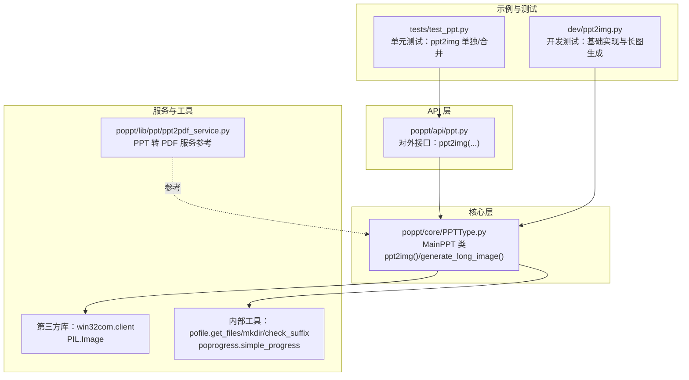
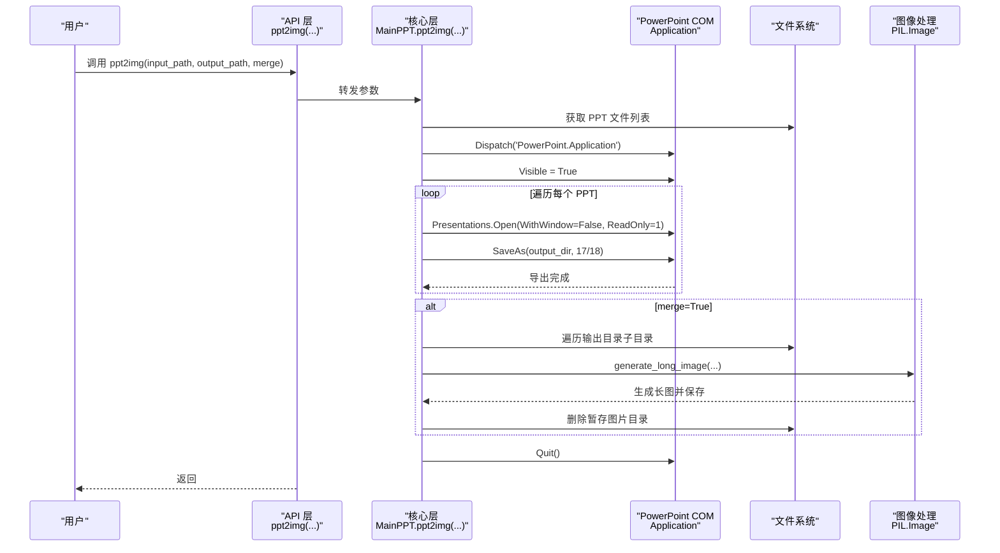
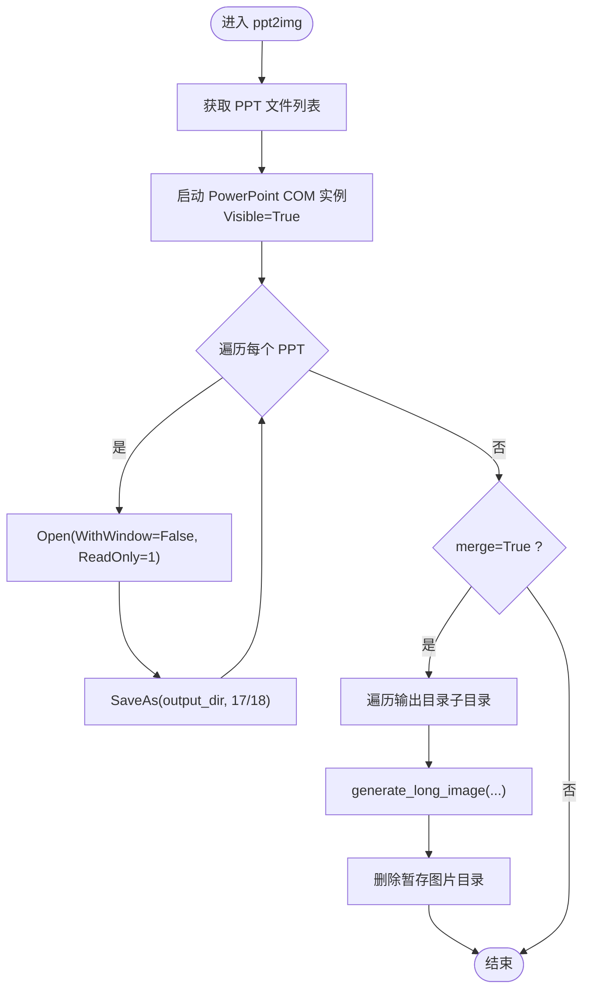
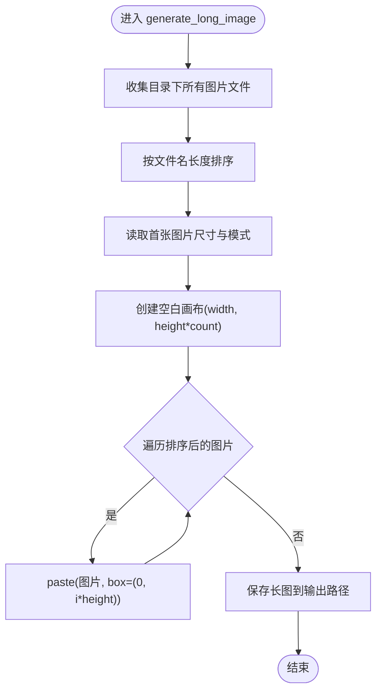
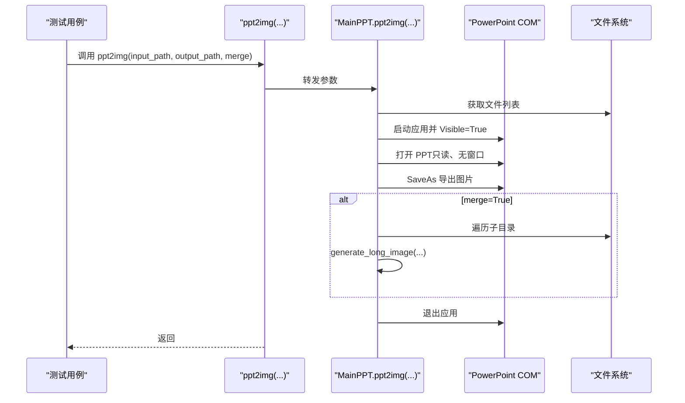
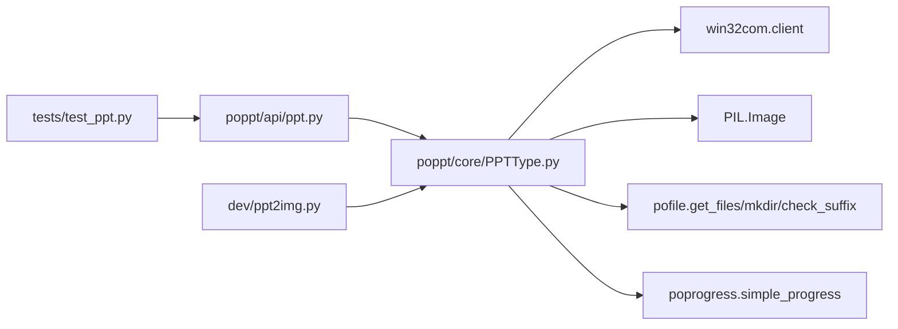

# PPT转图片实现原理

<cite>
**本文引用的文件**
- [poppt/core/PPTType.py](file://poppt/core/PPTType.py)
- [poppt/api/ppt.py](file://poppt/api/ppt.py)
- [tests/test_ppt.py](file://tests/test_ppt.py)
- [dev/ppt2img.py](file://dev/ppt2img.py)
- [poppt/lib/ppt/ppt2pdf_service.py](file://poppt/lib/ppt/ppt2pdf_service.py)
- [README.md](file://README.md)
</cite>

## 目录
1. [引言](#引言)
2. [项目结构](#项目结构)
3. [核心组件](#核心组件)
4. [架构总览](#架构总览)
5. [详细组件分析](#详细组件分析)
6. [依赖关系分析](#依赖关系分析)
7. [性能考量](#性能考量)
8. [故障排查指南](#故障排查指南)
9. [结论](#结论)
10. [附录](#附录)

## 引言
本技术文档围绕 MainPPT 类的 ppt2img 方法展开，系统阐述其如何处理输入路径、启动 PowerPoint COM 实例（Visible=True）、遍历 PPT 文件、为每个 PPT 创建独立输出子目录、以只读无窗口模式打开 PPT 并导出为图片，以及在 merge=True 时生成长图的完整流程。同时，文档将深入解析 generate_long_image 的图片排序逻辑及其局限性，并给出优化建议。最后，提供处理流程图与关键代码片段路径，帮助读者快速定位实现细节。

## 项目结构
该项目采用分层设计：
- API 层：对外暴露统一接口，负责参数校验与调用核心类。
- 核心层：MainPPT 类封装具体业务逻辑，包括 PPT 转图片、合并长图等。
- 工具与服务：依赖第三方库（win32com、PIL）与内部工具包（pofile、poprogress）。
- 示例与测试：提供演示脚本与单元测试，验证功能正确性。

图表来源
- [poppt/api/ppt.py](file://poppt/api/ppt.py#L1-L66)
- [poppt/core/PPTType.py](file://poppt/core/PPTType.py#L1-L204)
- [poppt/lib/ppt/ppt2pdf_service.py](file://poppt/lib/ppt/ppt2pdf_service.py#L1-L42)
- [tests/test_ppt.py](file://tests/test_ppt.py#L1-L98)
- [dev/ppt2img.py](file://dev/ppt2img.py#L1-L149)

章节来源
- [README.md](file://README.md#L1-L94)
- [poppt/api/ppt.py](file://poppt/api/ppt.py#L1-L66)
- [poppt/core/PPTType.py](file://poppt/core/PPTType.py#L1-L204)

## 核心组件
- MainPPT 类：封装 PPT 转图片、合并长图等能力；维护 PowerPoint 应用实例、默认图片类型、后缀过滤等配置。
- API 层 ppt2img 函数：面向用户的入口，负责接收输入路径、输出路径与 merge 参数，并委托 MainPPT 执行。
- generate_long_image 方法：在 merge=True 时，对单个 PPT 的图片序列进行排序、拼接并生成长图。

章节来源
- [poppt/core/PPTType.py](file://poppt/core/PPTType.py#L1-L204)
- [poppt/api/ppt.py](file://poppt/api/ppt.py#L1-L66)

## 架构总览
下图展示了从用户调用到最终生成长图的整体流程，包括 COM 实例管理、文件遍历、只读打开、SaveAs 导出、长图生成与清理等环节。

图表来源
- [poppt/api/ppt.py](file://poppt/api/ppt.py#L34-L51)
- [poppt/core/PPTType.py](file://poppt/core/PPTType.py#L114-L167)
- [poppt/core/PPTType.py](file://poppt/core/PPTType.py#L168-L204)

## 详细组件分析

### MainPPT.ppt2img 方法实现机制
- 输入路径处理：通过工具函数获取输入路径下的所有 PPT 文件（支持单文件或文件夹）。
- COM 实例启动：使用 win32com.client.Dispatch 启动 PowerPoint 应用，并设置 Visible=True。
- 遍历与导出：
  - 为每个 PPT 文件创建独立输出子目录（以 PPT 文件名作为子目录名）。
  - 使用 Presentations.Open(WithWindow=False, ReadOnly=1) 以只读、无窗口模式打开 PPT。
  - 调用 SaveAs(output_dir, 17/18) 导出为图片（17=JPG，18=PNG）。
- 长图生成（merge=True）：
  - 遍历输出目录下的所有子目录，逐个生成长图。
  - 调用 generate_long_image，传入当前 PPT 名称、输出路径与目标图片名。
  - 生成完成后删除暂存的图片目录，避免冗余。

图表来源
- [poppt/core/PPTType.py](file://poppt/core/PPTType.py#L114-L167)
- [poppt/core/PPTType.py](file://poppt/core/PPTType.py#L168-L204)

章节来源
- [poppt/core/PPTType.py](file://poppt/core/PPTType.py#L114-L167)
- [poppt/core/PPTType.py](file://poppt/core/PPTType.py#L168-L204)

### generate_long_image 方法与长图生成流程
- 图片收集：列出指定目录下的所有图片文件，形成 img_list。
- 排序策略：按文件名长度升序排序（ims_sort = sorted(img_list, key=lambda x: len(x))）。
- 尺寸与模式：读取首张图片的尺寸(width,height)与色彩模式(mode)，创建高度为单张高度乘以图片总数的空白画布。
- 拼接粘贴：从上至下依次将每张图片粘贴到画布对应位置。
- 保存输出：将生成的长图保存到指定输出路径，文件名由当前 PPT 名称与默认扩展名组成。

图表来源
- [poppt/core/PPTType.py](file://poppt/core/PPTType.py#L168-L204)

章节来源
- [poppt/core/PPTType.py](file://poppt/core/PPTType.py#L168-L204)

### API 层与调用链
- API 层的 ppt2img 函数负责参数透传，内部直接调用 MainPPT.ppt2img。
- 测试用例中分别演示了 merge=False（独立图片）与 merge=True（长图）两种场景。

图表来源
- [poppt/api/ppt.py](file://poppt/api/ppt.py#L34-L51)
- [tests/test_ppt.py](file://tests/test_ppt.py#L44-L63)
- [poppt/core/PPTType.py](file://poppt/core/PPTType.py#L114-L167)

章节来源
- [poppt/api/ppt.py](file://poppt/api/ppt.py#L34-L51)
- [tests/test_ppt.py](file://tests/test_ppt.py#L44-L63)

### 开发测试参考：dev/ppt2img.py
- 提供了基础的 PPT 转图片与长图生成思路，包含：
  - 启动 PowerPoint 应用并 Visible=1。
  - 使用 SaveAs 导出为 JPG。
  - generate_long_image 的实现（按文件名长度排序、读取首图尺寸与模式、创建画布并粘贴）。
- 该文件可作为理解早期实现与长图生成逻辑的参考材料。

章节来源
- [dev/ppt2img.py](file://dev/ppt2img.py#L57-L149)

### 参考实现：PPT 转 PDF 服务
- 虽非本功能直接实现，但展示了 COM 调用与 SaveAs 的通用模式，有助于理解 PPT 导出的底层机制。

章节来源
- [poppt/lib/ppt/ppt2pdf_service.py](file://poppt/lib/ppt/ppt2pdf_service.py#L15-L42)

## 依赖关系分析
- 外部依赖：pywin32（win32com.client）、pillow（PIL.Image）、pofile（get_files/mkdir/check_suffix）、poprogress（simple_progress）。
- 内部依赖：API 层依赖核心层 MainPPT；核心层依赖 COM 与 PIL；测试依赖 API 层。

图表来源
- [poppt/api/ppt.py](file://poppt/api/ppt.py#L1-L66)
- [poppt/core/PPTType.py](file://poppt/core/PPTType.py#L1-L204)
- [tests/test_ppt.py](file://tests/test_ppt.py#L1-L98)
- [dev/ppt2img.py](file://dev/ppt2img.py#L1-L149)

章节来源
- [poppt/api/ppt.py](file://poppt/api/ppt.py#L1-L66)
- [poppt/core/PPTType.py](file://poppt/core/PPTType.py#L1-L204)
- [tests/test_ppt.py](file://tests/test_ppt.py#L1-L98)
- [dev/ppt2img.py](file://dev/ppt2img.py#L1-L149)

## 性能考量
- COM 实例生命周期：每次导出均创建/销毁 PowerPoint 应用，频繁启动/退出可能带来额外开销。若批量处理大量 PPT，可考虑复用应用实例或分批处理。
- 只读无窗口打开：通过 WithWindow=False、ReadOnly=1 降低 UI 干扰与内存占用，提升稳定性。
- 图像拼接：长图生成涉及多次文件读取与像素粘贴，图片数量较多时耗时显著。建议在生成前对图片质量与分辨率做预处理，减少后续 I/O 与内存压力。
- 排序成本：按文件名长度排序的时间复杂度为 O(n log n)，通常可接受；若图片数量巨大，可评估更高效的排序策略（如按文件名自然序）。

## 故障排查指南
- PowerPoint 未安装或 COM 组件不可用
  - 现象：启动 COM 失败或报错。
  - 处理：确保已安装 Microsoft PowerPoint，并正确安装 pywin32。
- 权限不足或文件被占用
  - 现象：Open/SaveAs 失败。
  - 处理：确认目标文件未被其他进程占用，以只读模式打开。
- 输出路径不存在或权限不足
  - 现象：mkdir 失败或保存失败。
  - 处理：检查输出路径权限与磁盘空间。
- 长图生成异常
  - 现象：尺寸不一致导致拼接错位。
  - 处理：确保所有幻灯片导出为相同分辨率与模式；检查排序逻辑是否符合预期。
- merge=False 时未生成长图
  - 现象：仅生成独立图片。
  - 处理：确认调用时 merge=True。

章节来源
- [poppt/core/PPTType.py](file://poppt/core/PPTType.py#L114-L167)
- [poppt/core/PPTType.py](file://poppt/core/PPTType.py#L168-L204)

## 结论
MainPPT.ppt2img 方法通过 COM 与 SaveAs 实现 PPT 到图片的稳定导出，并在 merge=True 时自动聚合为长图。其设计遵循“先导出、后拼接”的清晰流程，具备良好的可扩展性。针对长图排序逻辑的局限性，建议引入更稳健的排序策略以提升鲁棒性与可预测性。

## 附录

### 关键代码片段路径
- API 层入口：[poppt/api/ppt.py](file://poppt/api/ppt.py#L34-L51)
- 主流程实现：[poppt/core/PPTType.py](file://poppt/core/PPTType.py#L114-L167)
- 长图生成实现：[poppt/core/PPTType.py](file://poppt/core/PPTType.py#L168-L204)
- 开发测试参考：[dev/ppt2img.py](file://dev/ppt2img.py#L57-L149)
- PPT 转 PDF 参考：[poppt/lib/ppt/ppt2pdf_service.py](file://poppt/lib/ppt/ppt2pdf_service.py#L15-L42)
- 单元测试用例：[tests/test_ppt.py](file://tests/test_ppt.py#L44-L63)

### 图片排序逻辑的局限性与改进建议
- 局限性
  - 当前按文件名长度排序，可能导致页面顺序与 PPT 幻灯片顺序不一致，尤其在文件名长度相近时。
  - 不同导出工具或系统行为可能影响文件名生成，进一步放大偏差风险。
- 改进建议
  - 按文件名自然序（如按数字编号排序）替代长度排序，确保与幻灯片顺序一致。
  - 若无法保证文件名编号，可在导出时强制命名规则（如固定前缀+序号），并在生成长图前进行规范化处理。
  - 增加可选参数控制排序策略，允许用户自定义排序键（如按文件创建时间、修改时间）。

章节来源
- [poppt/core/PPTType.py](file://poppt/core/PPTType.py#L168-L204)