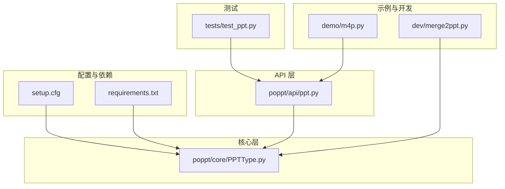
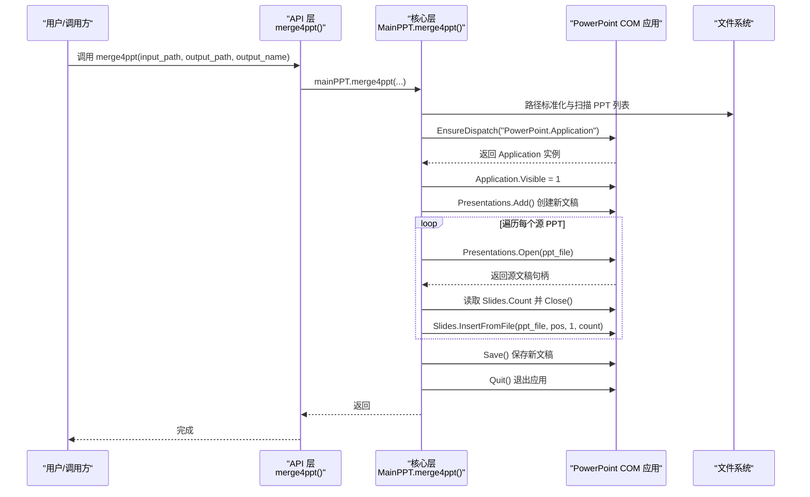
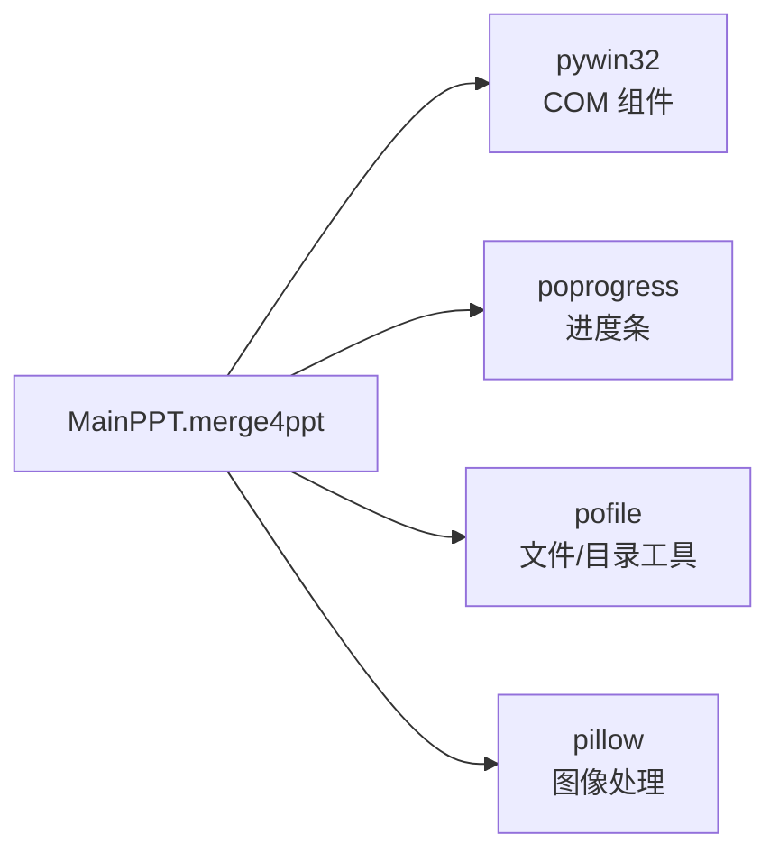

# 合并PPT实现原理

<cite>
**本文引用的文件**
- [poppt/api/ppt.py](file://poppt/api/ppt.py)
- [poppt/core/PPTType.py](file://poppt/core/PPTType.py)
- [demo/m4p.py](file://demo/m4p.py)
- [dev/merge2ppt.py](file://dev/merge2ppt.py)
- [tests/test_ppt.py](file://tests/test_ppt.py)
- [setup.cfg](file://setup.cfg)
- [requirements.txt](file://requirements.txt)
</cite>

## 目录
1. [引言](#引言)
2. [项目结构](#项目结构)
3. [核心组件](#核心组件)
4. [架构总览](#架构总览)
5. [详细组件分析](#详细组件分析)
6. [依赖分析](#依赖分析)
7. [性能考虑](#性能考虑)
8. [故障排查指南](#故障排查指南)
9. [结论](#结论)

## 引言
本技术文档围绕 poppt 项目中的“合并PPT”能力展开，重点解析 MainPPT 类中 merge4ppt 方法的实现细节与工作流。文档将说明该方法如何接收输入文件夹路径、转换为绝对路径、扫描 PPT 文件列表、创建 PowerPoint 应用实例、构建目标演示文稿、逐个源 PPT 插入幻灯片、最终保存并退出应用。同时，文档将解释 InsertFromFile 方法的参数语义、保持原始顺序与格式的原理、以及在处理大型 PPT 时的性能与资源管理注意事项。

## 项目结构
该项目采用分层组织方式：
- API 层：对外暴露统一接口，封装调用 MainPPT 的具体实现。
- 核心层：包含 MainPPT 主类，集中实现 PPT 转 PDF、PPT 转图片、合并 PPT 等核心逻辑。
- 示例与开发脚本：提供演示与开发阶段的示例代码。
- 测试：包含针对各功能的单元测试，覆盖合并 PPT 的测试场景。
- 配置与依赖：setup.cfg 与 requirements.txt 提供包元数据与运行依赖。

图表来源
- [poppt/api/ppt.py](file://poppt/api/ppt.py#L1-L66)
- [poppt/core/PPTType.py](file://poppt/core/PPTType.py#L1-L204)
- [demo/m4p.py](file://demo/m4p.py#L1-L16)
- [dev/merge2ppt.py](file://dev/merge2ppt.py#L1-L78)
- [tests/test_ppt.py](file://tests/test_ppt.py#L1-L98)
- [setup.cfg](file://setup.cfg#L1-L31)
- [requirements.txt](file://requirements.txt#L1-L5)

章节来源
- [poppt/api/ppt.py](file://poppt/api/ppt.py#L1-L66)
- [poppt/core/PPTType.py](file://poppt/core/PPTType.py#L1-L204)
- [demo/m4p.py](file://demo/m4p.py#L1-L16)
- [dev/merge2ppt.py](file://dev/merge2ppt.py#L1-L78)
- [tests/test_ppt.py](file://tests/test_ppt.py#L1-L98)
- [setup.cfg](file://setup.cfg#L1-L31)
- [requirements.txt](file://requirements.txt#L1-L5)

## 核心组件
- MainPPT 类：封装 PPT 相关操作，其中 merge4ppt 方法负责合并多个 PPT 文件。
- API 层接口：对外提供 merge4ppt 函数，内部委托 MainPPT 实例执行。
- 示例与开发脚本：演示如何调用合并接口；开发脚本展示了早期实现思路。
- 测试：验证合并流程与输出结果。

章节来源
- [poppt/core/PPTType.py](file://poppt/core/PPTType.py#L67-L113)
- [poppt/api/ppt.py](file://poppt/api/ppt.py#L53-L66)
- [demo/m4p.py](file://demo/m4p.py#L1-L16)
- [dev/merge2ppt.py](file://dev/merge2ppt.py#L21-L65)
- [tests/test_ppt.py](file://tests/test_ppt.py#L64-L93)

## 架构总览
下图展示从 API 调用到核心实现的端到端流程，包括路径处理、COM 组件交互、文件插入与保存退出。

图表来源
- [poppt/api/ppt.py](file://poppt/api/ppt.py#L53-L66)
- [poppt/core/PPTType.py](file://poppt/core/PPTType.py#L67-L113)
- [dev/merge2ppt.py](file://dev/merge2ppt.py#L34-L65)

## 详细组件分析

### MainPPT.merge4ppt 方法实现细节
- 输入参数与职责
  - input_path：包含多个 PPT 文件的文件夹路径
  - output_path：合并后 PPT 文件的输出路径
  - output_name：合并后 PPT 文件的名称
- 路径处理
  - 将相对路径转换为绝对路径，确保后续文件扫描与保存路径稳定可靠。
  - 使用文件扫描工具获取文件夹下所有 PPT 文件列表。
- PowerPoint 应用实例
  - 通过 gencache.EnsureDispatch 获取 PowerPoint 应用实例。
  - 设置 Visible=1，使 PowerPoint 可见，便于观察合并过程。
  - 创建一个新的空白演示文稿作为目标容器。
- 合并流程
  - 遍历每个源 PPT 文件：
    - 使用 Presentations.Open 打开文件，读取 Slides.Count 获取幻灯片总数，随后 Close。
    - 使用目标文稿的 Slides.InsertFromFile 将源文件的所有幻灯片插入到目标文稿末尾。
- 保存与退出
  - 保存新文稿至指定输出路径。
  - 退出 PowerPoint 应用程序，释放资源。

章节来源
- [poppt/core/PPTType.py](file://poppt/core/PPTType.py#L67-L113)

#### 参数与行为说明：InsertFromFile
- 方法签名要点（基于实际调用）：InsertFromFile(ppt_file, position, start_page, page_count)
- 参数语义
  - ppt_file：源 PPT 文件路径
  - position：插入位置（此处传入目标文稿的 Slides.Count，即末尾）
  - start_page：起始页（此处传入 1，表示从第一页开始）
  - page_count：页数（此处传入 Slides.Count，表示全部插入）
- 作用
  - 将源 PPT 的指定范围（从第 1 页起，共 page_count 页）插入到目标文稿的指定位置（末尾）。

章节来源
- [poppt/core/PPTType.py](file://poppt/core/PPTType.py#L99-L109)

#### 顺序与格式保持原理
- 顺序保持
  - 由于每次插入均追加到目标文稿末尾（position=目标文稿 Slides.Count），且按源文件在列表中的出现顺序依次处理，因此合并后的顺序与输入文件夹中的文件顺序一致。
- 格式保持
  - InsertFromFile 以“插入幻灯片”的方式将源文稿内容复制到目标文稿，避免了另存为新格式可能带来的格式变化，从而尽可能保持原始格式。
- 注意事项
  - 若源 PPT 中包含外部链接或嵌入对象，插入后仍指向原资源路径，需确保目标环境可访问这些资源。

章节来源
- [poppt/core/PPTType.py](file://poppt/core/PPTType.py#L99-L109)

#### 错误处理与健壮性
- 当前实现未显式捕获异常，建议在生产环境中增加 try/except 包裹关键步骤（如 Open、InsertFromFile、Save、Quit），并在异常发生时记录日志并保证应用退出。
- 对于空文件夹或无 PPT 文件的情况，循环不会执行，最终保存一个空文稿；可根据业务需求增加空输入校验与提示。

章节来源
- [poppt/core/PPTType.py](file://poppt/core/PPTType.py#L67-L113)

### API 层与调用链
- API 层的 merge4ppt 函数将调用委托给 MainPPT 实例，简化了外部调用复杂度。
- 示例脚本演示了如何直接调用 API 层函数，便于快速验证功能。

章节来源
- [poppt/api/ppt.py](file://poppt/api/ppt.py#L53-L66)
- [demo/m4p.py](file://demo/m4p.py#L1-L16)

### 开发脚本对比
- 开发脚本 dev/merge2ppt.py 展示了早期实现思路，与核心实现基本一致，但更侧重于演示与调试。
- 两者共同验证了路径处理、COM 交互、插入与保存流程。

章节来源
- [dev/merge2ppt.py](file://dev/merge2ppt.py#L21-L65)

### 测试用例
- 单元测试通过复制多个 PPT 文件到临时目录，调用 merge4ppt 并断言输出结果，验证合并流程可用性。
- 测试还清理了临时目录，避免残留文件影响后续测试。

章节来源
- [tests/test_ppt.py](file://tests/test_ppt.py#L64-L93)

## 依赖分析
- 运行时依赖
  - pywin32：提供 Windows COM 组件支持，用于与 PowerPoint 交互。
  - poprogress：提供简单进度条工具，改善长任务的可观测性。
  - pofile：提供文件扫描、目录创建等辅助函数。
  - Pillow：图像处理库，用于图片相关功能（与合并 PPT 间接相关）。
- 包元数据
  - setup.cfg 定义了包名、版本、依赖与元信息，确保安装与分发一致性。

图表来源
- [setup.cfg](file://setup.cfg#L19-L31)
- [requirements.txt](file://requirements.txt#L1-L5)
- [poppt/core/PPTType.py](file://poppt/core/PPTType.py#L1-L20)

章节来源
- [setup.cfg](file://setup.cfg#L19-L31)
- [requirements.txt](file://requirements.txt#L1-L5)
- [poppt/core/PPTType.py](file://poppt/core/PPTType.py#L1-L20)

## 性能考虑
- 大型 PPT 的处理
  - 逐个打开源 PPT 并插入，对于超大文稿可能带来较长等待时间。建议：
    - 在批量处理前预估总页数与文件大小，给出进度提示。
    - 对于极大规模文稿，可考虑分批合并或优化插入策略（如减少不必要的打开/关闭）。
- 资源管理
  - 确保在异常情况下也能调用 Quit 退出应用，避免 PowerPoint 进程残留。
  - 插入完成后及时保存，避免长时间占用内存。
- 可见性与用户体验
  - Visible=1 有助于观察合并过程，但在后台批量处理时可考虑 Visible=0 以减少 UI 干扰。

[本节为通用指导，无需特定文件来源]

## 故障排查指南
- PowerPoint 未安装或 COM 组件不可用
  - 现象：EnsureDispatch 失败或报错。
  - 处理：确认已安装 PowerPoint，并确保 pywin32 正确安装与注册。
- 权限不足或路径错误
  - 现象：无法读取输入文件夹或保存输出文件。
  - 处理：检查路径是否为绝对路径、权限是否足够、输出目录是否存在并可写。
- 插入失败或格式异常
  - 现象：部分幻灯片丢失或格式错乱。
  - 处理：检查源 PPT 是否损坏、外部资源是否可达；尝试使用 Visible=0 的后台模式进行合并。
- 进程未退出导致资源泄漏
  - 现象：PowerPoint 进程常驻。
  - 处理：在异常分支中也调用 Quit，或使用上下文管理器包装应用生命周期。

章节来源
- [poppt/core/PPTType.py](file://poppt/core/PPTType.py#L91-L113)

## 结论
merge4ppt 方法通过标准的 COM 交互与 InsertFromFile 插入机制，实现了对多个 PPT 文件的顺序合并与格式保持。其核心流程清晰、易于扩展，适合在自动化办公场景中使用。建议在生产环境中增强异常处理与资源回收，并结合进度反馈提升用户体验。对于超大文稿，可进一步优化插入策略与并发控制，以平衡性能与稳定性。