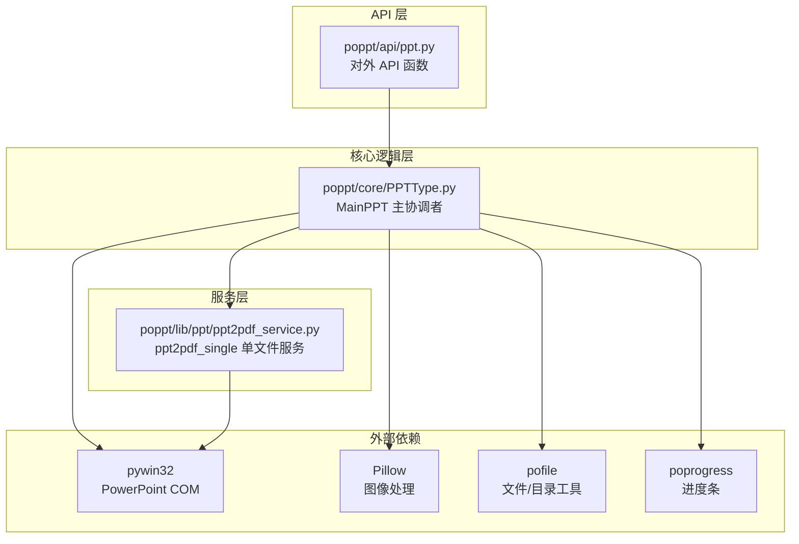
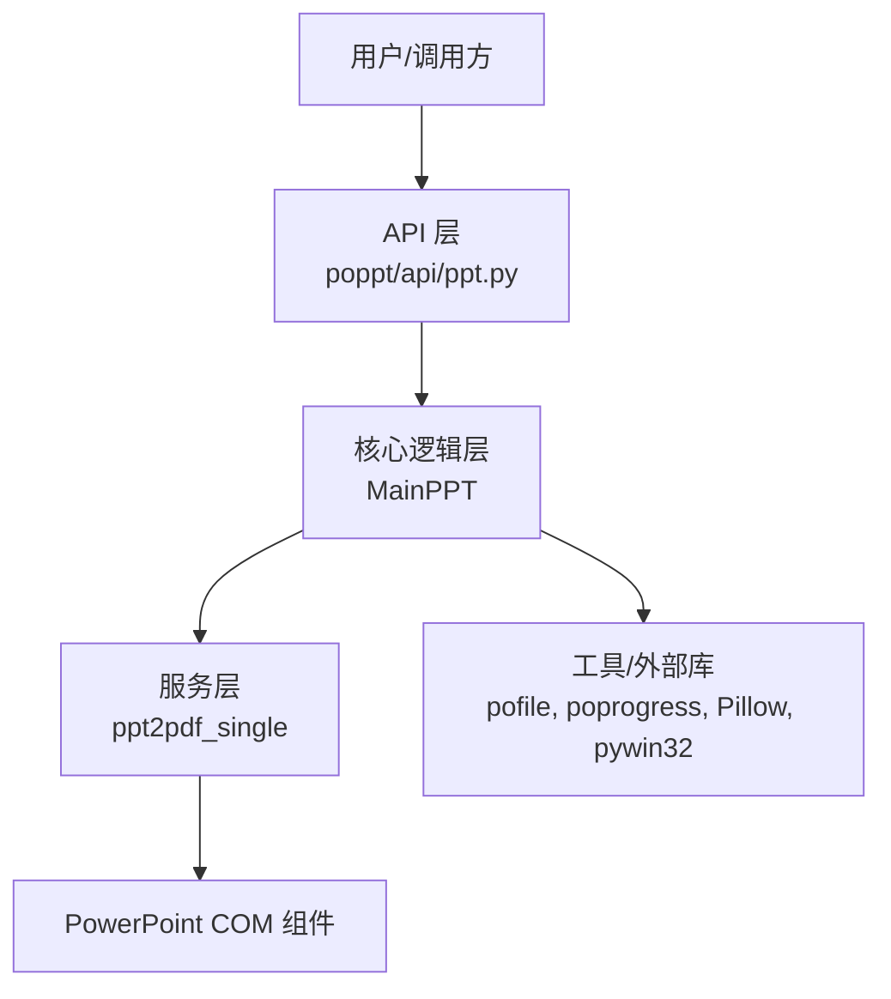
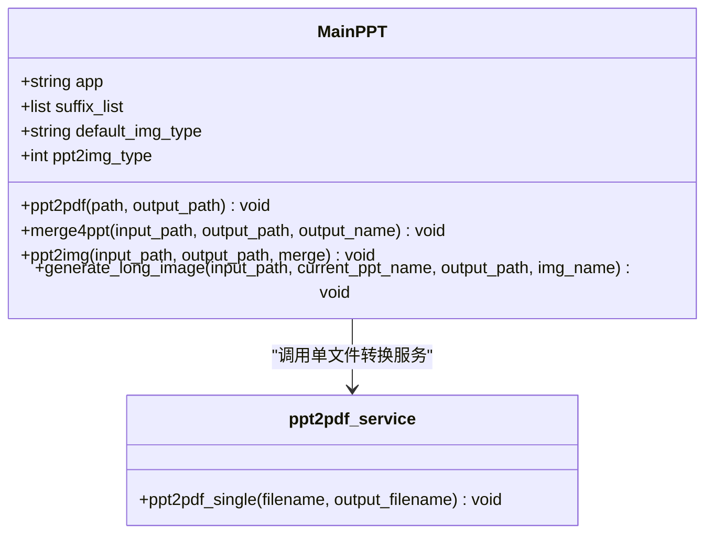
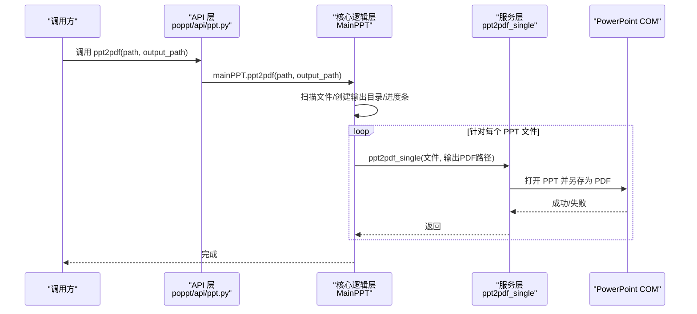
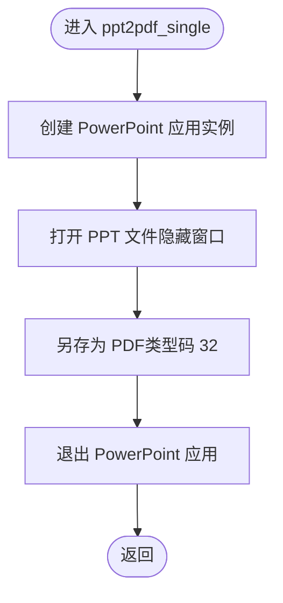
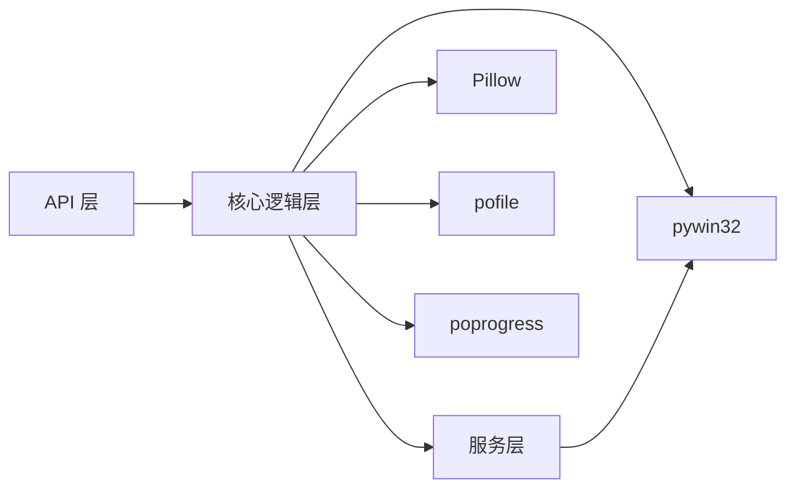

# 核心架构设计

<cite>
**本文引用的文件**
- [README.md](file://README.md)
- [requirements.txt](file://requirements.txt)
- [setup.py](file://setup.py)
- [poppt/__init__.py](file://poppt/__init__.py)
- [poppt/api/ppt.py](file://poppt/api/ppt.py)
- [poppt/core/PPTType.py](file://poppt/core/PPTType.py)
- [poppt/lib/ppt/ppt2pdf_service.py](file://poppt/lib/ppt/ppt2pdf_service.py)
- [tests/test_ppt.py](file://tests/test_ppt.py)
- [poppt/core/need_dev/2img.py](file://poppt/core/need_dev/2img.py)
- [dev/merge2ppt.py](file://dev/merge2ppt.py)
</cite>

## 目录
1. [引言](#引言)
2. [项目结构](#项目结构)
3. [核心组件](#核心组件)
4. [架构总览](#架构总览)
5. [详细组件分析](#详细组件分析)
6. [依赖分析](#依赖分析)
7. [性能考虑](#性能考虑)
8. [故障排查指南](#故障排查指南)
9. [结论](#结论)
10. [附录](#附录)

## 引言
本技术文档聚焦于 poppt 的核心架构设计，系统阐述其分层设计与组件交互关系。重点解析 MainPPT 类（位于 PPTType.py）作为核心协调者的职责，说明其如何封装复杂的 PPT 操作逻辑并提供简洁的门面接口；梳理 API 层、核心逻辑层与服务层之间的调用链路；并通过序列图展示从用户调用 ppt2pdf 到最终生成 PDF 文件的完整数据流；最后总结该分层架构带来的解耦、易测与可扩展优势，并给出贡献者在何处添加新功能的指导。

## 项目结构
该项目采用按“功能域+层次”混合组织的方式：
- API 层：对外暴露统一的函数接口，负责接收用户请求并委派给核心逻辑层。
- 核心逻辑层：以 MainPPT 为核心协调者，封装业务流程、文件扫描、目录管理、进度控制与与 COM 组件交互。
- 服务层：提供细粒度的服务函数，专注于单一职责（如单文件 PPT 转 PDF），便于复用与测试。
- 工具与外部依赖：通过第三方库实现文件扫描、目录创建、进度条、图像处理与 COM 组件交互。

图表来源
- [poppt/api/ppt.py](file://poppt/api/ppt.py#L1-L66)
- [poppt/core/PPTType.py](file://poppt/core/PPTType.py#L1-L204)
- [poppt/lib/ppt/ppt2pdf_service.py](file://poppt/lib/ppt/ppt2pdf_service.py#L1-L42)
- [requirements.txt](file://requirements.txt#L1-L5)

章节来源
- [README.md](file://README.md#L1-L94)
- [requirements.txt](file://requirements.txt#L1-L5)
- [poppt/__init__.py](file://poppt/__init__.py#L1-L3)

## 核心组件
- API 层（poppt/api/ppt.py）：提供三个对外函数，分别对应 PPT 转 PDF、PPT 转图片、合并 PPT。该层仅负责参数透传与实例化 MainPPT，不包含业务细节。
- 核心逻辑层（poppt/core/PPTType.py）：MainPPT 类承担以下职责
  - 文件扫描与过滤：基于后缀列表筛选 PPT/PPTX。
  - 目录管理：创建输出目录并返回绝对路径。
  - 进度控制：使用进度条工具对批量任务进行可视化反馈。
  - COM 交互：通过 pywin32 与 PowerPoint 进行交互，执行保存、另存为、插入等操作。
  - 图像拼接：将多页图片拼接为长图，并清理中间产物。
- 服务层（poppt/lib/ppt/ppt2pdf_service.py）：提供单文件 PPT 转 PDF 的最小可用服务，专注单一职责，便于测试与复用。

章节来源
- [poppt/api/ppt.py](file://poppt/api/ppt.py#L1-L66)
- [poppt/core/PPTType.py](file://poppt/core/PPTType.py#L1-L204)
- [poppt/lib/ppt/ppt2pdf_service.py](file://poppt/lib/ppt/ppt2pdf_service.py#L1-L42)

## 架构总览
该系统遵循“API 层 -> 核心逻辑层 -> 服务层”的分层设计，各层边界清晰、职责单一：
- API 层：薄门面，屏蔽内部实现细节，面向使用者提供简洁接口。
- 核心逻辑层：编排业务流程，协调工具与服务，处理通用逻辑（文件扫描、目录、进度、COM 生命周期）。
- 服务层：封装底层能力（COM 操作、图像处理），保证可测试性与可替换性。

图表来源
- [poppt/api/ppt.py](file://poppt/api/ppt.py#L1-L66)
- [poppt/core/PPTType.py](file://poppt/core/PPTType.py#L1-L204)
- [poppt/lib/ppt/ppt2pdf_service.py](file://poppt/lib/ppt/ppt2pdf_service.py#L1-L42)
- [requirements.txt](file://requirements.txt#L1-L5)

## 详细组件分析

### MainPPT 类（核心协调者）
MainPPT 作为核心协调者，承担以下关键职责：
- 配置与常量：定义 PowerPoint 应用标识、支持的文件后缀、默认图片格式与类型码。
- 批量转换（ppt2pdf）：扫描输入路径，创建输出目录，逐个调用服务层函数生成 PDF。
- 合并 PPT（merge4ppt）：通过 COM 创建新演示文稿，循环打开源文件并将幻灯片插入到末尾，最后保存并退出。
- PPT 转图片（ppt2img）：打开 PPT 并另存为图片，支持独立图片与长图合并；长图合并完成后清理中间目录。
- 长图生成（generate_long_image）：读取页面图片，按顺序拼接为纵向长图并保存。

图表来源
- [poppt/core/PPTType.py](file://poppt/core/PPTType.py#L1-L204)
- [poppt/lib/ppt/ppt2pdf_service.py](file://poppt/lib/ppt/ppt2pdf_service.py#L1-L42)

章节来源
- [poppt/core/PPTType.py](file://poppt/core/PPTType.py#L1-L204)

### API 层（poppt/api/ppt.py）
API 层仅做三件事：
- 导入核心类 MainPPT。
- 创建全局实例 mainPPT。
- 暴露三个函数：ppt2pdf、ppt2img、merge4ppt，均委托给 mainPPT 的对应方法。

图表来源
- [poppt/api/ppt.py](file://poppt/api/ppt.py#L1-L66)
- [poppt/core/PPTType.py](file://poppt/core/PPTType.py#L1-L204)
- [poppt/lib/ppt/ppt2pdf_service.py](file://poppt/lib/ppt/ppt2pdf_service.py#L1-L42)

章节来源
- [poppt/api/ppt.py](file://poppt/api/ppt.py#L1-L66)

### 服务层（ppt2pdf_single）
服务层函数负责单文件转换的核心动作：
- 通过 Dispatch 获取 PowerPoint 应用实例。
- 打开目标 PPT 文件（WithWindow=False）。
- 使用 SaveAs 导出 PDF（类型码 32）。
- 退出应用。

图表来源
- [poppt/lib/ppt/ppt2pdf_service.py](file://poppt/lib/ppt/ppt2pdf_service.py#L1-L42)

章节来源
- [poppt/lib/ppt/ppt2pdf_service.py](file://poppt/lib/ppt/ppt2pdf_service.py#L1-L42)

### 关键设计决策与权衡
- 服务层与核心逻辑分离：将单文件转换抽象为独立服务函数，使批量转换流程（核心逻辑）无需关心 COM 生命周期与具体保存类型，提升可测试性与可替换性。
- API 层薄门面：API 仅做参数透传与实例化，避免在接口层引入业务细节，便于未来扩展新接口而不影响现有实现。
- 工具与外部库解耦：通过 pofile、poprogress、Pillow、pywin32 等库分别承担文件/目录、进度、图像与 COM 交互，降低耦合度，便于替换与升级。

章节来源
- [poppt/core/PPTType.py](file://poppt/core/PPTType.py#L1-L204)
- [poppt/lib/ppt/ppt2pdf_service.py](file://poppt/lib/ppt/ppt2pdf_service.py#L1-L42)
- [requirements.txt](file://requirements.txt#L1-L5)

### 开发者贡献指南
- 新增功能建议添加到：
  - API 层：新增对外函数，保持薄门面风格，仅做参数校验与透传。
  - 核心逻辑层：新增业务编排方法，复用现有工具（文件扫描、目录创建、进度条）。
  - 服务层：新增细粒度服务函数，确保单一职责与可测试性。
- 测试策略：
  - 单元测试覆盖 API 函数与核心逻辑方法，验证参数传递与流程正确性。
  - 服务层函数建议通过集成测试验证 COM 交互与文件输出。
- 依赖管理：
  - 在 requirements.txt 中声明新依赖，避免硬编码在源码中。
  - 通过 setup.py 统一打包与发布。

章节来源
- [tests/test_ppt.py](file://tests/test_ppt.py#L1-L98)
- [requirements.txt](file://requirements.txt#L1-L5)
- [setup.py](file://setup.py#L1-L17)

## 依赖分析
- 内部依赖
  - API 层依赖核心逻辑层（MainPPT）。
  - 核心逻辑层依赖服务层（ppt2pdf_single）、工具库（pofile、poprogress）、图像库（Pillow）与 COM（pywin32）。
- 外部依赖
  - pywin32：与 PowerPoint 交互。
  - Pillow：图像拼接与保存。
  - pofile：文件扫描与目录创建。
  - poprogress：批量任务进度条。

图表来源
- [poppt/api/ppt.py](file://poppt/api/ppt.py#L1-L66)
- [poppt/core/PPTType.py](file://poppt/core/PPTType.py#L1-L204)
- [poppt/lib/ppt/ppt2pdf_service.py](file://poppt/lib/ppt/ppt2pdf_service.py#L1-L42)
- [requirements.txt](file://requirements.txt#L1-L5)

章节来源
- [requirements.txt](file://requirements.txt#L1-L5)

## 性能考虑
- 批量转换的 I/O 与 COM 调用成本较高，建议：
  - 控制并发：当前实现逐个文件处理，避免同时打开多个 PowerPoint 实例导致资源争用。
  - 进度反馈：利用进度条减少等待焦虑，同时便于监控耗时。
  - 中间产物清理：长图合并后及时删除中间图片目录，避免磁盘占用。
- 图像拼接复杂度：长图拼接为 O(n) 操作，n 为页面数；注意内存占用与磁盘 IO。
- COM 生命周期：每次转换后及时 Quit，避免进程残留与资源泄漏。

章节来源
- [poppt/core/PPTType.py](file://poppt/core/PPTType.py#L1-L204)
- [poppt/lib/ppt/ppt2pdf_service.py](file://poppt/lib/ppt/ppt2pdf_service.py#L1-L42)

## 故障排查指南
- PowerPoint 未安装或 COM 组件不可用
  - 现象：调用 COM 相关函数时报错。
  - 处理：确认 Windows 系统已安装 PowerPoint，并允许 COM 组件访问。
- 文件路径与权限
  - 现象：无法创建输出目录或保存 PDF。
  - 处理：检查路径权限与磁盘空间，确保输出目录可写。
- 合并 PPT 时页面丢失
  - 现象：合并后页面数量异常。
  - 处理：确认源文件路径正确，检查 InsertFromFile 的参数与页面计数。
- 长图生成失败
  - 现象：拼接后图片损坏或尺寸异常。
  - 处理：检查页面图片的尺寸与模式一致性，确保中间目录清理后仍可读取。

章节来源
- [poppt/core/PPTType.py](file://poppt/core/PPTType.py#L1-L204)
- [poppt/lib/ppt/ppt2pdf_service.py](file://poppt/lib/ppt/ppt2pdf_service.py#L1-L42)

## 结论
poppt 采用清晰的三层架构：API 层薄门面、核心逻辑层编排业务、服务层封装底层能力。该设计实现了良好的解耦、可测试性与可扩展性。MainPPT 作为核心协调者，将复杂流程封装为简洁接口，既降低了使用者的学习成本，也为后续功能扩展提供了稳定基座。建议在新增功能时遵循“API -> 核心 -> 服务”的分层原则，并通过测试保障质量。

## 附录
- 示例与演示
  - README 提供功能概览与演示入口，便于快速了解项目能力。
  - 测试用例覆盖主要场景，包括单文件转换、长图合并与多文件合并。
- 开发与贡献
  - 通过 PR 规范与贡献流程，鼓励社区协作与持续演进。

章节来源
- [README.md](file://README.md#L1-L94)
- [tests/test_ppt.py](file://tests/test_ppt.py#L1-L98)
- [poppt/core/need_dev/2img.py](file://poppt/core/need_dev/2img.py#L1-L105)
- [dev/merge2ppt.py](file://dev/merge2ppt.py#L1-L70)