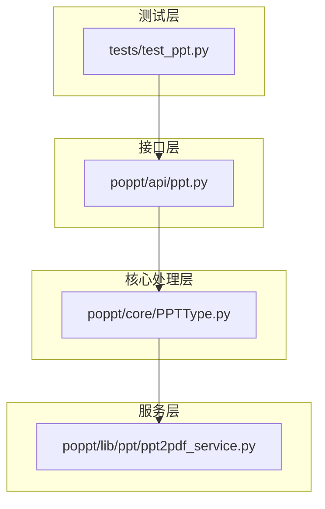
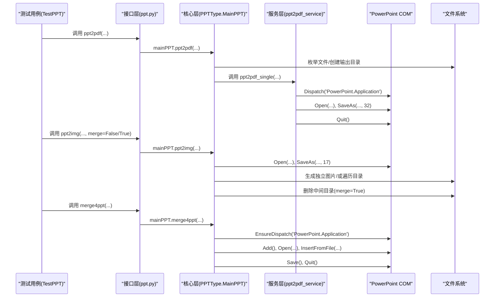
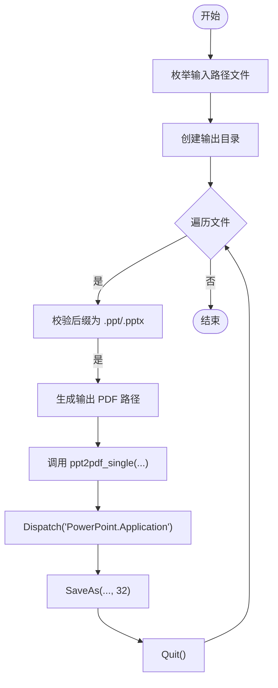
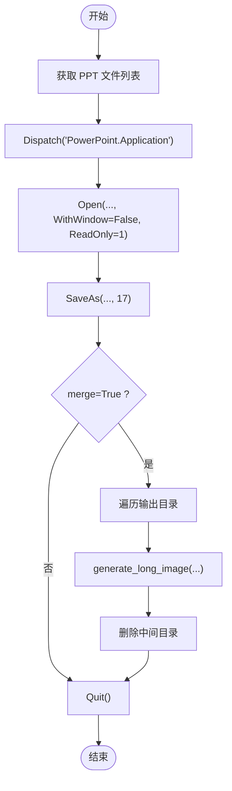
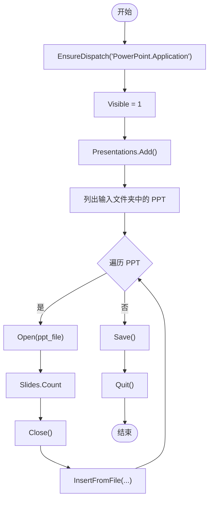
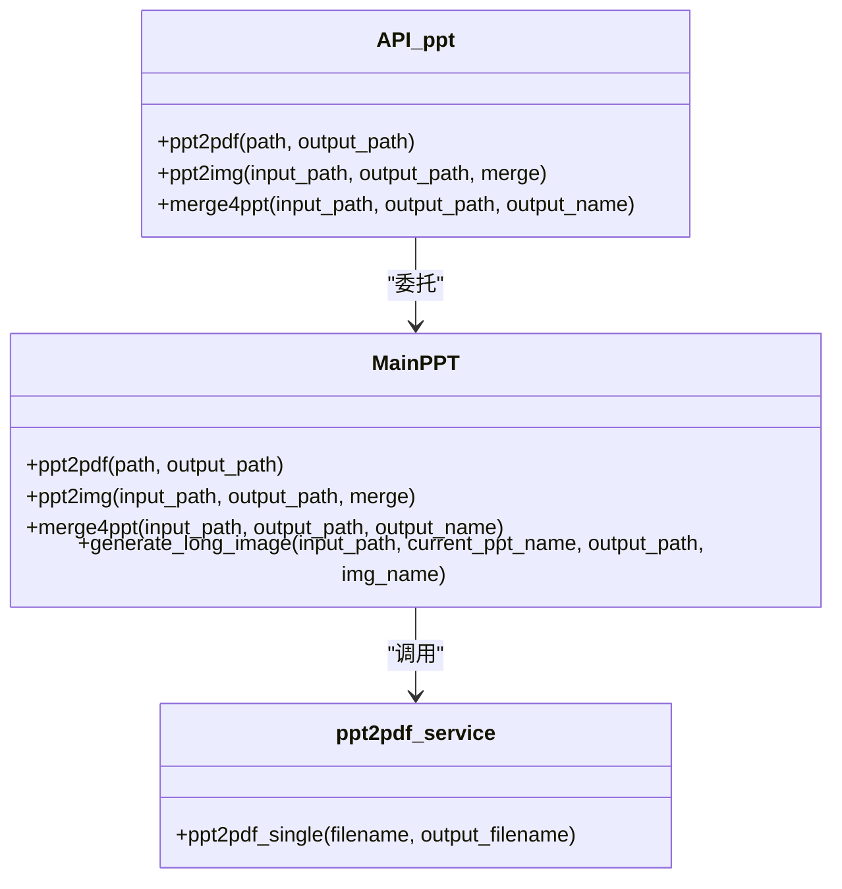
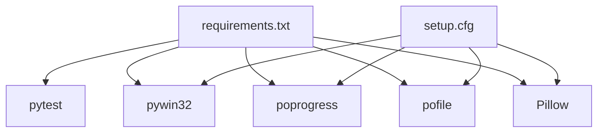

# 测试与验证

<cite>
**本文引用的文件**
- [tests/test_ppt.py](file://tests/test_ppt.py)
- [poppt/api/ppt.py](file://poppt/api/ppt.py)
- [poppt/core/PPTType.py](file://poppt/core/PPTType.py)
- [poppt/lib/ppt/ppt2pdf_service.py](file://poppt/lib/ppt/ppt2pdf_service.py)
- [requirements.txt](file://requirements.txt)
- [setup.cfg](file://setup.cfg)
- [README.md](file://README.md)
</cite>

## 目录
1. [引言](#引言)
2. [项目结构](#项目结构)
3. [核心组件](#核心组件)
4. [架构总览](#架构总览)
5. [详细组件分析](#详细组件分析)
6. [依赖关系分析](#依赖关系分析)
7. [性能考量](#性能考量)
8. [故障排查指南](#故障排查指南)
9. [结论](#结论)
10. [附录](#附录)

## 引言
本测试策略文档聚焦于 poppt 项目的质量保证流程，围绕单元测试用例 test_ppt.py 展开，系统阐述其如何验证以下核心能力：
- ppt2pdf：将 PPT/PPTX 转换为 PDF
- ppt2img：将 PPT 转换为图片，支持独立图片与合并为长图
- merge4ppt：将文件夹中多个 PPT 合并为一个 PPT

文档还提供测试覆盖率目标、断言方法、为新功能编写测试用例的指南（含文件系统与 PowerPoint COM 组件的模拟思路）、测试运行方式与命令行参数、测试驱动开发（TDD）的应用建议、贡献者测试最佳实践，以及测试结果分析与调试指引。

## 项目结构
该项目采用分层架构：
- 接口层：poppt/api/ppt.py 提供高层 API（ppt2pdf、ppt2img、merge4ppt），委托给核心处理类
- 核心处理层：poppt/core/PPTType.py 实现具体逻辑，调用外部组件（PowerPoint COM、PIL、文件工具）
- 服务层：poppt/lib/ppt/ppt2pdf_service.py 提供单 PPT 转 PDF 的底层服务
- 测试层：tests/test_ppt.py 包含针对上述三个功能的单元测试

图表来源
- [poppt/api/ppt.py](file://poppt/api/ppt.py#L1-L66)
- [poppt/core/PPTType.py](file://poppt/core/PPTType.py#L1-L204)
- [poppt/lib/ppt/ppt2pdf_service.py](file://poppt/lib/ppt/ppt2pdf_service.py#L1-L42)
- [tests/test_ppt.py](file://tests/test_ppt.py#L1-L98)

章节来源
- [tests/test_ppt.py](file://tests/test_ppt.py#L1-L98)
- [poppt/api/ppt.py](file://poppt/api/ppt.py#L1-L66)
- [poppt/core/PPTType.py](file://poppt/core/PPTType.py#L1-L204)
- [poppt/lib/ppt/ppt2pdf_service.py](file://poppt/lib/ppt/ppt2pdf_service.py#L1-L42)

## 核心组件
本节聚焦三个被测试的核心函数及其职责：
- ppt2pdf：批量将 PPT/PPTX 转 PDF，内部通过文件枚举、目录创建、逐个调用单 PPT 转 PDF 服务实现
- ppt2img：将 PPT 转图片，支持独立图片与合并为长图；合并时依赖 PIL 进行图像拼接
- merge4ppt：将文件夹中多个 PPT 合并为一个 PPT，使用 PowerPoint COM 组件进行插入与保存

章节来源
- [poppt/api/ppt.py](file://poppt/api/ppt.py#L18-L66)
- [poppt/core/PPTType.py](file://poppt/core/PPTType.py#L38-L113)
- [poppt/core/PPTType.py](file://poppt/core/PPTType.py#L114-L204)
- [poppt/lib/ppt/ppt2pdf_service.py](file://poppt/lib/ppt/ppt2pdf_service.py#L15-L42)

## 架构总览
下图展示测试用例与被测函数之间的调用关系与数据流：

图表来源
- [tests/test_ppt.py](file://tests/test_ppt.py#L34-L93)
- [poppt/api/ppt.py](file://poppt/api/ppt.py#L18-L66)
- [poppt/core/PPTType.py](file://poppt/core/PPTType.py#L38-L113)
- [poppt/core/PPTType.py](file://poppt/core/PPTType.py#L114-L204)
- [poppt/lib/ppt/ppt2pdf_service.py](file://poppt/lib/ppt/ppt2pdf_service.py#L15-L42)

## 详细组件分析

### 测试用例设计与覆盖范围
- 测试类 TestPPT 使用统一测试资源 ./ppt/test_ppt/晚枫-1211重庆.pptx
- setUpClass 中定义多个输出目录，分别用于 PDF、独立图片、长图与合并 PPT 的输出
- 单元测试覆盖：
  - test_ppt2pdf：验证单 PPT 转 PDF 的端到端流程
  - test_ppt2img_single：验证独立图片输出
  - test_ppt2img_merge：验证长图生成与中间目录清理
  - test_merge4ppt：验证多 PPT 合并，包含临时目录准备与清理

断言方法
- 当前测试未显式使用断言（assert）语句，但通过打印日志与文件系统检查间接验证功能可用性
- 建议补充断言：校验输出文件存在性、数量、扩展名、内容完整性（如 PDF 可打开、图片尺寸合理、合并后幻灯片数量）

章节来源
- [tests/test_ppt.py](file://tests/test_ppt.py#L12-L93)

### ppt2pdf 测试流程
- 输入：单个 PPT 文件路径
- 输出：对应 PDF 文件
- 关键步骤：文件枚举、输出目录创建、逐个调用单 PPT 转 PDF 服务、PowerPoint 保存为 PDF

图表来源
- [poppt/core/PPTType.py](file://poppt/core/PPTType.py#L38-L66)
- [poppt/lib/ppt/ppt2pdf_service.py](file://poppt/lib/ppt/ppt2pdf_service.py#L15-L42)

章节来源
- [tests/test_ppt.py](file://tests/test_ppt.py#L34-L43)
- [poppt/core/PPTType.py](file://poppt/core/PPTType.py#L38-L66)
- [poppt/lib/ppt/ppt2pdf_service.py](file://poppt/lib/ppt/ppt2pdf_service.py#L15-L42)

### ppt2img 测试流程
- 输入：单个 PPT 或文件夹
- 输出：独立图片或长图
- 关键步骤：启动 PowerPoint、打开 PPT、另存为图片、可选长图拼接与中间目录清理

图表来源
- [poppt/core/PPTType.py](file://poppt/core/PPTType.py#L114-L167)
- [poppt/core/PPTType.py](file://poppt/core/PPTType.py#L168-L204)

章节来源
- [tests/test_ppt.py](file://tests/test_ppt.py#L44-L63)
- [poppt/core/PPTType.py](file://poppt/core/PPTType.py#L114-L167)
- [poppt/core/PPTType.py](file://poppt/core/PPTType.py#L168-L204)

### merge4ppt 测试流程
- 输入：包含多个 PPT 的文件夹
- 输出：合并后的单个 PPT
- 关键步骤：EnsureDispatch 应用程序、Add 新 PPT、逐个 Open 并 InsertFromFile、保存与退出

图表来源
- [poppt/core/PPTType.py](file://poppt/core/PPTType.py#L67-L113)

章节来源
- [tests/test_ppt.py](file://tests/test_ppt.py#L64-L93)
- [poppt/core/PPTType.py](file://poppt/core/PPTType.py#L67-L113)

### 类关系与依赖

图表来源
- [poppt/api/ppt.py](file://poppt/api/ppt.py#L18-L66)
- [poppt/core/PPTType.py](file://poppt/core/PPTType.py#L38-L204)
- [poppt/lib/ppt/ppt2pdf_service.py](file://poppt/lib/ppt/ppt2pdf_service.py#L15-L42)

## 依赖关系分析
- 测试依赖
  - pytest：测试框架
  - pywin32：PowerPoint COM 组件交互
  - poprogress：进度条工具
  - pofile：文件枚举与目录管理
  - Pillow：图像处理（长图拼接）
- 安装与运行
  - requirements.txt 明确列出测试所需依赖
  - setup.cfg 指定安装依赖（与 requirements 一致）

图表来源
- [requirements.txt](file://requirements.txt#L1-L5)
- [setup.cfg](file://setup.cfg#L19-L29)

章节来源
- [requirements.txt](file://requirements.txt#L1-L5)
- [setup.cfg](file://setup.cfg#L19-L29)

## 性能考量
- PowerPoint COM 调用开销较大，建议：
  - 在 CI 环境中尽量减少并发 COM 操作
  - 对于大量文件的转换，优先使用批处理与进度条工具提升可观测性
  - 长图拼接涉及多次图像读取与写入，建议控制输入图片数量与分辨率
- 文件系统操作：
  - 合并前确保输入目录结构清晰，避免重复文件导致的额外 IO
  - 合并后及时清理中间目录，防止磁盘占用

## 故障排查指南
常见问题与定位建议：
- PowerPoint 未安装或 COM 组件不可用
  - 现象：COM 调用失败或异常
  - 排查：确认 Windows 系统已安装 PowerPoint，且 pywin32 正确安装
- 权限不足导致无法创建输出目录或保存文件
  - 现象：目录创建失败或保存异常
  - 排查：以管理员权限运行测试，检查输出路径权限
- 合并后 PPT 内容为空或顺序错误
  - 现象：合并后幻灯片数量异常
  - 排查：检查输入目录中仅包含 .ppt/.pptx 文件；确认 InsertFromFile 参数与页数计算
- 长图生成失败
  - 现象：长图保存失败或尺寸异常
  - 排查：确认中间图片目录存在且均为有效图片；检查 PIL 模式与尺寸一致性

章节来源
- [poppt/core/PPTType.py](file://poppt/core/PPTType.py#L38-L113)
- [poppt/core/PPTType.py](file://poppt/core/PPTType.py#L114-L204)
- [poppt/lib/ppt/ppt2pdf_service.py](file://poppt/lib/ppt/ppt2pdf_service.py#L15-L42)

## 结论
当前测试用例围绕三个核心功能提供了端到端验证，但缺少显式断言。建议在保持现有流程不变的前提下，补充断言与覆盖率目标，同时为新功能编写可模拟 COM 与文件系统的测试用例，以提升稳定性与可维护性。

## 附录

### 测试覆盖率目标与断言建议
- 覆盖率目标
  - 代码行覆盖率：≥80%
  - 分支覆盖率：≥70%
  - 关键路径（COM 调用、文件系统操作、图像处理）100% 覆盖
- 断言建议
  - 输出文件存在性与数量断言
  - 输出扩展名与内容合法性断言（如 PDF 可打开、图片尺寸非空）
  - 合并后幻灯片数量与顺序断言
  - 异常场景断言（无效路径、空目录、非 PPT 文件）

### 新功能测试用例编写指南
- 模拟文件系统
  - 使用临时目录与文件占位符，避免真实磁盘 IO
  - 使用路径工具（如 pathlib）构造输入/输出路径
- 模拟 PowerPoint COM 组件
  - 使用第三方库（如 comtypes 或 pywin32 的模拟接口）进行行为注入
  - 对关键调用点（Open、SaveAs、InsertFromFile）进行桩函数替换
- 测试组织
  - 为每个新功能创建独立测试类或模块
  - 使用参数化测试覆盖多种输入组合（单文件/多文件、不同后缀、不同分辨率）

### 运行测试套件
- 安装依赖
  - 使用 requirements.txt 或 setup.cfg 中的依赖项
- 运行命令
  - 基本运行：pytest tests/
  - 详细输出：pytest tests/ -v
  - 仅运行特定测试：pytest tests/test_ppt.py::TestPPT::test_ppt2pdf -v
  - 并发与并发安全：谨慎使用并发，避免 COM 组件冲突
- 命令行参数建议
  - -v：提高可读性
  - --tb=short：缩短回溯信息
  - -k：按关键字过滤测试
  - --maxfail=N：限制失败次数

章节来源
- [requirements.txt](file://requirements.txt#L1-L5)
- [setup.cfg](file://setup.cfg#L19-L29)
- [README.md](file://README.md#L1-L94)

### 测试驱动开发（TDD）在本项目的应用
- 建议流程
  - 编写最小可运行测试（如验证函数签名与基本行为）
  - 实现最小可行代码（满足测试）
  - 重构与补充断言，逐步完善边界条件与异常处理
- 适用场景
  - 新增 API 或改进既有 API 的行为
  - 优化 COM 调用与文件系统交互的健壮性
  - 引入新的图像处理逻辑（如不同图片格式支持）

### 贡献者测试最佳实践
- 提交前自测
  - 在本地运行 pytest tests/，确保所有测试通过
  - 针对新增/修改的功能补充测试用例
- 代码审查要点
  - 测试用例是否覆盖正常与异常路径
  - 是否包含断言与可验证的输出
  - 是否考虑了 COM 与文件系统的行为差异
- 持续集成
  - 在 CI 中运行 pytest，报告覆盖率与失败详情
  - 对关键平台（Windows + PowerPoint）进行专门测试