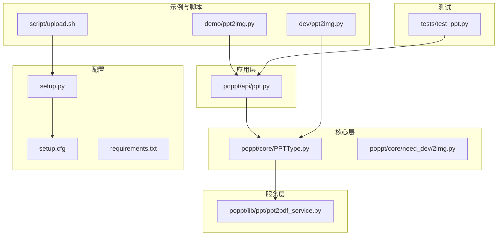
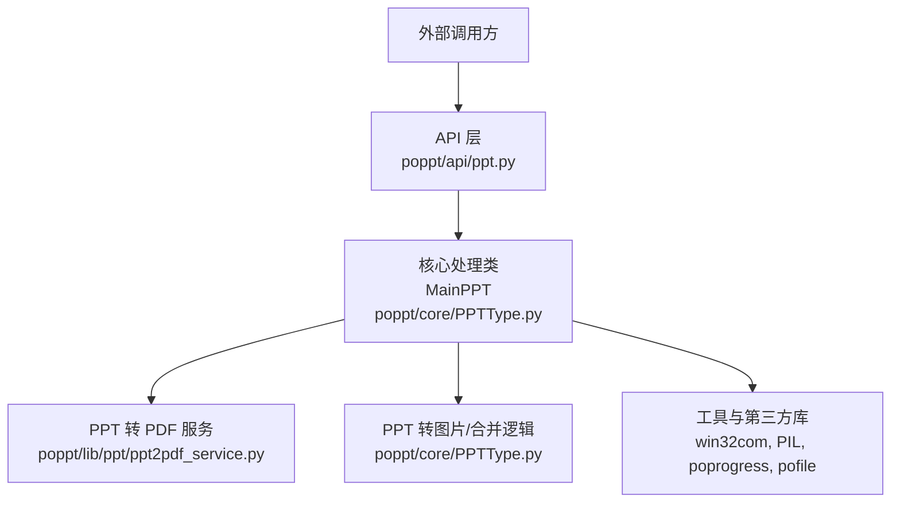
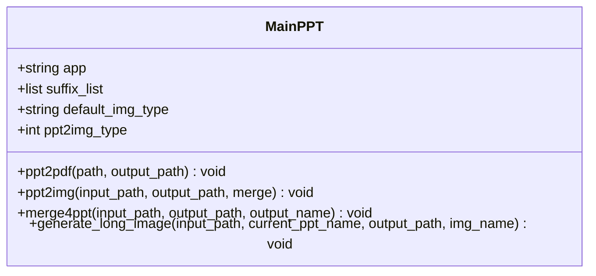
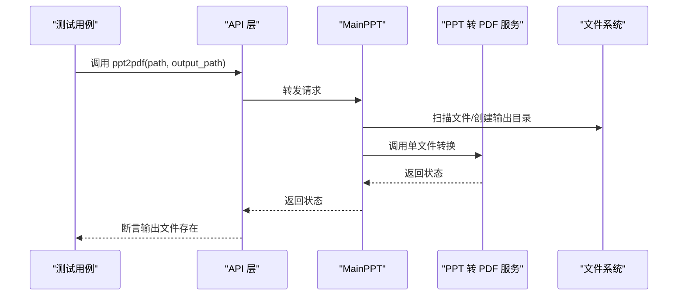
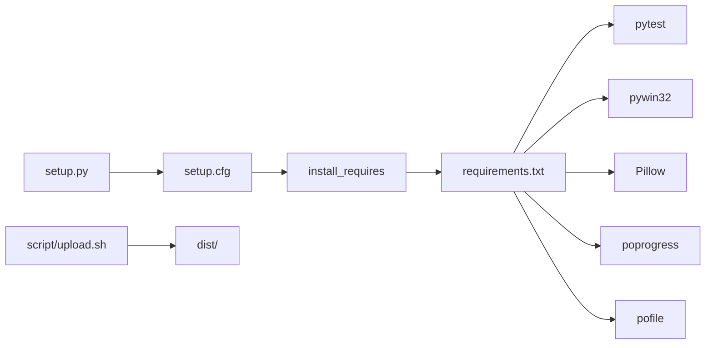
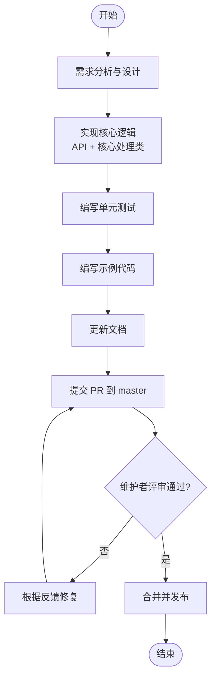

# 贡献指南

<cite>
**本文引用的文件**
- [README.md](file://README.md)
- [setup.cfg](file://setup.cfg)
- [setup.py](file://setup.py)
- [requirements.txt](file://requirements.txt)
- [tests/test_ppt.py](file://tests/test_ppt.py)
- [poppt/api/ppt.py](file://poppt/api/ppt.py)
- [poppt/core/PPTType.py](file://poppt/core/PPTType.py)
- [poppt/lib/ppt/ppt2pdf_service.py](file://poppt/lib/ppt/ppt2pdf_service.py)
- [poppt/core/need_dev/2img.py](file://poppt/core/need_dev/2img.py)
- [dev/ppt2img.py](file://dev/ppt2img.py)
- [demo/ppt2img.py](file://demo/ppt2img.py)
- [script/upload.sh](file://script/upload.sh)
</cite>

## 目录
1. [引言](#引言)
2. [项目结构](#项目结构)
3. [核心组件](#核心组件)
4. [架构总览](#架构总览)
5. [详细组件分析](#详细组件分析)
6. [依赖关系分析](#依赖关系分析)
7. [性能与质量考虑](#性能与质量考虑)
8. [故障排查指南](#故障排查指南)
9. [贡献流程与规范](#贡献流程与规范)
10. [示例：添加新功能“PPT转视频”](#示例添加新功能ppt转视频)
11. [结语](#结语)

## 引言
本贡献指南面向希望参与 poppt 项目的开发者，围绕 README 中“添砖加瓦”的内容进行扩展，明确 PR 提交流程、代码规范、分支策略、测试与文档要求、维护者评审标准以及常见问题反馈渠道。目标是帮助新贡献者快速理解项目结构、贡献方式与最佳实践，确保高质量协作。

## 项目结构
项目采用按功能分层的组织方式：
- 核心业务逻辑位于 poppt/core，包含 PPT 主处理类与工具函数
- API 层位于 poppt/api，提供对外接口
- 服务层位于 poppt/lib，封装底层服务（如 PPT 转 PDF）
- 示例与开发脚本位于 demo、dev、script
- 单元测试位于 tests
- 安装与打包配置位于 setup.cfg、setup.py、requirements.txt

图表来源
- [poppt/api/ppt.py](file://poppt/api/ppt.py#L1-L66)
- [poppt/core/PPTType.py](file://poppt/core/PPTType.py#L1-L204)
- [poppt/lib/ppt/ppt2pdf_service.py](file://poppt/lib/ppt/ppt2pdf_service.py#L1-L42)
- [demo/ppt2img.py](file://demo/ppt2img.py#L1-L25)
- [dev/ppt2img.py](file://dev/ppt2img.py#L1-L149)
- [tests/test_ppt.py](file://tests/test_ppt.py#L1-L98)
- [setup.cfg](file://setup.cfg#L1-L31)
- [setup.py](file://setup.py#L1-L17)
- [requirements.txt](file://requirements.txt#L1-L5)
- [script/upload.sh](file://script/upload.sh#L1-L6)

章节来源
- [README.md](file://README.md#L1-L94)
- [setup.cfg](file://setup.cfg#L1-L31)
- [setup.py](file://setup.py#L1-L17)
- [requirements.txt](file://requirements.txt#L1-L5)

## 核心组件
- API 层：提供统一入口，封装调用核心处理类，便于外部使用
- 核心处理类：MainPPT 封装 PPT 转 PDF、PPT 转图片、合并 PPT 等能力
- 服务层：PPT 转 PDF 的底层实现
- 示例与开发：演示与开发脚本，便于验证与扩展
- 测试：覆盖主要功能的单元测试
- 配置与打包：setup.cfg、setup.py、requirements.txt、upload.sh

章节来源
- [poppt/api/ppt.py](file://poppt/api/ppt.py#L1-L66)
- [poppt/core/PPTType.py](file://poppt/core/PPTType.py#L1-L204)
- [poppt/lib/ppt/ppt2pdf_service.py](file://poppt/lib/ppt/ppt2pdf_service.py#L1-L42)
- [tests/test_ppt.py](file://tests/test_ppt.py#L1-L98)
- [setup.cfg](file://setup.cfg#L1-L31)
- [setup.py](file://setup.py#L1-L17)
- [requirements.txt](file://requirements.txt#L1-L5)
- [script/upload.sh](file://script/upload.sh#L1-L6)

## 架构总览
整体采用“API 层 -> 核心处理类 -> 服务层”的分层设计，API 层负责对外暴露方法，核心处理类负责业务编排与调用底层服务，服务层封装平台相关实现（如 COM 组件调用）。

图表来源
- [poppt/api/ppt.py](file://poppt/api/ppt.py#L1-L66)
- [poppt/core/PPTType.py](file://poppt/core/PPTType.py#L1-L204)
- [poppt/lib/ppt/ppt2pdf_service.py](file://poppt/lib/ppt/ppt2pdf_service.py#L1-L42)

## 详细组件分析

### API 层（对外接口）
- 职责：提供简洁易用的函数接口，内部委托核心处理类执行
- 关键方法：ppt2pdf、ppt2img、merge4ppt
- 设计要点：参数校验、默认值、错误处理与日志打印

章节来源
- [poppt/api/ppt.py](file://poppt/api/ppt.py#L1-L66)

### 核心处理类（MainPPT）
- 职责：封装 PPT 转 PDF、PPT 转图片、合并 PPT 的完整流程
- 关键方法：ppt2pdf、ppt2img、merge4ppt、generate_long_image
- 设计要点：路径解析、文件扫描、COM 组件调用、进度条、长图拼接

图表来源
- [poppt/core/PPTType.py](file://poppt/core/PPTType.py#L1-L204)

章节来源
- [poppt/core/PPTType.py](file://poppt/core/PPTType.py#L1-L204)

### 服务层（PPT 转 PDF）
- 职责：通过 COM 组件将单个 PPT 转换为 PDF
- 关键方法：ppt2pdf_single
- 设计要点：应用启动、打开文件、另存为 PDF、释放资源

章节来源
- [poppt/lib/ppt/ppt2pdf_service.py](file://poppt/lib/ppt/ppt2pdf_service.py#L1-L42)

### 示例与开发脚本
- demo/ppt2img.py：演示如何调用 API
- dev/ppt2img.py：开发与测试脚本，包含长图拼接思路
- need_dev/2img.py：待完善的功能脚本，体现扩展方向

章节来源
- [demo/ppt2img.py](file://demo/ppt2img.py#L1-L25)
- [dev/ppt2img.py](file://dev/ppt2img.py#L1-L149)
- [poppt/core/need_dev/2img.py](file://poppt/core/need_dev/2img.py#L1-L105)

### 测试
- tests/test_ppt.py：覆盖 PPT 转 PDF、PPT 转图片（独立/合并）、合并 PPT 的测试
- 设计要点：setUpClass 统一准备测试数据与输出目录；各测试方法职责单一

图表来源
- [tests/test_ppt.py](file://tests/test_ppt.py#L1-L98)
- [poppt/api/ppt.py](file://poppt/api/ppt.py#L1-L66)
- [poppt/core/PPTType.py](file://poppt/core/PPTType.py#L1-L204)
- [poppt/lib/ppt/ppt2pdf_service.py](file://poppt/lib/ppt/ppt2pdf_service.py#L1-L42)

章节来源
- [tests/test_ppt.py](file://tests/test_ppt.py#L1-L98)

## 依赖关系分析
- 第三方依赖：pywin32（COM 组件）、Pillow（图像处理）、poprogress（进度条）、pofile（文件工具）
- 开发依赖：pytest（测试框架）
- 打包与上传：setup.cfg 定义元数据与依赖；setup.py 读取配置；upload.sh 打包并上传至 PyPI

图表来源
- [requirements.txt](file://requirements.txt#L1-L5)
- [setup.cfg](file://setup.cfg#L1-L31)
- [setup.py](file://setup.py#L1-L17)
- [script/upload.sh](file://script/upload.sh#L1-L6)

章节来源
- [requirements.txt](file://requirements.txt#L1-L5)
- [setup.cfg](file://setup.cfg#L1-L31)
- [setup.py](file://setup.py#L1-L17)
- [script/upload.sh](file://script/upload.sh#L1-L6)

## 性能与质量考虑
- 平台相关性：依赖 Windows COM 组件，需在 Windows 环境运行 PowerPoint
- 资源管理：每次 COM 调用后及时 Quit，避免资源泄漏
- I/O 优化：批量处理时使用进度条与路径缓存，减少重复 IO
- 图像处理：长图拼接时按顺序读取与粘贴，注意内存占用
- 测试覆盖：针对核心流程（转换、合并、长图）建立稳定测试

章节来源
- [poppt/core/PPTType.py](file://poppt/core/PPTType.py#L1-L204)
- [poppt/lib/ppt/ppt2pdf_service.py](file://poppt/lib/ppt/ppt2pdf_service.py#L1-L42)
- [tests/test_ppt.py](file://tests/test_ppt.py#L1-L98)

## 故障排查指南
- 环境问题
  - 确认已安装并可用 PowerPoint
  - 确认 pywin32、Pillow、poprogress、pofile 已安装
- 权限问题
  - 以管理员权限运行，避免 COM 组件访问受限
- 路径问题
  - 使用绝对路径，避免相对路径导致的找不到文件
- 资源泄漏
  - 确保每次 COM 调用后调用 Quit
- 测试失败
  - 检查测试数据路径与输出目录权限
  - 使用 pytest 详细日志定位失败点

章节来源
- [requirements.txt](file://requirements.txt#L1-L5)
- [poppt/core/PPTType.py](file://poppt/core/PPTType.py#L1-L204)
- [poppt/lib/ppt/ppt2pdf_service.py](file://poppt/lib/ppt/ppt2pdf_service.py#L1-L42)
- [tests/test_ppt.py](file://tests/test_ppt.py#L1-L98)

## 贡献流程与规范

### PR 提交流程（从 fork 到提交）
- Fork 项目到个人仓库
- Clone 到本地
- 修改代码
- Commit 并 Push 到个人仓库
- 在 GitHub/Gitee 上发起 Pull Request，目标分支为 master
- 等待维护者审核与合并

章节来源
- [README.md](file://README.md#L68-L76)

### 代码规范
- 文档注释：遵循 Google Python 文档规范，为新增方法提供完整 docstring，包含方法说明、参数说明、返回值说明、异常说明（如有）
- 格式化：仅格式化自己新增或修改的代码，避免无关变更
- 分支策略：PR 直接提交到 master 分支
- 问题管理：若 issue/pr 被关闭，保持沟通以便后续重新打开讨论

章节来源
- [README.md](file://README.md#L60-L67)

### 分支策略说明
- master 为主分支，对应已发布版本，PR 应直接提交到 master
- 随着参与人数增加，未来可能开辟新分支，需关注文档更新

章节来源
- [README.md](file://README.md#L63-L65)

### 贡献检查清单
- 添加单元测试：覆盖新增功能与边界场景
- 更新文档：在 README 或相应文档中补充功能说明与使用示例
- 提供示例代码：在 demo 或示例目录中提供最小可运行示例
- 本地验证：确保在 Windows 环境下 COM 组件可用，测试通过

章节来源
- [README.md](file://README.md#L60-L67)
- [tests/test_ppt.py](file://tests/test_ppt.py#L1-L98)
- [demo/ppt2img.py](file://demo/ppt2img.py#L1-L25)

### 维护者评审标准与流程
- 代码质量：遵循 Google Python 文档规范，注释完整，逻辑清晰
- 兼容性：确保在 Windows 环境下 COM 组件可用，避免破坏既有功能
- 测试：新增功能配套单元测试，测试用例通过
- 文档：更新 README 或示例，提供使用说明
- 分支：PR 提交至 master，便于快速集成与发布

章节来源
- [README.md](file://README.md#L60-L67)
- [tests/test_ppt.py](file://tests/test_ppt.py#L1-L98)

### bug 反馈渠道与信息格式
- 请在 GitHub Issues 提交与 poppt 代码本身相关的问题
- 信息格式建议包含：环境信息（Windows、PowerPoint 版本）、Python 版本、依赖版本、复现步骤、预期行为与实际行为、错误日志

章节来源
- [README.md](file://README.md#L78-L84)
- [setup.cfg](file://setup.cfg#L1-L31)

## 示例：添加新功能“PPT转视频”
以下为“PPT转视频”的完整贡献示例，展示从需求到 PR 的全流程。

- 需求分析
  - 明确“PPT转视频”的目标：将 PPT 的每一页导出为图片，再拼接为视频
  - 评估可行性：现有 PPT 转图片能力已具备，视频拼接可借助图像处理库
- 设计与实现
  - 在 API 层新增接口函数，封装“转图片 -> 拼接视频”的流程
  - 在核心处理类中新增或复用长图拼接逻辑，扩展为视频帧序列
  - 依赖：Pillow（图像处理）、可选：视频处理库（如 ffmpeg-python）
- 单元测试
  - 编写测试用例，覆盖单页/多页、不同分辨率、视频拼接
  - 使用临时目录与断言输出文件存在
- 示例与文档
  - 在 demo 目录新增示例脚本，展示调用方式
  - 在 README 中补充功能说明与使用示例链接
- PR 提交
  - Fork -> 修改 -> Commit -> Push -> PR 到 master
  - 在 PR 描述中说明功能背景、实现方案、测试情况与示例

图表来源
- [poppt/api/ppt.py](file://poppt/api/ppt.py#L1-L66)
- [poppt/core/PPTType.py](file://poppt/core/PPTType.py#L1-L204)
- [tests/test_ppt.py](file://tests/test_ppt.py#L1-L98)
- [demo/ppt2img.py](file://demo/ppt2img.py#L1-L25)
- [README.md](file://README.md#L60-L67)

## 结语
感谢每一位贡献者的参与。请严格遵循贡献流程与规范，确保代码质量与用户体验。遇到问题时，优先在 Issues 中反馈，以便维护者高效响应与处理。期待你的精彩贡献！