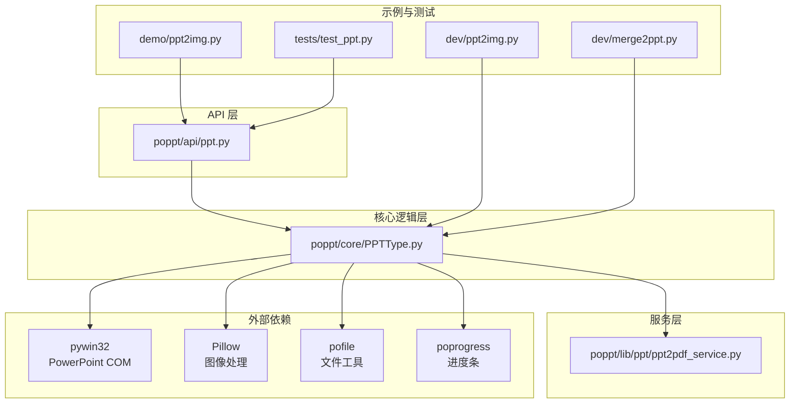
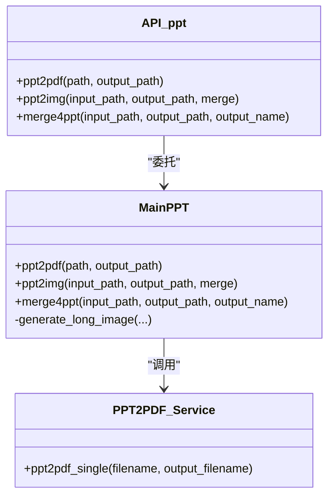
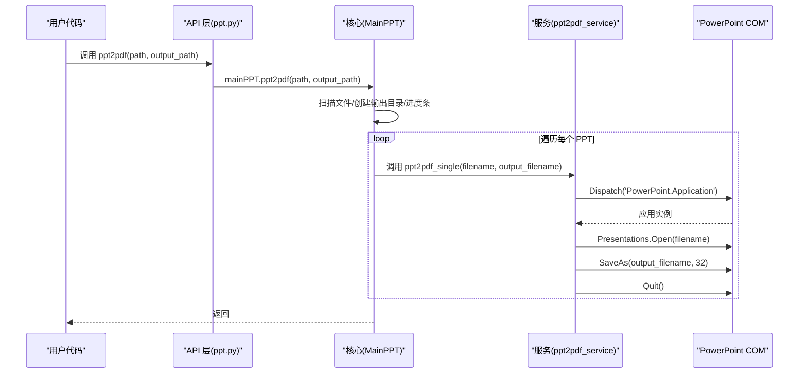
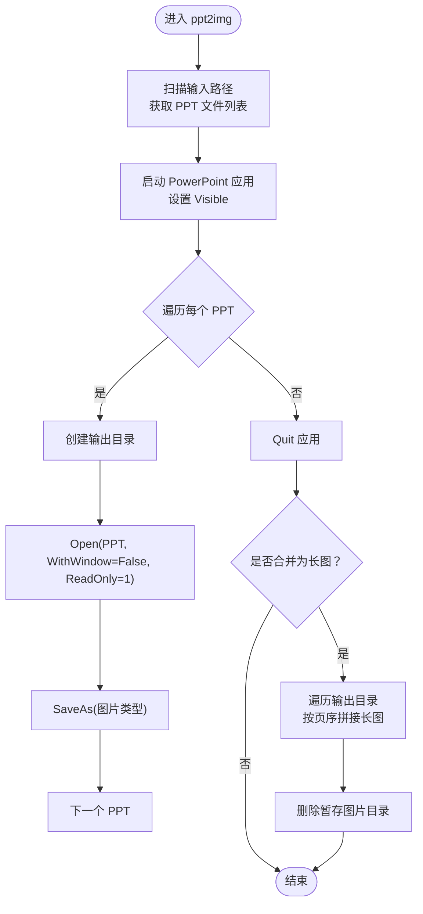
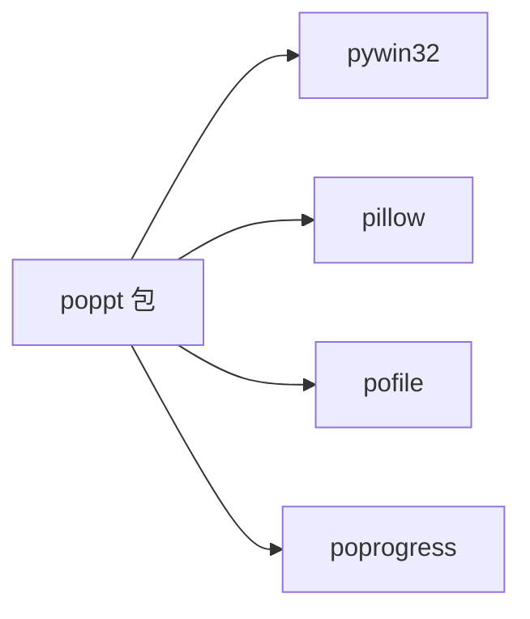

# 项目概述

<cite>
**本文引用的文件**
- [README.md](file://README.md)
- [poppt/__init__.py](file://poppt/__init__.py)
- [poppt/api/ppt.py](file://poppt/api/ppt.py)
- [poppt/core/PPTType.py](file://poppt/core/PPTType.py)
- [poppt/lib/ppt/ppt2pdf_service.py](file://poppt/lib/ppt/ppt2pdf_service.py)
- [requirements.txt](file://requirements.txt)
- [setup.py](file://setup.py)
- [setup.cfg](file://setup.cfg)
- [tests/test_ppt.py](file://tests/test_ppt.py)
- [tests/__init__.py](file://tests/__init__.py)
- [demo/ppt2img.py](file://demo/ppt2img.py)
- [dev/ppt2img.py](file://dev/ppt2img.py)
- [dev/merge2ppt.py](file://dev/merge2ppt.py)
</cite>

## 目录
1. [引言](#引言)
2. [项目结构](#项目结构)
3. [核心组件](#核心组件)
4. [架构总览](#架构总览)
5. [详细组件分析](#详细组件分析)
6. [依赖关系分析](#依赖关系分析)
7. [性能与可靠性考虑](#性能与可靠性考虑)
8. [故障排查指南](#故障排查指南)
9. [结论](#结论)
10. [附录](#附录)

## 引言
poppt 是 python-office 系列自动化办公工具的重要组成部分，专注于简化 PowerPoint（PPT/PPTX）的批量处理任务。项目通过 Python 与 Windows 平台的 COM 组件交互，提供三大核心能力：
- PPT 转 PDF：将演示文稿批量导出为 PDF，便于归档与分享。
- PPT 转图片：支持逐页导出为图片或合并为长图，满足内容提取与二次编辑需求。
- 合并 PPT：将多个 PPT 文件整合为一个完整的演示文稿，提升内容组织效率。

项目面向三类用户：
- 办公人员：快速完成批量转换与整理，减少重复劳动。
- Python 开发者：以简洁 API 快速集成自动化流程。
- 自动化初学者：通过清晰的示例与文档入门 Office 自动化。

社区与协作方面，README 提供了官网、交流群与问题反馈渠道；贡献流程与代码规范在 README 中明确，鼓励社区共建。

章节来源
- file://README.md#L14-L42
- file://README.md#L45-L94

## 项目结构
项目采用分层设计，围绕“API 层—核心逻辑层—服务层”展开，同时通过门面模式对外暴露统一入口，降低使用复杂度。

- API 层：位于 poppt/api，提供简洁易用的函数接口（如 ppt2pdf、ppt2img、merge4ppt），负责参数校验与调用核心逻辑。
- 核心逻辑层：位于 poppt/core，封装业务主流程与平台交互细节（如 PowerPoint COM 操作、文件遍历与目录管理、长图拼接等）。
- 服务层：位于 poppt/lib，提供具体的服务实现（如单文件 PPT 转 PDF 的底层服务）。
- 示例与测试：demo 与 dev 目录提供使用示例与开发验证脚本；tests 提供单元测试保障质量。
- 包配置：setup.py 与 setup.cfg 定义打包与依赖；requirements.txt 明确运行所需第三方库。

图表来源
- [poppt/api/ppt.py](file://poppt/api/ppt.py#L1-L66)
- [poppt/core/PPTType.py](file://poppt/core/PPTType.py#L1-L204)
- [poppt/lib/ppt/ppt2pdf_service.py](file://poppt/lib/ppt/ppt2pdf_service.py#L1-L42)
- [requirements.txt](file://requirements.txt#L1-L5)
- [demo/ppt2img.py](file://demo/ppt2img.py#L1-L25)
- [dev/ppt2img.py](file://dev/ppt2img.py#L1-L149)
- [dev/merge2ppt.py](file://dev/merge2ppt.py#L1-L70)
- [tests/test_ppt.py](file://tests/test_ppt.py#L1-L98)

章节来源
- file://poppt/__init__.py#L1-L3
- file://setup.py#L1-L17
- file://setup.cfg#L1-L30
- file://requirements.txt#L1-L5

## 核心组件
- API 层接口
  - ppt2pdf(path, output_path)：将 PPT/PPTX 转 PDF，支持单文件与文件夹批量处理。
  - ppt2img(input_path, output_path, merge=False)：将 PPT 转图片，可选择逐页保存或合并为长图。
  - merge4ppt(input_path, output_path, output_name='merge4ppt.pptx')：合并文件夹内的多个 PPT 为一个文件。
- 核心逻辑类 MainPPT
  - 负责文件扫描、目录创建、COM 应用生命周期管理、长图拼接等。
  - 统一封装 PowerPoint 操作，屏蔽平台差异。
- 服务层
  - ppt2pdf_single(filename, output_filename)：单文件 PPT 转 PDF 的底层实现，基于 PowerPoint COM 组件 SaveAs 导出。

章节来源
- file://poppt/api/ppt.py#L18-L66
- file://poppt/core/PPTType.py#L20-L204
- file://poppt/lib/ppt/ppt2pdf_service.py#L15-L42

## 架构总览
项目采用“门面模式 + 分层架构”的设计思路：
- 门面模式：通过 poppt/__init__.py 将 API 层统一导出，用户只需 import poppt 即可使用全部接口，降低心智负担。
- 分层架构：
  - API 层：薄薄的接口层，职责单一，便于扩展与测试。
  - 核心逻辑层：集中处理业务流程与平台交互，复用性强。
  - 服务层：提供细粒度服务，便于独立演进与替换。

图表来源
- [poppt/api/ppt.py](file://poppt/api/ppt.py#L18-L66)
- [poppt/core/PPTType.py](file://poppt/core/PPTType.py#L38-L204)
- [poppt/lib/ppt/ppt2pdf_service.py](file://poppt/lib/ppt/ppt2pdf_service.py#L15-L42)

## 详细组件分析

### API 层：对外接口与调用链
- 设计要点
  - 仅暴露高层 API，内部通过实例化 MainPPT 统一调度。
  - 参数命名直观，支持单文件与文件夹两种输入模式。
- 调用序列（以 ppt2pdf 为例）

图表来源
- [poppt/api/ppt.py](file://poppt/api/ppt.py#L18-L32)
- [poppt/core/PPTType.py](file://poppt/core/PPTType.py#L38-L66)
- [poppt/lib/ppt/ppt2pdf_service.py](file://poppt/lib/ppt/ppt2pdf_service.py#L15-L42)

章节来源
- file://poppt/api/ppt.py#L18-L66

### 核心逻辑层：MainPPT 主类
- 职责边界
  - 文件扫描与过滤（仅支持 .ppt/.pptx）。
  - 目录创建与路径管理。
  - PowerPoint 应用生命周期管理（启动、可见性控制、关闭）。
  - 长图拼接（基于 Pillow 的图像拼接）。
- 关键流程（PPT 转图片）

图表来源
- [poppt/core/PPTType.py](file://poppt/core/PPTType.py#L114-L204)

章节来源
- file://poppt/core/PPTType.py#L20-L204

### 服务层：PPT 转 PDF 单文件服务
- 设计要点
  - 专注单文件导出，避免应用生命周期管理细节外溢。
  - 通过 COM 组件的 SaveAs 指定导出类型（PDF 对应编号）。
- 适用场景
  - 与核心逻辑层配合，实现批量转换。
  - 作为独立服务被其他模块复用。

章节来源
- file://poppt/lib/ppt/ppt2pdf_service.py#L15-L42

### 示例与使用场景
- 批量转换报告为 PDF
  - 场景：将多个部门汇报 PPT 批量导出为 PDF，便于归档与审阅。
  - 实现：调用 ppt2pdf，传入包含 PPT 的文件夹路径与输出目录。
- 提取 PPT 内容为图片
  - 场景：将 PPT 的每一页导出为图片，用于内容审核或二次编辑。
  - 实现：调用 ppt2img，merge=False 逐页保存；或 merge=True 合并为长图。
- 合并 PPT
  - 场景：将多个讲稿按顺序整合为完整演示文稿。
  - 实现：调用 merge4ppt，传入包含多个 PPT 的文件夹路径与输出名称。

章节来源
- file://demo/ppt2img.py#L1-L25
- file://tests/test_ppt.py#L34-L93

## 依赖关系分析
- 运行时依赖
  - pywin32：与 PowerPoint COM 组件交互的核心。
  - Pillow：图像处理，用于长图拼接。
  - pofile：文件与目录工具（文件扫描、目录创建、后缀检查）。
  - poprogress：进度条工具，改善批量任务的可观测性。
- 包配置
  - setup.cfg 指定安装依赖与最低 Python 版本要求。
  - setup.py 委托 setup.cfg 完成打包配置。

图表来源
- [requirements.txt](file://requirements.txt#L1-L5)
- [setup.cfg](file://setup.cfg#L19-L30)

章节来源
- file://requirements.txt#L1-L5
- file://setup.cfg#L19-L30
- file://setup.py#L1-L17

## 性能与可靠性考虑
- 并发与可见性
  - PowerPoint 应用默认可见，有助于调试但可能影响性能；在生产环境可考虑隐藏窗口以减少 UI 开销。
- 批量处理策略
  - 使用进度条提升用户体验；对大文件或大批量任务，建议分批执行并监控内存占用。
- 错误恢复
  - 确保在异常情况下也能释放 COM 应用实例，避免进程残留。
- 平台兼容性
  - 仅适用于 Windows 环境；需确保系统已安装 PowerPoint。

[本节为通用建议，无需特定文件引用]

## 故障排查指南
- 常见问题
  - 无法找到 PowerPoint：确认系统已安装 PowerPoint，且 pywin32 正确安装。
  - 权限不足：以管理员权限运行，避免文件写入失败。
  - 文件后缀不匹配：确保输入为 .ppt 或 .pptx。
- 单元测试辅助
  - 使用 tests/test_ppt.py 验证各功能点，覆盖单文件转换、长图生成与合并流程。
- 示例脚本
  - demo/ppt2img.py 与 dev/ppt2img.py 提供不同层次的使用范式，便于对照与调试。

章节来源
- file://tests/test_ppt.py#L1-L98
- file://demo/ppt2img.py#L1-L25
- file://dev/ppt2img.py#L1-L149

## 结论
poppt 以简洁 API 与稳健的分层架构，将复杂的 Office 自动化任务抽象为易用的功能模块。通过 pywin32 与 PowerPoint COM 的深度集成，项目实现了高可靠性的批量处理能力。对于办公人员、Python 开发者与自动化初学者而言，poppt 提供了即插即用的解决方案，并具备良好的扩展性与社区协作生态。

[本节为总结性内容，无需特定文件引用]

## 附录

### 技术选型背景
- pywin32 与 PowerPoint COM
  - 选择 COM 组件交互的原因在于 PowerPoint 提供成熟的 SaveAs 导出能力，且在 Windows 平台上稳定可靠。
  - 通过 Dispatch/EnsureDispatch 管理应用生命周期，避免手动注册与复杂 COM 绑定。
- 门面模式的应用
  - 通过 poppt/__init__.py 统一导出 API，降低用户学习成本，提升可用性。
- 第三方库的作用
  - Pillow：高质量图像处理，保证长图拼接效果。
  - pofile：标准化文件与目录操作，提升健壮性。
  - poprogress：改善批量任务的可观测性与用户体验。

章节来源
- file://poppt/__init__.py#L1-L3
- file://poppt/core/PPTType.py#L91-L112
- file://requirements.txt#L1-L5

### 基础概念指导（面向初学者）
- Windows 自动化原理
  - COM 组件是 Windows 下跨语言的组件对象模型，PowerPoint 提供 COM 接口用于自动化控制。
  - Python 通过 pywin32 访问 COM，实现启动应用、打开文档、执行命令与保存文件。
- Python 包导入机制
  - __init__.py 控制包的导出行为；在此项目中，统一导出 API 层接口，使用户可直接使用 poppt.ppt2pdf 等函数。
  - 模块间通过相对导入组织结构，保持清晰的层次边界。

章节来源
- file://poppt/__init__.py#L1-L3
- file://poppt/api/ppt.py#L1-L17