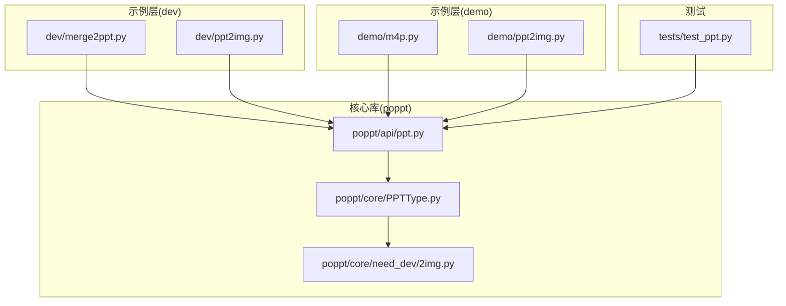
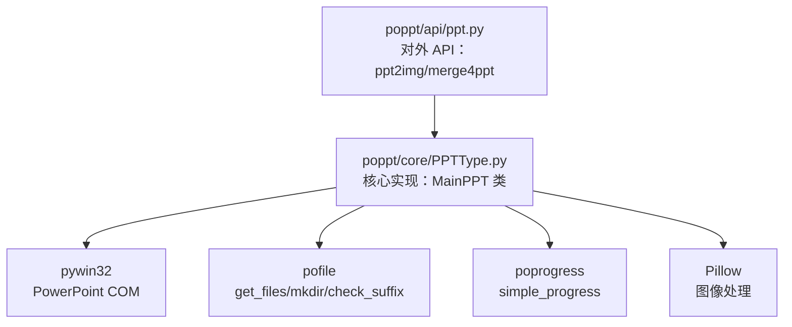
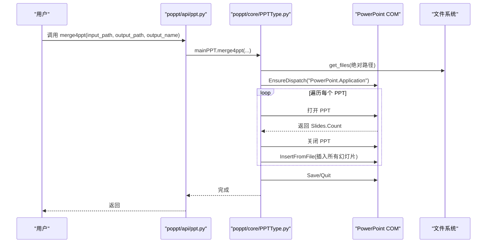
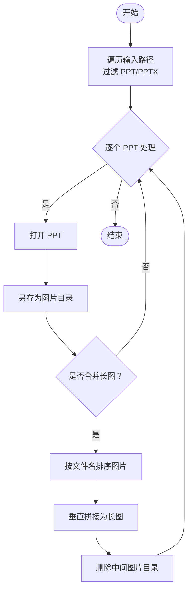
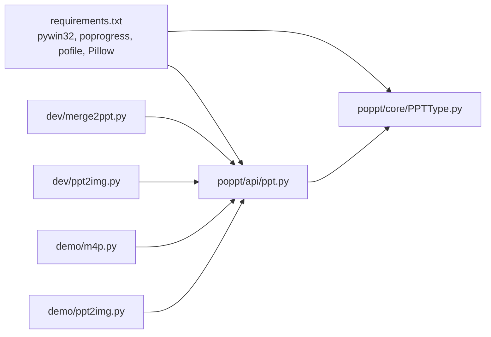

# 批量处理

<cite>
**本文引用的文件**
- [README.md](file://README.md)
- [requirements.txt](file://requirements.txt)
- [dev/merge2ppt.py](file://dev/merge2ppt.py)
- [dev/ppt2img.py](file://dev/ppt2img.py)
- [demo/m4p.py](file://demo/m4p.py)
- [demo/ppt2img.py](file://demo/ppt2img.py)
- [poppt/api/ppt.py](file://poppt/api/ppt.py)
- [poppt/core/PPTType.py](file://poppt/core/PPTType.py)
- [poppt/core/need_dev/2img.py](file://poppt/core/need_dev/2img.py)
- [tests/test_ppt.py](file://tests/test_ppt.py)
</cite>

## 目录
1. [引言](#引言)
2. [项目结构](#项目结构)
3. [核心组件](#核心组件)
4. [架构总览](#架构总览)
5. [详细组件分析](#详细组件分析)
6. [依赖关系分析](#依赖关系分析)
7. [性能考虑](#性能考虑)
8. [故障排查指南](#故障排查指南)
9. [结论](#结论)
10. [附录](#附录)

## 引言
本文件围绕 poppt 库提供的批量处理能力，系统讲解如何使用其接口对 PPT 文件进行批量合并与批量转图片。重点基于以下文件的实现逻辑展开：
- 合并：dev/merge2ppt.py 与 poppt/core/PPTType.py 中的 merge4ppt
- 转图片：poppt/api/ppt.py 与 poppt/core/PPTType.py 中的 ppt2img
- 进度条：poprogress.simple_progress 的集成
- 路径兼容：pathlib.Path.absolute() 的使用
- 错误处理：文件不存在等异常场景的处理思路

## 项目结构
仓库采用按功能分层的组织方式：
- dev：开发者示例脚本，包含合并与转图片的开发测试代码
- demo：面向用户的示例入口，便于快速调用
- poppt：核心库，包含 API 层与核心实现
- tests：测试用例，覆盖批量转换与合并流程
- 其他：安装与依赖声明

图表来源
- [dev/merge2ppt.py](file://dev/merge2ppt.py#L1-L78)
- [dev/ppt2img.py](file://dev/ppt2img.py#L1-L149)
- [demo/m4p.py](file://demo/m4p.py#L1-L16)
- [demo/ppt2img.py](file://demo/ppt2img.py#L1-L25)
- [poppt/api/ppt.py](file://poppt/api/ppt.py#L1-L66)
- [poppt/core/PPTType.py](file://poppt/core/PPTType.py#L1-L204)
- [poppt/core/need_dev/2img.py](file://poppt/core/need_dev/2img.py#L1-L105)
- [tests/test_ppt.py](file://tests/test_ppt.py#L42-L74)

章节来源
- [README.md](file://README.md#L1-L94)
- [requirements.txt](file://requirements.txt#L1-L5)

## 核心组件
- 合并 PPT：通过 merge4ppt 将指定目录下的所有 PPT/PPTX 文件按顺序插入到一个新 PPT 中，支持进度条显示与路径绝对化处理。
- 转图片：通过 ppt2img 将 PPT 单独转为图片或合并为长图；支持批量处理与路径绝对化。
- 进度条：simple_progress 包装迭代过程，提供可视化进度反馈。
- 路径处理：统一使用 pathlib.Path.absolute()，保证跨平台路径一致性。
- 依赖：pywin32（COM）、poprogress、pofile、pillow。

章节来源
- [poppt/api/ppt.py](file://poppt/api/ppt.py#L34-L66)
- [poppt/core/PPTType.py](file://poppt/core/PPTType.py#L68-L113)
- [poppt/core/PPTType.py](file://poppt/core/PPTType.py#L114-L167)
- [requirements.txt](file://requirements.txt#L1-L5)

## 架构总览
poppt 的批量处理由“API 层 → 核心实现层”构成，API 层负责对外暴露方法签名与默认参数，核心实现层负责具体逻辑（COM 调用、文件遍历、图片拼接等），并统一使用路径与进度条工具。

图表来源
- [poppt/api/ppt.py](file://poppt/api/ppt.py#L34-L66)
- [poppt/core/PPTType.py](file://poppt/core/PPTType.py#L1-L204)
- [requirements.txt](file://requirements.txt#L1-L5)

## 详细组件分析

### 合并 PPT：merge4ppt
- 输入参数：输入目录、输出目录、输出文件名
- 关键步骤：
  - 将输入路径转换为绝对路径，避免相对路径导致的查找失败
  - 使用 get_files 遍历目录下所有 PPT/PPTX 文件
  - 通过 simple_progress 显示进度
  - 逐个打开文件，读取幻灯片数量，再将全部幻灯片插入到新 PPT 末尾
  - 保存并退出 PowerPoint
- 路径兼容性：使用 Path.absolute() 统一路径，提升跨平台稳定性
- 进度条：simple_progress 包裹文件列表迭代，直观显示处理进度

图表来源
- [poppt/api/ppt.py](file://poppt/api/ppt.py#L53-L66)
- [poppt/core/PPTType.py](file://poppt/core/PPTType.py#L68-L113)
- [dev/merge2ppt.py](file://dev/merge2ppt.py#L21-L65)

章节来源
- [dev/merge2ppt.py](file://dev/merge2ppt.py#L21-L65)
- [poppt/core/PPTType.py](file://poppt/core/PPTType.py#L68-L113)
- [poppt/api/ppt.py](file://poppt/api/ppt.py#L53-L66)

### 批量转图片：ppt2img
- 输入参数：输入路径（单文件或目录）、输出目录、merge 标志
- 关键步骤：
  - 遍历输入路径下的 PPT/PPTX 文件
  - 逐个打开 PPT 并另存为图片（默认 JPG）
  - 若 merge=True，则对每个 PPT 的图片目录进行排序并拼接成长图，随后删除中间目录
- 路径兼容性：输出目录与中间目录均使用 Path.absolute()，确保跨平台一致
- 进度条：在某些实现中可配合 simple_progress 使用（核心实现中未显式包裹）

图表来源
- [poppt/core/PPTType.py](file://poppt/core/PPTType.py#L114-L167)
- [poppt/core/PPTType.py](file://poppt/core/PPTType.py#L168-L204)

章节来源
- [poppt/core/PPTType.py](file://poppt/core/PPTType.py#L114-L167)
- [poppt/core/PPTType.py](file://poppt/core/PPTType.py#L168-L204)
- [poppt/api/ppt.py](file://poppt/api/ppt.py#L34-L52)

### 开发示例与演示入口
- 开发示例（dev/merge2ppt.py）：展示了如何直接调用 merge4ppt 并集成 simple_progress
- 开发示例（dev/ppt2img.py）：展示了 PPT 转图片与长图拼接的开发思路
- 演示入口（demo/m4p.py）：通过 poppt.merge4ppt 快速合并
- 演示入口（demo/ppt2img.py）：通过 office.ppt.ppt2img 快速转图片

章节来源
- [dev/merge2ppt.py](file://dev/merge2ppt.py#L1-L78)
- [dev/ppt2img.py](file://dev/ppt2img.py#L1-L149)
- [demo/m4p.py](file://demo/m4p.py#L1-L16)
- [demo/ppt2img.py](file://demo/ppt2img.py#L1-L25)

## 依赖关系分析
- 外部依赖：pywin32（PowerPoint COM）、poprogress（进度条）、pofile（文件工具）、pillow（图像处理）
- 内部依赖：API 层依赖核心实现；核心实现依赖外部工具与 COM

图表来源
- [requirements.txt](file://requirements.txt#L1-L5)
- [poppt/api/ppt.py](file://poppt/api/ppt.py#L1-L66)
- [poppt/core/PPTType.py](file://poppt/core/PPTType.py#L1-L204)
- [dev/merge2ppt.py](file://dev/merge2ppt.py#L1-L78)
- [dev/ppt2img.py](file://dev/ppt2img.py#L1-L149)
- [demo/m4p.py](file://demo/m4p.py#L1-L16)
- [demo/ppt2img.py](file://demo/ppt2img.py#L1-L25)

章节来源
- [requirements.txt](file://requirements.txt#L1-L5)
- [poppt/api/ppt.py](file://poppt/api/ppt.py#L1-L66)
- [poppt/core/PPTType.py](file://poppt/core/PPTType.py#L1-L204)

## 性能考虑
- 大量文件合并时的内存占用
  - 合并策略：逐个打开并插入，避免一次性加载所有 PPT 的内容，降低峰值内存
  - 建议：在处理超大集合时，分批执行或限制并发，避免 PowerPoint 进程长时间占用
- 图片拼接的内存占用
  - 长图拼接时，先排序再逐张粘贴，避免重复读取与多次计算
  - 建议：在 merge=True 时，尽量控制单个 PPT 的页数规模，或分批处理
- 路径与 IO
  - 使用 Path.absolute() 统一路径，减少跨平台差异带来的 IO 失败
  - 输出目录提前 mkdir，避免中途失败

章节来源
- [poppt/core/PPTType.py](file://poppt/core/PPTType.py#L68-L113)
- [poppt/core/PPTType.py](file://poppt/core/PPTType.py#L114-L167)

## 故障排查指南
- 文件不存在
  - 合并：若输入目录为空或路径错误，get_files 可能返回空列表；建议在调用前校验路径存在性
  - 转图片：若输入路径不存在，需在业务层捕获并提示
- PowerPoint 未安装或权限不足
  - 确保系统已安装 PowerPoint，并允许 COM 访问
  - 在 CI/CD 环境中，可能需要无头运行或使用虚拟显示
- 权限与杀软拦截
  - 部分安全软件会阻止 COM 自动化，建议在受控环境中运行
- 跨平台兼容
  - 仅 Windows 支持 pywin32 与 PowerPoint COM；Linux/macOS 需要替代方案（如 LibreOffice 转换）

章节来源
- [dev/ppt2img.py](file://dev/ppt2img.py#L71-L93)
- [poppt/core/PPTType.py](file://poppt/core/PPTType.py#L114-L167)

## 结论
poppt 提供了简洁易用的批量处理接口：
- 合并：通过 merge4ppt 一键将目录下所有 PPT 合并为一个文件，路径与进度条处理完善
- 转图片：通过 ppt2img 支持独立图片与长图两种模式，路径与图像处理工具链完备
- 实践建议：在处理大量文件时控制内存占用，合理拆分批次；在非 Windows 环境中评估替代方案

## 附录

### 如何调用 merge4ppt 实现自动化批量合并
- 方式一：使用 API 层
  - 调用 poppt.merge4ppt(input_path, output_path, output_name)
  - 参考：[poppt/api/ppt.py](file://poppt/api/ppt.py#L53-L66)
- 方式二：使用演示入口
  - 参考：[demo/m4p.py](file://demo/m4p.py#L1-L16)
- 方式三：直接使用开发示例
  - 参考：[dev/merge2ppt.py](file://dev/merge2ppt.py#L21-L65)

章节来源
- [poppt/api/ppt.py](file://poppt/api/ppt.py#L53-L66)
- [demo/m4p.py](file://demo/m4p.py#L1-L16)
- [dev/merge2ppt.py](file://dev/merge2ppt.py#L21-L65)

### 如何对多个 PPT 执行批量转图片
- 方式一：使用 API 层
  - 调用 poppt.ppt2img(input_path, output_path, merge=False/True)
  - 参考：[poppt/api/ppt.py](file://poppt/api/ppt.py#L34-L52)
- 方式二：使用演示入口
  - 参考：[demo/ppt2img.py](file://demo/ppt2img.py#L1-L25)
- 方式三：参考开发示例
  - 参考：[dev/ppt2img.py](file://dev/ppt2img.py#L1-L149)

章节来源
- [poppt/api/ppt.py](file://poppt/api/ppt.py#L34-L52)
- [demo/ppt2img.py](file://demo/ppt2img.py#L1-L25)
- [dev/ppt2img.py](file://dev/ppt2img.py#L1-L149)

### get_files 的使用方式
- 作用：遍历指定目录，返回匹配的文件路径列表
- 在合并与转图片中均被调用，作为批量处理的起点
- 参考：
  - [poppt/core/PPTType.py](file://poppt/core/PPTType.py#L52-L66)
  - [poppt/core/PPTType.py](file://poppt/core/PPTType.py#L85-L86)
  - [poppt/core/PPTType.py](file://poppt/core/PPTType.py#L127-L128)

章节来源
- [poppt/core/PPTType.py](file://poppt/core/PPTType.py#L52-L66)
- [poppt/core/PPTType.py](file://poppt/core/PPTType.py#L85-L86)
- [poppt/core/PPTType.py](file://poppt/core/PPTType.py#L127-L128)

### simple_progress 进度条在批量操作中的集成
- 在合并与转图片流程中，simple_progress 包裹迭代过程，提供进度反馈
- 参考：
  - [dev/merge2ppt.py](file://dev/merge2ppt.py#L51-L51)
  - [poppt/core/PPTType.py](file://poppt/core/PPTType.py#L56-L56)
  - [poppt/core/PPTType.py](file://poppt/core/PPTType.py#L99-L99)

章节来源
- [dev/merge2ppt.py](file://dev/merge2ppt.py#L51-L51)
- [poppt/core/PPTType.py](file://poppt/core/PPTType.py#L56-L56)
- [poppt/core/PPTType.py](file://poppt/core/PPTType.py#L99-L99)

### 通过 Path.absolute() 处理路径兼容性
- 合并：将输入与输出路径转换为绝对路径，避免相对路径导致的查找失败
  - 参考：[poppt/core/PPTType.py](file://poppt/core/PPTType.py#L83-L83)
- 转图片：输出目录与中间目录使用绝对路径
  - 参考：[poppt/core/PPTType.py](file://poppt/core/PPTType.py#L139-L139)
- 开发示例：同样使用 Path.absolute() 进行路径转换
  - 参考：[dev/merge2ppt.py](file://dev/merge2ppt.py#L35-L35)

章节来源
- [poppt/core/PPTType.py](file://poppt/core/PPTType.py#L83-L83)
- [poppt/core/PPTType.py](file://poppt/core/PPTType.py#L139-L139)
- [dev/merge2ppt.py](file://dev/merge2ppt.py#L35-L35)

### 错误处理机制与优化建议
- 文件不存在
  - 合并：若输入目录为空，get_files 返回空列表，流程不会报错但也不会合并任何文件；建议在业务层增加存在性校验
  - 转图片：开发示例中对文件存在性做了检查并抛出异常；生产环境建议统一捕获并记录日志
  - 参考：
    - [dev/ppt2img.py](file://dev/ppt2img.py#L71-L93)
- 大量文件处理的内存优化
  - 合并：逐个打开并插入，避免一次性加载所有内容
  - 转图片：长图拼接时先排序再粘贴，减少重复读取
  - 参考：
    - [poppt/core/PPTType.py](file://poppt/core/PPTType.py#L68-L113)
    - [poppt/core/PPTType.py](file://poppt/core/PPTType.py#L168-L204)
- 跨平台与环境
  - 仅 Windows 支持 pywin32 与 PowerPoint COM；Linux/macOS 需要替代方案
  - 参考：[requirements.txt](file://requirements.txt#L1-L5)

章节来源
- [dev/ppt2img.py](file://dev/ppt2img.py#L71-L93)
- [poppt/core/PPTType.py](file://poppt/core/PPTType.py#L68-L113)
- [poppt/core/PPTType.py](file://poppt/core/PPTType.py#L168-L204)
- [requirements.txt](file://requirements.txt#L1-L5)