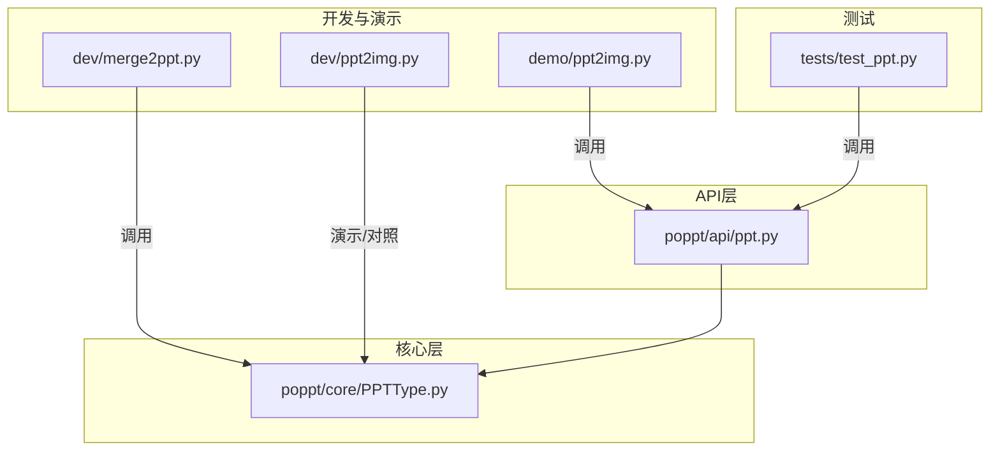
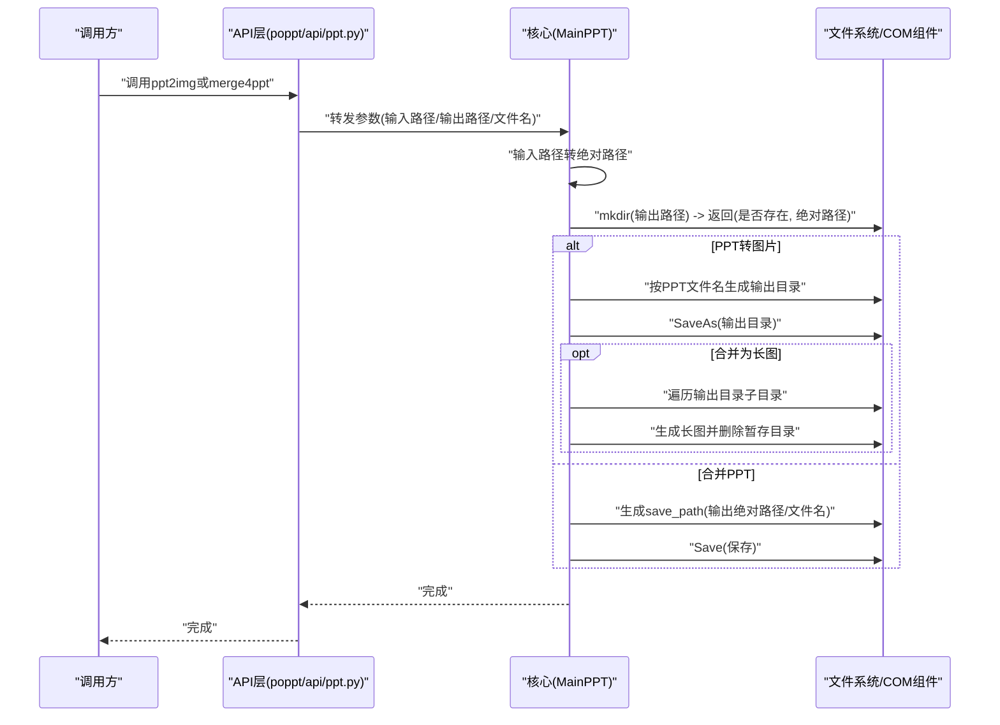
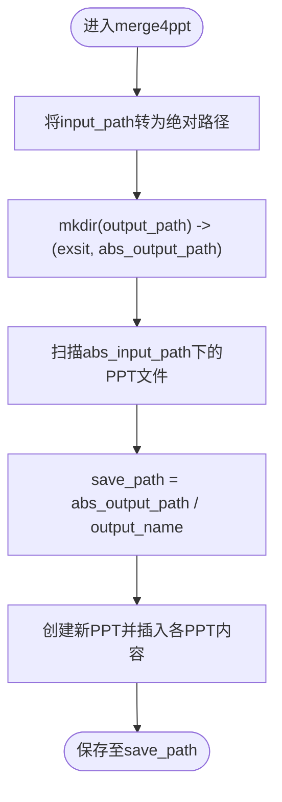
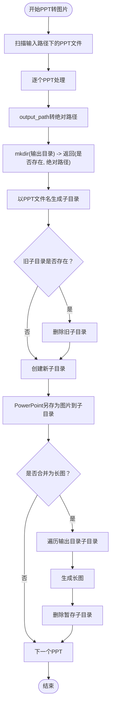
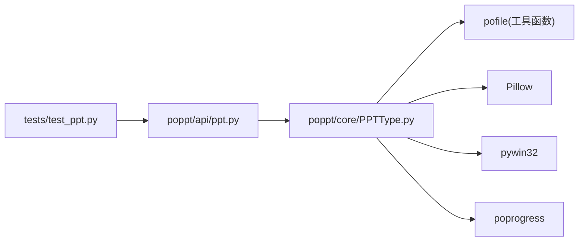

# 自定义输出配置

<cite>
**本文引用的文件**
- [README.md](file://README.md)
- [setup.cfg](file://setup.cfg)
- [poppt/api/ppt.py](file://poppt/api/ppt.py)
- [poppt/core/PPTType.py](file://poppt/core/PPTType.py)
- [dev/merge2ppt.py](file://dev/merge2ppt.py)
- [dev/ppt2img.py](file://dev/ppt2img.py)
- [demo/ppt2img.py](file://demo/ppt2img.py)
- [tests/test_ppt.py](file://tests/test_ppt.py)
</cite>

## 目录
1. [引言](#引言)
2. [项目结构](#项目结构)
3. [核心组件](#核心组件)
4. [架构总览](#架构总览)
5. [详细组件分析](#详细组件分析)
6. [依赖关系分析](#依赖关系分析)
7. [性能考量](#性能考量)
8. [故障排查指南](#故障排查指南)
9. [结论](#结论)
10. [附录](#附录)

## 引言
本文件围绕“自定义输出路径与文件命名规则”展开，结合仓库中的合并PPT与PPT转图片两大能力，系统讲解以下主题：
- 如何通过接口参数设计实现灵活的输出路径与文件命名
- mkdir工具函数如何创建输出目录并返回绝对路径
- save_path的构建过程与相对路径到系统绝对路径的转换策略
- 如何灵活设置输出文件名（如test.pptx），满足不同项目需求
- 结合PPT转图片流程，解析图片输出目录的生成机制、旧目录清理与重建策略
- 提供配置最佳实践，帮助开发者设计可复用、易维护的输出结构

## 项目结构
本仓库采用分层组织：API层提供统一入口，核心层封装业务逻辑，开发与演示代码位于dev与demo目录，测试覆盖关键流程。

图表来源
- [poppt/api/ppt.py](file://poppt/api/ppt.py#L1-L66)
- [poppt/core/PPTType.py](file://poppt/core/PPTType.py#L1-L204)
- [dev/merge2ppt.py](file://dev/merge2ppt.py#L1-L78)
- [dev/ppt2img.py](file://dev/ppt2img.py#L1-L149)
- [demo/ppt2img.py](file://demo/ppt2img.py#L1-L25)
- [tests/test_ppt.py](file://tests/test_ppt.py#L1-L98)

章节来源
- [README.md](file://README.md#L1-L94)
- [setup.cfg](file://setup.cfg#L1-L30)

## 核心组件
- API层接口：提供统一的ppt2pdf、ppt2img、merge4ppt入口，负责参数校验与默认值设置。
- 核心类MainPPT：封装PPT转PDF、PPT转图片、合并PPT的具体实现；内置路径处理、目录创建、长图拼接等逻辑。
- 开发与演示代码：dev/merge2ppt.py与dev/ppt2img.py作为开发测试样例，展示参数与路径处理思路；demo/ppt2img.py展示外部调用方式。
- 测试用例：tests/test_ppt.py验证各功能在真实场景下的输出路径与文件命名行为。

章节来源
- [poppt/api/ppt.py](file://poppt/api/ppt.py#L1-L66)
- [poppt/core/PPTType.py](file://poppt/core/PPTType.py#L1-L204)
- [dev/merge2ppt.py](file://dev/merge2ppt.py#L1-L78)
- [dev/ppt2img.py](file://dev/ppt2img.py#L1-L149)
- [demo/ppt2img.py](file://demo/ppt2img.py#L1-L25)
- [tests/test_ppt.py](file://tests/test_ppt.py#L1-L98)

## 架构总览
API层通过MainPPT类实现具体功能，路径处理贯穿于各流程：输入路径统一转为绝对路径，输出路径通过mkdir创建并返回绝对路径，最终生成save_path或输出目录树。

图表来源
- [poppt/api/ppt.py](file://poppt/api/ppt.py#L18-L66)
- [poppt/core/PPTType.py](file://poppt/core/PPTType.py#L38-L204)
- [dev/merge2ppt.py](file://dev/merge2ppt.py#L21-L78)

## 详细组件分析

### 合并PPT：output_path与output_name参数设计
- 参数职责
  - input_path：包含多个PPT的文件夹路径
  - output_path：合并后PPT的输出目录
  - output_name：合并后PPT的文件名（如test.pptx）
- 路径处理
  - 输入路径转绝对路径，确保跨工作目录稳定
  - 通过mkdir创建输出目录，返回是否存在与绝对路径
  - 生成save_path = Path(abs_output_path) / output_name，保证文件名可控
- 保存流程
  - 逐个打开PPT，读取幻灯片数量，插入到新PPT末尾
  - 最终保存至save_path

图表来源
- [dev/merge2ppt.py](file://dev/merge2ppt.py#L21-L78)
- [poppt/core/PPTType.py](file://poppt/core/PPTType.py#L67-L113)

章节来源
- [dev/merge2ppt.py](file://dev/merge2ppt.py#L21-L78)
- [tests/test_ppt.py](file://tests/test_ppt.py#L64-L98)

### mkdir工具函数：创建输出目录并返回绝对路径
- 设计要点
  - 接收相对路径或绝对路径，内部统一转为绝对路径
  - 返回元组：(是否存在, 绝对路径)，便于上层判断是否需要清理或重建
  - 与Path对象配合，保证跨平台路径拼接安全
- 在合并PPT与PPT转图片中的应用
  - 合并PPT：output_path经mkdir后得到abs_output_path，再与output_name拼接为save_path
  - PPT转图片：output_path经mkdir后得到绝对路径，再按PPT文件名生成子目录

章节来源
- [dev/merge2ppt.py](file://dev/merge2ppt.py#L34-L41)
- [poppt/core/PPTType.py](file://poppt/core/PPTType.py#L51-L66)
- [poppt/core/PPTType.py](file://poppt/core/PPTType.py#L138-L141)

### save_path构建：相对路径到系统绝对路径的转换
- 转换策略
  - input_path通过Path(input_path).absolute()转为绝对路径，消除工作目录差异
  - output_path通过mkdir返回绝对路径，避免相对路径在不同工作目录下产生歧义
  - save_path = Path(abs_output_path) / output_name，确保文件名可控且路径安全
- 作用
  - 避免路径错误与跨平台兼容性问题
  - 便于日志记录与后续文件定位

章节来源
- [dev/merge2ppt.py](file://dev/merge2ppt.py#L34-L41)
- [poppt/core/PPTType.py](file://poppt/core/PPTType.py#L82-L89)

### 灵活设置输出文件名：以test.pptx为例
- 合并PPT场景
  - output_name可自定义为任意.pptx文件名，如“合并后的PPT.pptx”
  - tests中展示了如何通过output_name控制最终文件名
- PPT转图片场景
  - output_name在该流程中不直接使用，但可通过output_path与PPT文件名组合实现清晰的输出层次
  - 若需自定义文件名，可在调用层对output_path进行规划，或在生成长图阶段调整文件名

章节来源
- [tests/test_ppt.py](file://tests/test_ppt.py#L64-L98)
- [dev/merge2ppt.py](file://dev/merge2ppt.py#L70-L78)

### PPT转图片：图片输出目录生成、旧目录清理与重建
- 目录生成机制
  - output_path经mkdir后得到绝对路径
  - 以PPT文件名为基准生成子目录，作为每页图片的输出根目录
- 旧目录清理与重建策略
  - 若目标子目录已存在，先删除旧目录，再重建，确保输出干净
  - 该策略避免历史图片残留影响后续拼接
- 长图生成与清理
  - 遍历输出目录下的所有子目录，逐个生成长图
  - 长图生成完成后删除暂存的页面图片目录，保持输出整洁

图表来源
- [poppt/core/PPTType.py](file://poppt/core/PPTType.py#L114-L167)
- [poppt/core/PPTType.py](file://poppt/core/PPTType.py#L168-L204)

章节来源
- [poppt/core/PPTType.py](file://poppt/core/PPTType.py#L114-L167)
- [poppt/core/PPTType.py](file://poppt/core/PPTType.py#L168-L204)

### 对比：dev/ppt2img.py中的图片输出目录生成（开发测试样例）
- 该文件展示了另一种思路：基于PPT文件路径生成图片输出目录，并在必要时删除旧目录再重建
- 与核心实现的区别
  - 核心实现按PPT文件名生成子目录，便于区分不同PPT的输出
  - dev样例更贴近“按文件生成对应图片目录”的直观做法
- 适用场景
  - 若项目希望以“文件为中心”的输出结构，可参考dev样例的清理与重建策略

章节来源
- [dev/ppt2img.py](file://dev/ppt2img.py#L1-L149)

### 外部调用示例：demo/ppt2img.py
- 展示了通过API层调用PPT转图片的方式，传入input_path、output_path与merge参数
- 有助于理解参数传递与输出路径的关系

章节来源
- [demo/ppt2img.py](file://demo/ppt2img.py#L1-L25)
- [poppt/api/ppt.py](file://poppt/api/ppt.py#L34-L51)

## 依赖关系分析
- API层依赖核心类MainPPT，负责参数转发与默认值处理
- 核心类依赖pofile工具（get_files、mkdir、check_suffix）、poprogress进度条、PIL图像处理、pywin32 COM组件
- 测试用例依赖API层，验证输出路径与文件命名的实际效果

图表来源
- [poppt/api/ppt.py](file://poppt/api/ppt.py#L1-L66)
- [poppt/core/PPTType.py](file://poppt/core/PPTType.py#L1-L204)
- [setup.cfg](file://setup.cfg#L19-L30)

章节来源
- [setup.cfg](file://setup.cfg#L19-L30)
- [poppt/api/ppt.py](file://poppt/api/ppt.py#L1-L66)
- [poppt/core/PPTType.py](file://poppt/core/PPTType.py#L1-L204)

## 性能考量
- 路径处理成本低：仅涉及路径转换与目录创建，对整体性能影响有限
- 长图拼接：按页面数量线性增长，注意磁盘IO与内存占用
- 并行与进度条：核心流程使用进度条提升可观测性，但不改变IO瓶颈
- 建议
  - 大量PPT合并时，优先使用绝对路径与稳定的输出目录，减少重复创建目录的开销
  - 长图生成前确保磁盘空间充足，避免中途失败导致的清理成本

## 故障排查指南
- 输出路径无效或权限不足
  - 确认output_path经mkdir后返回的绝对路径可用
  - 检查是否具有写权限
- 相对路径导致的输出位置不一致
  - 合并PPT与PPT转图片均将输入路径转为绝对路径，确保跨工作目录一致
- 旧目录未清理导致图片拼接异常
  - 确认长图流程中已删除暂存子目录
- 文件名冲突
  - 合并PPT时自定义output_name，避免与现有文件冲突
  - PPT转图片时通过output_path规划层级，避免不同PPT输出互相覆盖

章节来源
- [dev/merge2ppt.py](file://dev/merge2ppt.py#L34-L41)
- [poppt/core/PPTType.py](file://poppt/core/PPTType.py#L150-L167)
- [tests/test_ppt.py](file://tests/test_ppt.py#L64-L98)

## 结论
- 通过API层与核心类的参数设计，实现了对输出路径与文件名的精细化控制
- mkdir工具函数确保输出目录的创建与绝对路径一致性，避免路径错误
- 合并PPT与PPT转图片分别采用不同的输出策略：前者强调“目录+文件名”，后者强调“以PPT文件名为根的目录树”
- 通过旧目录清理与重建、长图生成与清理，形成闭环的输出管理流程
- 建议在团队协作中约定统一的输出规范，结合本仓库的最佳实践，提升可维护性与可移植性

## 附录
- 配置最佳实践
  - 输出路径
    - 始终使用绝对路径，避免相对路径带来的不确定性
    - 通过mkdir返回的绝对路径进行后续拼接
  - 输出文件名
    - 合并PPT：通过output_name自定义文件名，建议包含时间戳或版本号
    - PPT转图片：通过output_path规划层级，使不同PPT的输出相互隔离
  - 目录清理
    - 长图流程中删除暂存目录，保持输出整洁
  - 跨平台兼容
    - 使用Path对象进行路径拼接，避免手动拼接字符串
  - 日志与调试
    - 记录绝对路径与最终保存位置，便于定位问题