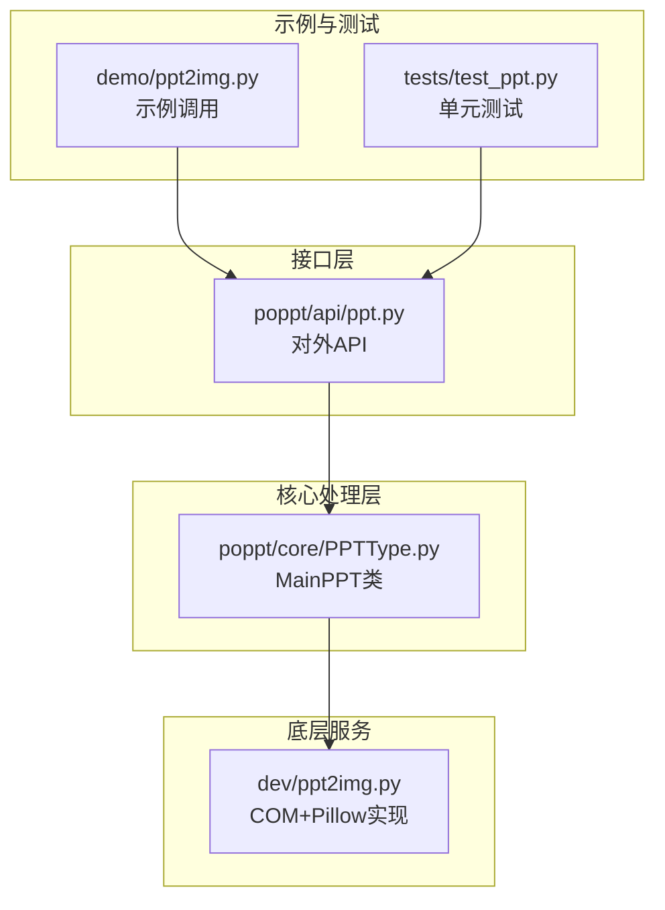
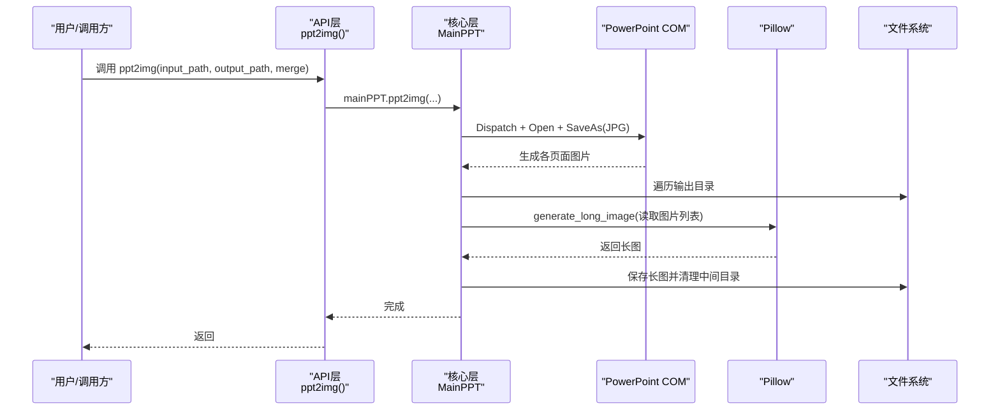
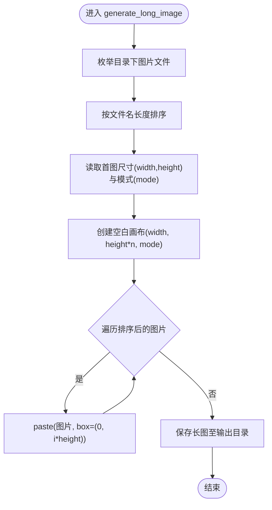
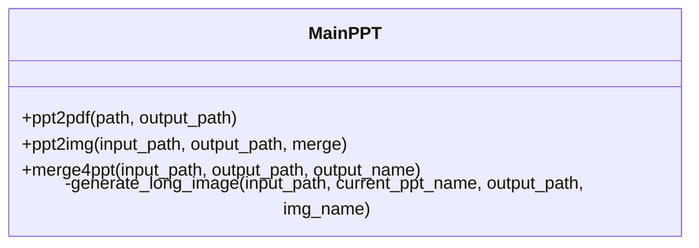
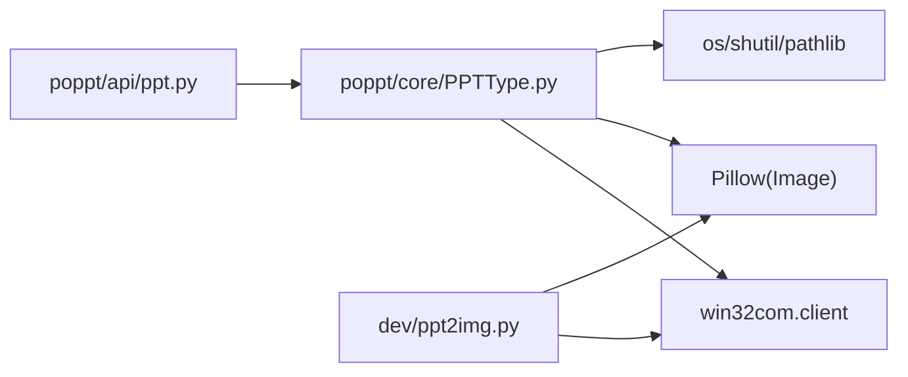

# 长图生成技术详解

<cite>
**本文引用的文件**
- [dev/ppt2img.py](file://dev/ppt2img.py)
- [poppt/core/PPTType.py](file://poppt/core/PPTType.py)
- [poppt/api/ppt.py](file://poppt/api/ppt.py)
- [tests/test_ppt.py](file://tests/test_ppt.py)
- [demo/ppt2img.py](file://demo/ppt2img.py)
</cite>

## 目录
1. [引言](#引言)
2. [项目结构](#项目结构)
3. [核心组件](#核心组件)
4. [架构总览](#架构总览)
5. [详细组件分析](#详细组件分析)
6. [依赖关系分析](#依赖关系分析)
7. [性能考量](#性能考量)
8. [故障排查指南](#故障排查指南)
9. [结论](#结论)
10. [附录](#附录)

## 引言
本文件围绕“PPT转长图”的实现原理与技术细节展开，重点基于仓库中两条实现路径：
- dev/ppt2img.py 中的 generate_long_image 函数，展示如何使用 Pillow 将多个页面图片垂直拼接为一张长图；
- poppt/core/PPTType.py 中的 MainPPT.ppt2img 与 generate_long_image，体现从 PPT 转图片到自动长图合并的完整流程。

我们将从系统架构、数据流、处理逻辑、错误处理与性能优化等维度进行深入解析，并给出 PNG 保存的最佳实践与质量/体积权衡建议。

## 项目结构
该仓库采用“接口层-核心处理层-底层服务”的分层组织方式：
- 接口层：poppt/api/ppt.py 提供统一 API（如 ppt2img），调用核心处理类；
- 核心处理层：poppt/core/PPTType.py 定义 MainPPT，负责 PPT 转图片、长图拼接、PPT 合并等；
- 底层服务：dev/ppt2img.py 展示了另一种开发测试思路（COM+Pillow），其中包含 generate_long_image；
- 示例与测试：demo/ppt2img.py 与 tests/test_ppt.py 分别演示调用与验证。

图表来源
- [poppt/api/ppt.py](file://poppt/api/ppt.py#L1-L66)
- [poppt/core/PPTType.py](file://poppt/core/PPTType.py#L1-L204)
- [dev/ppt2img.py](file://dev/ppt2img.py#L1-L149)
- [demo/ppt2img.py](file://demo/ppt2img.py#L1-L25)
- [tests/test_ppt.py](file://tests/test_ppt.py#L1-L98)

章节来源
- [poppt/api/ppt.py](file://poppt/api/ppt.py#L1-L66)
- [poppt/core/PPTType.py](file://poppt/core/PPTType.py#L1-L204)
- [dev/ppt2img.py](file://dev/ppt2img.py#L1-L149)
- [demo/ppt2img.py](file://demo/ppt2img.py#L1-L25)
- [tests/test_ppt.py](file://tests/test_ppt.py#L1-L98)

## 核心组件
- 接口层 API：poppt/api/ppt.py 的 ppt2img(input_path, output_path, merge) 作为统一入口，委托给核心处理类 MainPPT。
- 核心处理类 MainPPT：
  - ppt2img：通过 COM 调用 PowerPoint 将 PPT 另存为图片（默认 JPG），随后遍历输出目录，逐个生成长图并清理中间目录。
  - generate_long_image：读取页面图片列表，按文件名长度排序，创建与首图同宽、n 倍高的空白画布，逐页垂直粘贴，最终保存为图片。
- 开发测试实现 dev/ppt2img.py：
  - generate_long_image：与核心实现类似，但排序策略与保存格式略有差异，展示了另一种思路。

章节来源
- [poppt/api/ppt.py](file://poppt/api/ppt.py#L34-L51)
- [poppt/core/PPTType.py](file://poppt/core/PPTType.py#L114-L204)
- [dev/ppt2img.py](file://dev/ppt2img.py#L95-L135)

## 架构总览
整体流程从 API 入口开始，经由 MainPPT 完成 PPT 转图片与长图拼接，最终输出目标文件。

图表来源
- [poppt/api/ppt.py](file://poppt/api/ppt.py#L34-L51)
- [poppt/core/PPTType.py](file://poppt/core/PPTType.py#L114-L204)

## 详细组件分析

### 组件A：generate_long_image（核心实现）
- 输入：页面图片所在目录路径
- 处理逻辑：
  - 枚举目录下所有图片文件，构建待处理列表；
  - 按文件名长度排序，确保页面顺序与文件名一致；
  - 读取首张图片尺寸与模式，创建同宽、n 倍高的空白画布；
  - 逐页读取并 paste 到对应纵向位置，形成垂直堆叠；
  - 保存为图片（默认 JPG）。
- 关键点：
  - 文件排序：按文件名长度排序，避免自然顺序导致的乱序；
  - 画布尺寸：首图宽高决定画布宽高，长图高度为页面数×单页高度；
  - 粘贴位置：box=(0, i*height)，自上而下依次放置；
  - 模式一致性：使用首图模式，避免 RGB/RGBA 不一致导致的异常。

图表来源
- [poppt/core/PPTType.py](file://poppt/core/PPTType.py#L168-L204)

章节来源
- [poppt/core/PPTType.py](file://poppt/core/PPTType.py#L168-L204)

### 组件B：generate_long_image（开发测试实现）
- 与核心实现相似，但排序策略与保存格式略有不同，展示了另一种思路：
  - 排序：按文件名长度排序；
  - 画布：同宽、n 倍高；
  - 粘贴：垂直堆叠；
  - 保存：PNG 格式（与核心默认 JPG 不同）。

章节来源
- [dev/ppt2img.py](file://dev/ppt2img.py#L95-L135)

### 组件C：PPT 转图片与长图合并（MainPPT）
- ppt2img：
  - 通过 COM 调用 PowerPoint，将 PPT 另存为图片（默认 JPG）；
  - 遍历输出目录，逐个调用 generate_long_image；
  - 保存长图后删除中间图片目录，减少磁盘占用。
- generate_long_image：
  - 读取页面图片列表；
  - 按文件名长度排序；
  - 读取首图尺寸与模式，创建空白画布；
  - 逐页粘贴，保存长图。

图表来源
- [poppt/core/PPTType.py](file://poppt/core/PPTType.py#L1-L204)

章节来源
- [poppt/core/PPTType.py](file://poppt/core/PPTType.py#L114-L204)

### 组件D：API 入口与调用链
- poppt/api/ppt.py 的 ppt2img 将调用委托给 mainPPT.ppt2img；
- tests/test_ppt.py 展示了 merge=True/False 的两种用法；
- demo/ppt2img.py 展示了外部库调用方式（非本仓库内部 API）。

章节来源
- [poppt/api/ppt.py](file://poppt/api/ppt.py#L34-L51)
- [tests/test_ppt.py](file://tests/test_ppt.py#L44-L62)
- [demo/ppt2img.py](file://demo/ppt2img.py#L1-L25)

## 依赖关系分析
- 接口层依赖核心处理层：API 层仅做参数透传与调用；
- 核心处理层依赖外部组件：
  - COM 组件：win32com.client 用于调用 PowerPoint；
  - Pillow：Image.new 与 paste 实现长图拼接；
  - 文件系统：os、shutil、pathlib 等进行路径与目录操作；
- 开发测试实现 dev/ppt2img.py 同样依赖 COM 与 Pillow，但与核心实现共享相同的长图拼接思想。

图表来源
- [poppt/api/ppt.py](file://poppt/api/ppt.py#L1-L66)
- [poppt/core/PPTType.py](file://poppt/core/PPTType.py#L1-L204)
- [dev/ppt2img.py](file://dev/ppt2img.py#L1-L149)

章节来源
- [poppt/api/ppt.py](file://poppt/api/ppt.py#L1-L66)
- [poppt/core/PPTType.py](file://poppt/core/PPTType.py#L1-L204)
- [dev/ppt2img.py](file://dev/ppt2img.py#L1-L149)

## 性能考量
- 内存管理与大型 PPT 的瓶颈：
  - 一次性读取所有页面图片并排序，可能导致内存峰值升高；对于超大 PPT，建议采用分块处理或流式拼接策略：
    - 分块处理：按固定页数分批生成长图，最后再将多个长图拼接为最终长图；
    - 流式拼接：边读取边写入，避免同时持有全部图片对象，降低峰值内存。
  - 画布创建：同宽 n 倍高，长图高度随页面数线性增长，需关注目标设备内存上限。
- I/O 与 COM 调用：
  - COM 调用 PowerPoint 会产生额外开销，建议在批量场景中复用应用实例或减少调用次数；
  - 保存为 PNG 会增大文件体积，建议根据需求选择 JPG（有损压缩）或 PNG（无损压缩）。
- 排序策略：
  - 按文件名长度排序可避免自然顺序导致的乱序，但需确保文件名具备稳定的页序语义；若文件名不可靠，可改为按文件名字典序或显式索引排序。

章节来源
- [poppt/core/PPTType.py](file://poppt/core/PPTType.py#L168-L204)
- [dev/ppt2img.py](file://dev/ppt2img.py#L95-L135)

## 故障排查指南
- 文件不存在或路径错误：
  - 检查输入路径是否为 PPT/PPTX 文件或包含 PPT 的目录；
  - 确保输出目录存在且可写。
- COM 组件异常：
  - 确认系统已安装 PowerPoint；
  - 若权限不足或被安全软件拦截，尝试以管理员权限运行或调整安全策略。
- 图像顺序错误：
  - 若文件名不具稳定页序语义，建议改为按文件名字典序排序；
  - 或在生成阶段即重命名，确保命名与页序一致。
- 内存不足：
  - 对于超大 PPT，采用分块处理或流式拼接；
  - 降低分辨率或改用 JPG 以减小内存与体积。
- 保存失败：
  - 检查输出路径权限与磁盘空间；
  - 确认保存格式与扩展名匹配（如 PNG）。

章节来源
- [poppt/core/PPTType.py](file://poppt/core/PPTType.py#L114-L204)
- [tests/test_ppt.py](file://tests/test_ppt.py#L44-L62)

## 结论
本仓库提供了两条实现路径：
- 核心实现（MainPPT）：通过 COM 调用 PowerPoint 生成页面图片，再用 Pillow 拼接为长图，流程清晰、可扩展性强；
- 开发测试实现（dev/ppt2img.py）：展示了另一种思路，强调排序与画布创建、粘贴的直观实现。

在实际工程中，建议优先采用核心实现，结合分块/流式策略与合适的保存格式，平衡内存占用与输出质量。

## 附录

### PNG 保存最佳实践与质量/体积权衡
- 适用场景：
  - 需要无损压缩、透明背景或高保真图像；
  - 文字清晰度要求高、线条锐利。
- 成本与权衡：
  - 文件体积通常大于 JPG；
  - 适合分享、归档、二次编辑等场景；
  - 若追求体积最小化，可考虑 JPG 并适当降低质量参数。
- 保存建议：
  - 优先使用 PNG 保存长图，确保视觉质量；
  - 对于超大长图，可考虑分块 PNG 输出，最后再合成。

章节来源
- [poppt/core/PPTType.py](file://poppt/core/PPTType.py#L168-L204)
- [dev/ppt2img.py](file://dev/ppt2img.py#L95-L135)