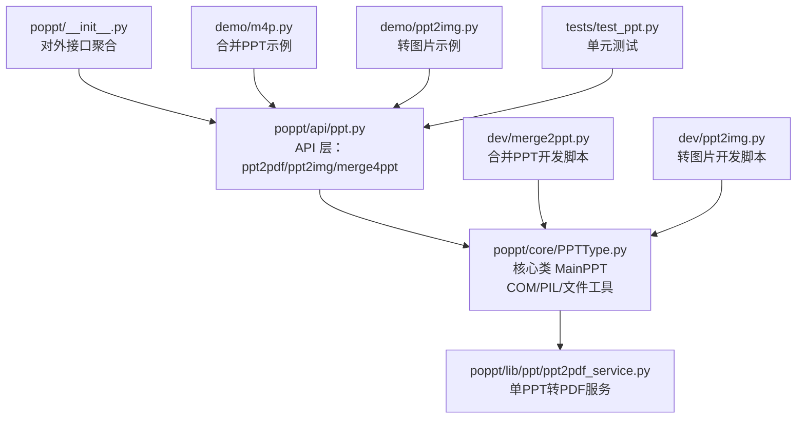
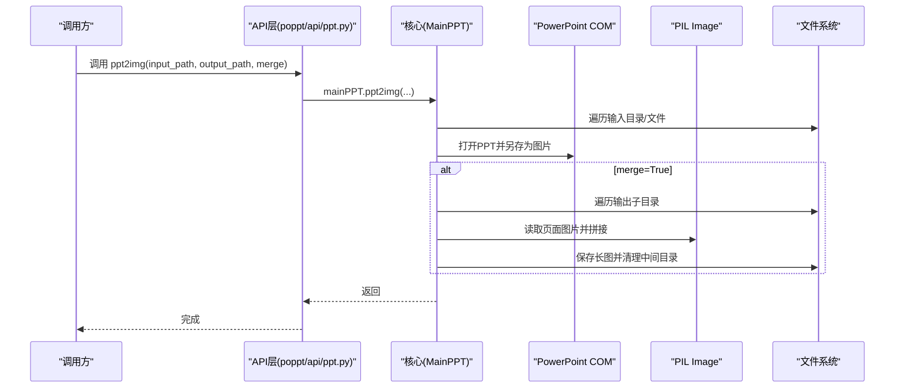
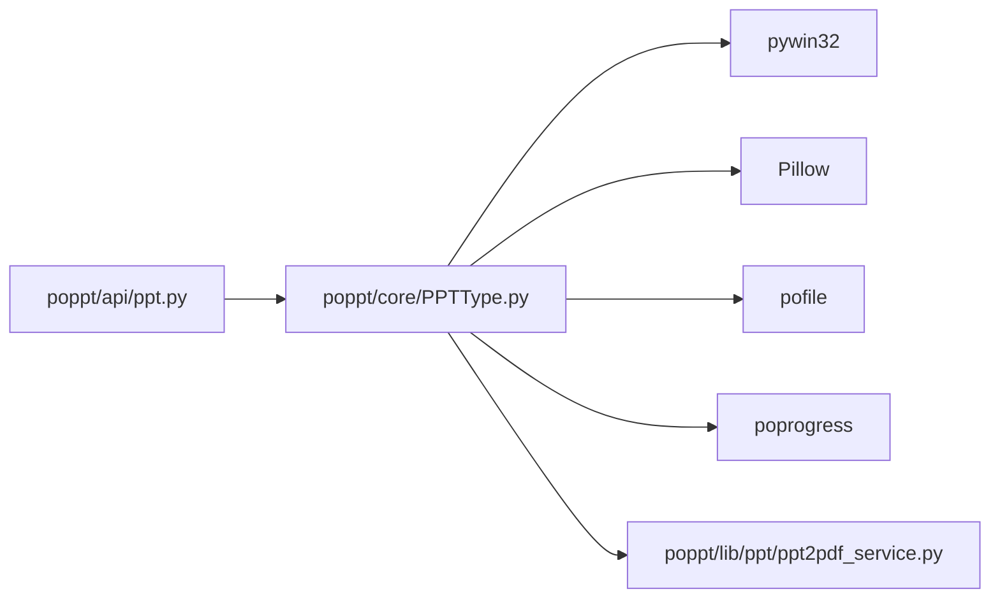
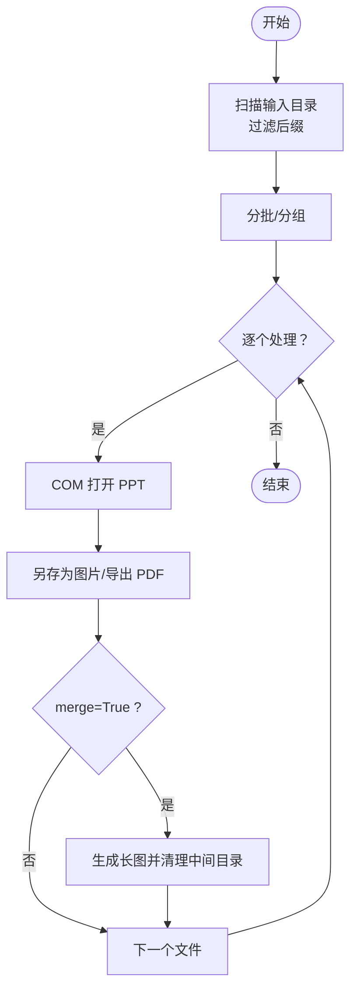
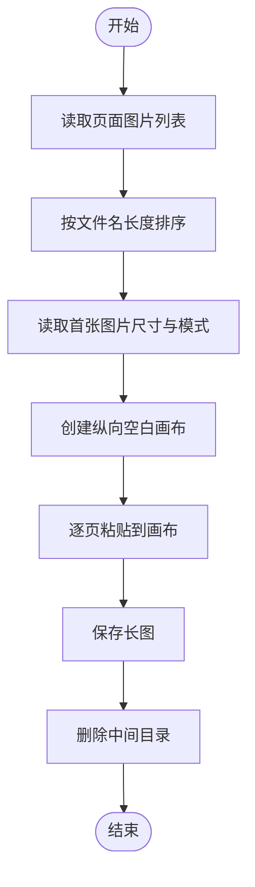

# 高级用法

<cite>
**本文引用的文件**
- [README.md](file://README.md)
- [poppt/__init__.py](file://poppt/__init__.py)
- [poppt/api/ppt.py](file://poppt/api/ppt.py)
- [poppt/core/PPTType.py](file://poppt/core/PPTType.py)
- [poppt/lib/ppt/ppt2pdf_service.py](file://poppt/lib/ppt/ppt2pdf_service.py)
- [dev/merge2ppt.py](file://dev/merge2ppt.py)
- [dev/ppt2img.py](file://dev/ppt2img.py)
- [demo/m4p.py](file://demo/m4p.py)
- [demo/ppt2img.py](file://demo/ppt2img.py)
- [tests/test_ppt.py](file://tests/test_ppt.py)
- [requirements.txt](file://requirements.txt)
</cite>

## 目录
1. [简介](#简介)
2. [项目结构](#项目结构)
3. [核心组件](#核心组件)
4. [架构总览](#架构总览)
5. [详细组件分析](#详细组件分析)
6. [依赖关系分析](#依赖关系分析)
7. [性能与资源优化](#性能与资源优化)
8. [批量处理与并行策略](#批量处理与并行策略)
9. [自定义输出路径与命名规则](#自定义输出路径与命名规则)
10. [长图生成（merge=True）技术细节](#长图生成mergetrue技术细节)
11. [集成到Web应用（Django/Flask）](#集成到web应用djangoflask)
12. [高级测试与边界情况](#高级测试与边界情况)
13. [扩展输出格式与功能](#扩展输出格式与功能)
14. [故障排查](#故障排查)
15. [结论](#结论)

## 简介
本指南面向需要在生产环境中大规模使用 poppt 的高级用户，围绕以下主题展开：
- 批量处理多个 PPT 文件：目录遍历与并行策略
- 自定义输出路径与文件命名规则
- 长图生成（merge=True）的图像拼接算法与内存管理
- 将 poppt 集成到 Django/Flask 等 Web 应用
- 性能优化与资源管理（尤其是处理大型 PPT 时）
- 基于 dev 目录测试脚本的高级用例与边界处理
- 扩展输出格式与功能的实践指导

## 项目结构
poppt 采用“API 层 → 核心处理类 → 服务函数”的分层设计，便于在不同场景下灵活调用与扩展。

图表来源
- [poppt/__init__.py](file://poppt/__init__.py#L1-L3)
- [poppt/api/ppt.py](file://poppt/api/ppt.py#L1-L66)
- [poppt/core/PPTType.py](file://poppt/core/PPTType.py#L1-L204)
- [poppt/lib/ppt/ppt2pdf_service.py](file://poppt/lib/ppt/ppt2pdf_service.py#L1-L42)
- [dev/merge2ppt.py](file://dev/merge2ppt.py#L1-L78)
- [dev/ppt2img.py](file://dev/ppt2img.py#L1-L149)
- [demo/m4p.py](file://demo/m4p.py#L1-L16)
- [demo/ppt2img.py](file://demo/ppt2img.py#L1-L25)
- [tests/test_ppt.py](file://tests/test_ppt.py#L1-L98)

章节来源
- [README.md](file://README.md#L1-L94)
- [poppt/__init__.py](file://poppt/__init__.py#L1-L3)
- [poppt/api/ppt.py](file://poppt/api/ppt.py#L1-L66)
- [poppt/core/PPTType.py](file://poppt/core/PPTType.py#L1-L204)
- [poppt/lib/ppt/ppt2pdf_service.py](file://poppt/lib/ppt/ppt2pdf_service.py#L1-L42)
- [dev/merge2ppt.py](file://dev/merge2ppt.py#L1-L78)
- [dev/ppt2img.py](file://dev/ppt2img.py#L1-L149)
- [demo/m4p.py](file://demo/m4p.py#L1-L16)
- [demo/ppt2img.py](file://demo/ppt2img.py#L1-L25)
- [tests/test_ppt.py](file://tests/test_ppt.py#L1-L98)

## 核心组件
- API 层（poppt/api/ppt.py）：提供高层接口，内部委托给核心类 MainPPT
- 核心类（poppt/core/PPTType.py）：封装 COM/PIL/文件工具，负责批量处理、长图拼接
- 单文件服务（poppt/lib/ppt/ppt2pdf_service.py）：封装单 PPT 转 PDF 的 COM 调用
- 开发脚本（dev/merge2ppt.py、dev/ppt2img.py）：演示与验证功能
- 示例脚本（demo/m4p.py、demo/ppt2img.py）：快速上手
- 测试（tests/test_ppt.py）：覆盖 PDF/图片/合并三大能力

章节来源
- [poppt/api/ppt.py](file://poppt/api/ppt.py#L1-L66)
- [poppt/core/PPTType.py](file://poppt/core/PPTType.py#L1-L204)
- [poppt/lib/ppt/ppt2pdf_service.py](file://poppt/lib/ppt/ppt2pdf_service.py#L1-L42)
- [dev/merge2ppt.py](file://dev/merge2ppt.py#L1-L78)
- [dev/ppt2img.py](file://dev/ppt2img.py#L1-L149)
- [demo/m4p.py](file://demo/m4p.py#L1-L16)
- [demo/ppt2img.py](file://demo/ppt2img.py#L1-L25)
- [tests/test_ppt.py](file://tests/test_ppt.py#L1-L98)

## 架构总览

图表来源
- [poppt/api/ppt.py](file://poppt/api/ppt.py#L33-L51)
- [poppt/core/PPTType.py](file://poppt/core/PPTType.py#L113-L166)
- [poppt/lib/ppt/ppt2pdf_service.py](file://poppt/lib/ppt/ppt2pdf_service.py#L14-L40)

## 详细组件分析

### API 层与对外接口
- ppt2pdf：批量将 PPT/PPTX 转 PDF，支持单文件或目录
- ppt2img：将 PPT 转为图片，支持独立图片或合并为长图
- merge4ppt：将目录下多个 PPT 合并为一个 PPT

章节来源
- [poppt/api/ppt.py](file://poppt/api/ppt.py#L19-L66)

### 核心类 MainPPT
- ppt2pdf：使用文件工具扫描输入，逐个调用单文件 PDF 服务
- merge4ppt：通过 COM 打开每个 PPT，统计页数并插入到新 PPT 中
- ppt2img：打开 PPT 并另存为图片；若 merge=True，遍历输出目录，调用长图生成并清理中间目录
- generate_long_image：按文件名长度排序页面图片，创建纵向长图并保存

章节来源
- [poppt/core/PPTType.py](file://poppt/core/PPTType.py#L37-L111)
- [poppt/core/PPTType.py](file://poppt/core/PPTType.py#L113-L204)

### 单文件 PDF 服务
- 通过 COM 打开 PPT，调用 SaveAs(32) 导出 PDF，随后释放资源

章节来源
- [poppt/lib/ppt/ppt2pdf_service.py](file://poppt/lib/ppt/ppt2pdf_service.py#L14-L40)

### 开发脚本与示例
- dev/merge2ppt.py：演示合并流程，包含进度条与 COM 调用
- dev/ppt2img.py：演示转图片与长图生成，包含异常处理与保存逻辑
- demo/m4p.py：最小化示例，调用合并接口
- demo/ppt2img.py：最小化示例，调用图片接口

章节来源
- [dev/merge2ppt.py](file://dev/merge2ppt.py#L20-L64)
- [dev/ppt2img.py](file://dev/ppt2img.py#L56-L134)
- [demo/m4p.py](file://demo/m4p.py#L1-L16)
- [demo/ppt2img.py](file://demo/ppt2img.py#L1-L25)

## 依赖关系分析
- 外部依赖：pywin32（COM）、Pillow（图像处理）、poprogress（进度条）、pofile（文件工具）
- 内部依赖：API 层依赖核心类；核心类依赖 COM/PIL/文件工具；单文件 PDF 服务独立封装

图表来源
- [requirements.txt](file://requirements.txt#L1-L5)
- [poppt/api/ppt.py](file://poppt/api/ppt.py#L1-L66)
- [poppt/core/PPTType.py](file://poppt/core/PPTType.py#L1-L204)
- [poppt/lib/ppt/ppt2pdf_service.py](file://poppt/lib/ppt/ppt2pdf_service.py#L1-L42)

章节来源
- [requirements.txt](file://requirements.txt#L1-L5)

## 性能与资源优化
- COM 资源释放：每次转换后及时 Quit，避免 PowerPoint 进程堆积
- 可见性控制：在后台处理时可设置 Visible=0 降低 UI 开销
- 进度条：使用 poprogress 提升大任务可观测性
- 大型 PPT 处理：建议拆分批次、限制并发、监控内存峰值
- 长图生成：按页面数量线性增长，注意内存占用与磁盘 IO

章节来源
- [poppt/core/PPTType.py](file://poppt/core/PPTType.py#L90-L112)
- [poppt/core/PPTType.py](file://poppt/core/PPTType.py#L130-L147)
- [poppt/lib/ppt/ppt2pdf_service.py](file://poppt/lib/ppt/ppt2pdf_service.py#L26-L40)

## 批量处理与并行策略
- 目录遍历：使用文件工具扫描输入目录，过滤后缀为 .ppt/.pptx
- 并行思路：
  - 进程池：将不同 PPT 文件交给不同进程处理，适合 CPU 密集型
  - 线程池：适合 I/O 密集型（COM 打开/保存），但需注意 COM 线程模型限制
  - 分批处理：按目录切分为多个批次，分别处理，降低内存峰值
- 注意事项：
  - PowerPoint COM 不是线程安全，建议串行或进程隔离
  - 长图生成阶段可并行处理不同 PPT 的输出目录，但需避免同一时间写入同一目录

图表来源
- [poppt/core/PPTType.py](file://poppt/core/PPTType.py#L50-L64)
- [poppt/core/PPTType.py](file://poppt/core/PPTType.py#L113-L166)

章节来源
- [poppt/core/PPTType.py](file://poppt/core/PPTType.py#L50-L64)
- [poppt/core/PPTType.py](file://poppt/core/PPTType.py#L113-L166)

## 自定义输出路径与命名规则
- 输出目录策略：
  - ppt2img：以 PPT 文件名为子目录，输出各页面图片；merge=True 时在父目录生成长图
  - merge4ppt：可自定义输出目录与文件名
- 命名规则建议：
  - 保留原 PPT 名称，追加时间戳或版本号
  - 长图命名：PPT 名称+“_长图”或“_merged”
  - PDF 命名：与图片一致，扩展名改为 .pdf
- 实践要点：
  - 使用绝对路径避免相对路径歧义
  - 预先创建输出目录，失败回滚
  - 为不同业务线划分子目录，便于归档与检索

章节来源
- [poppt/core/PPTType.py](file://poppt/core/PPTType.py#L137-L145)
- [poppt/core/PPTType.py](file://poppt/core/PPTType.py#L151-L166)
- [poppt/api/ppt.py](file://poppt/api/ppt.py#L52-L64)

## 长图生成（merge=True）技术细节
- 算法流程：
  1) 遍历输出子目录，定位每个 PPT 的页面图片
  2) 按文件名长度排序，确保顺序稳定
  3) 读取首张图片尺寸与模式，创建纵向画布
  4) 逐页粘贴至画布，形成纵向长图
  5) 保存长图并删除中间目录
- 内存管理：
  - 逐页读取与粘贴，避免一次性加载全部页面
  - 长图尺寸=宽度×(高度×页数)，注意内存占用
  - 大图建议分段处理或导出为更高分辨率再降采样
- 错误处理：
  - 文件缺失、格式不匹配、权限不足
  - 目录清理失败时回滚并记录日志

图表来源
- [poppt/core/PPTType.py](file://poppt/core/PPTType.py#L168-L204)

章节来源
- [poppt/core/PPTType.py](file://poppt/core/PPTType.py#L168-L204)

## 集成到Web应用（Django/Flask）
- 设计建议：
  - 将 poppt 封装为服务类，提供异步队列接口（Celery/RQ）
  - Web 请求仅触发任务，完成后通过回调或轮询通知
  - 对外暴露 REST 接口：POST /convert/ppt2img、POST /convert/merge4ppt
- 安全与稳定性：
  - 限制文件大小与数量，防止 OOM
  - 限定输出目录，避免路径穿越
  - 记录任务状态与错误日志
- 可靠性：
  - 失败重试与超时控制
  - 资源回收：COM 进程退出、临时文件清理

[本节为概念性指导，不直接分析具体文件，故无章节来源]

## 高级测试与边界情况
- 单元测试覆盖：
  - PDF 转换：单文件路径与目录路径
  - 图片转换：独立图片与长图
  - 合并 PPT：复制多个 PPT 到临时目录，断言输出
- 边界与异常：
  - 空目录/无 .ppt/.pptx 文件
  - 权限不足、磁盘空间不足
  - PowerPoint 未安装或 COM 无法启动
- 开发脚本验证：
  - 合并脚本：演示进度条与 COM 生命周期
  - 转图片脚本：演示 PNG/JPG 选择与长图生成

章节来源
- [tests/test_ppt.py](file://tests/test_ppt.py#L33-L91)
- [dev/merge2ppt.py](file://dev/merge2ppt.py#L20-L64)
- [dev/ppt2img.py](file://dev/ppt2img.py#L56-L134)

## 扩展输出格式与功能
- 新增图片格式：
  - 在核心类中增加枚举或常量映射（如 PNG=18），并在 SaveAs 传参
  - 更新默认输出类型与长图命名后缀
- 新增导出格式：
  - 若需导出为其他 Office 格式，需确认 COM 支持的 SaveAs 数字
  - 参考单文件 PDF 服务的 COM 调用模式
- 命名与路径：
  - 为新格式提供统一的命名模板与输出目录策略
- 兼容性：
  - 保持对外 API 不变，新增参数或可选开关
  - 为老版本提供兼容层与迁移提示

章节来源
- [poppt/core/PPTType.py](file://poppt/core/PPTType.py#L28-L36)
- [poppt/lib/ppt/ppt2pdf_service.py](file://poppt/lib/ppt/ppt2pdf_service.py#L34-L39)

## 故障排查
- 常见问题：
  - PowerPoint 未安装或 COM 未注册：安装 Office 或 pywin32
  - 权限不足：以管理员身份运行或调整输出目录权限
  - 磁盘空间不足：清理临时目录或扩大磁盘
  - 内存溢出：减少并发、拆分批次、降低分辨率
- 日志与诊断：
  - 使用进度条观察卡顿点
  - 记录 COM 打开/关闭次数与耗时
  - 捕获异常并输出详细上下文

章节来源
- [poppt/core/PPTType.py](file://poppt/core/PPTType.py#L90-L112)
- [poppt/core/PPTType.py](file://poppt/core/PPTType.py#L130-L147)

## 结论
通过分层设计与 COM/PIL 的结合，poppt 能够高效完成 PPT 的批量转换与合并。在生产环境中，建议：
- 使用分批/进程隔离策略，避免 COM 线程冲突
- 明确输出路径与命名规则，统一归档
- 针对长图生成做好内存与磁盘规划
- 将 poppt 作为服务集成到 Web 应用，配合异步队列与监控体系
- 持续扩展输出格式与健壮性，保障大规模任务稳定运行